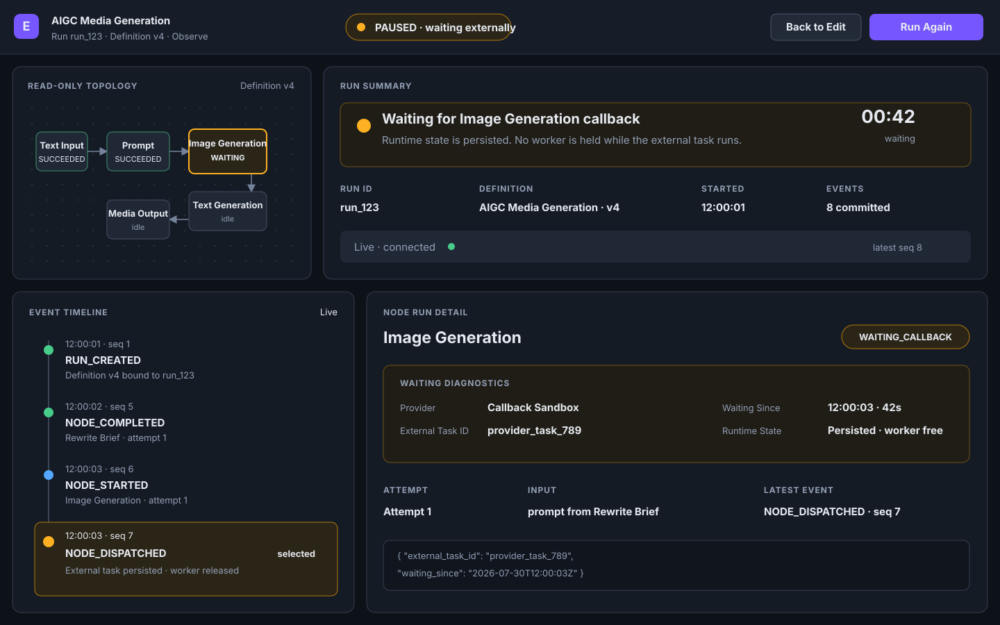
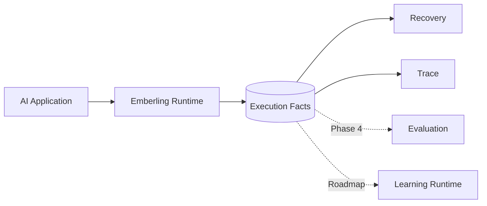
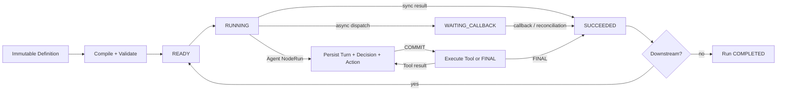
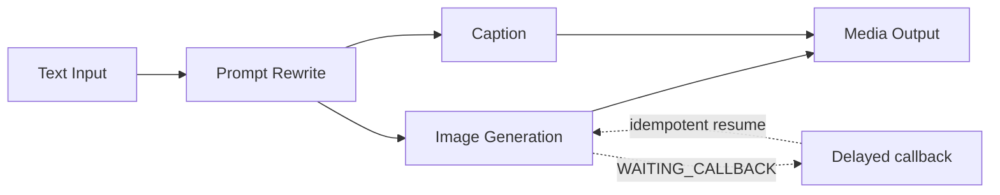
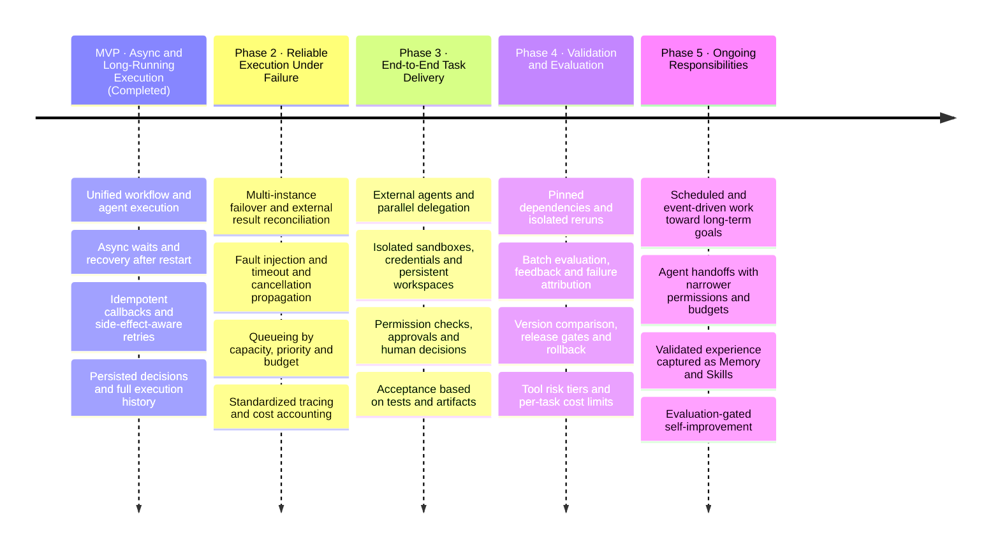

# Emberling

**Emberling is an AI-native Execution Runtime for long-running AI applications.**

It persists Workflow and Agent execution as durable facts, allowing interrupted work to continue from committed state while preserving a queryable record of Decisions, Actions and results.

When an Agent needs to run code, execute Shell commands or work with files, it also needs an isolated environment. Emberling manages logical execution; external Sandboxes run the code. AX is the first integration target on this roadmap.

```text
Emberling = durable logical execution
AX        = isolated physical execution
```

Emberling persists an Agent's logical execution; AX isolates its execution environment and preserves the workspace when suspended.

[中文](./README.zh-CN.md)



> **Every execution leaves an ember.**
>
> Emberling preserves those embers as durable execution facts—so interrupted work can recover and every run can become evidence for what comes next.

---

## Execution facts are the product

Emberling records what actually happened—not a reconstruction from logs. Definition versions, state transitions, Attempts, model Decisions, Tool Actions and Events form one durable execution ledger.



| Recover now | Understand now | Improve later |
|---|---|---|
| Resume persisted work after callbacks and restarts | Inspect the same facts that drive the Runtime | Evaluate candidate versions on ordinary Executions |

---

## Why Emberling exists

Calling a model is an API problem. Operating a long-running AI application is a systems problem.

| The workload | The execution problem |
|---|---|
| Model and Tool calls | Timeouts, retries, cost and uncertain outcomes |
| External generation jobs | Suspend, callback, resume and restart recovery |
| Agent decisions | Persist the Decision before performing the Action |
| Business side effects | Idempotency, auditability and explicit failure boundaries |
| Continuous improvement | Evaluate from real execution evidence, not synthetic traces |

In-memory orchestration and application logs lose authority at exactly the moment reliability matters: a process restarts, a callback arrives twice, or an external request has an ambiguous result.

---

## A different layer

Emberling sits between AI frameworks and infrastructure primitives.

| | AI workflow / agent framework | General durable engine | Emberling |
|---|---|---|---|
| Primary concern | Compose model and Tool calls | Execute arbitrary durable programs | Execute long-running AI applications |
| Native facts | Messages, steps or graph state | Workflow history | Run, NodeRun, Attempt, Decision, Action and Event |
| Agent recovery | Often process-local | Application-defined | Persisted Turn, Decision and Action boundaries |
| AI observability | Added through tracing | Domain-agnostic | Derived from the execution ledger |
| Learning path | Usually separate | Outside product scope | Evaluation and learning consume ordinary Executions |

Emberling does not replace Temporal, and it does not compete on node catalogs. Its focus is the AI-native execution layer between application definitions and external systems.

---

## How it works

Workflow and Agent semantics share one execution core.



Every transition follows one boundary:

```text
persist state + Event  →  COMMIT  →  execute external work / publish SSE
```

PostgreSQL is the source of Emberling-owned execution facts. Reconciliation rediscovers persisted `READY` work; immediate post-COMMIT execution is only the fast path.

---

## What the MVP proves

The MVP is deliberately narrow. If a feature does not strengthen or validate the execution layer, it does not belong.

| Synchronous baseline | Async recovery | Persisted Agent loop |
|---|---|---|
| **Document Processing** | **AIGC Media Generation** | **Agent Tool Loop** |
| Deterministic scheduling, data flow and Event-backed Trace | Dispatch, suspend, callback idempotency and Backend restart recovery | Persisted Decision/Action, sync and async Tools, Context/State and per-turn recovery |



The signature milestone is simple to state and hard to fake:

> Suspend an external task, restart the Backend, accept the callback, resume the same Execution, and finish the graph without duplicating progress.

---

## An honest durability boundary

| The MVP guarantees | The MVP does not claim |
|---|---|
| `WAITING_CALLBACK` survives Backend restart | Recovery of an in-flight synchronous call |
| Persisted `READY` work is rediscovered | Exactly-once external side effects |
| Repeated and stale callbacks cannot advance twice | Strict dispatch consistency across database and Provider |
| A committed Agent Decision is never regenerated | Recovery across incompatible Runtime implementations |
| A synchronous Tool call orphaned by a crash is never resent; the registered side-effect policy decides whether the Agent is told the outcome is unknown or that the call is safe to repeat, and the Agent decides the next step | Knowing whether that orphaned call took effect or was billed |

This is waiting recovery with explicit side-effect boundaries—not a claim of general durable execution.

---

## Reproduce it: the demo

The demo follows one photo effect template through its life: an Agent tunes it, it is served to many users, it runs out of Provider capacity, and a new version is rolled out. Every story injects a fault into a deterministic mock Provider and checks the Execution ledger against the Provider's own request record, so the claim is verifiable rather than narrated.

| Story | What the fault proves | `EMBERLING_DEMO_VARIANT` |
|---|---|---|
| **Submission and idempotency** | Resending one submission under one `Idempotency-Key` creates one Run; repeated callbacks add no Event; a crash while every task waits is finished by callbacks and polling | `serving-burst`, `serving-client-retry`, `serving-duplicate`, `serving-crash-held`, `serving-crash-waiting` |
| **Lost response and takeover** | When the Provider accepts a task but its answer is lost, the keyed retry takes over the original task instead of creating a second one; a lost callback is completed by Provider polling | `serving-response-lost`, `held-before-accept`, `after-accept` |
| **Sync versus async crash and the uncertain result** | A crash during an asynchronous call changes nothing: the callback completes the original Action once. A crash during a synchronous call is handed back to the Agent as an uncertain, counted result, never resent | `photo-video-restart`, `photo-sync-crash`, `delivery-deploy-lost` |
| **Capacity and rollout** | A fixed slot limit per Provider holds across a restart without leaking or over-admitting; a 10% split to a new version is rolled back while in-flight Runs finish on the version they were bound to | `serving-capacity`, `serving-rollout`, `serving-version-switch` |

The remaining variants are the baseline stories the faults are measured against: `photo-set`, `photo-gate` and `photo-limit` run the tuning Agent over three photos, and `delivery`, `delivery-restart-during-test` and `delivery-runner-redelivery` run an Agent that tests a patch in a sandbox and deploys it once.

```sh
make demo                                         # every photo, delivery and fault variant
EMBERLING_DEMO_VARIANT=serving make demo          # all nine serving variants
EMBERLING_DEMO_VARIANT=photo-sync-crash make demo # one variant
make demo-studio                                  # the same, watched in Studio
make demo-down
```

`make demo` needs Docker, `curl` and `jq`, and every variant ends with the invariant report and the ledger-versus-record comparison. The version split of the rollout story is `scripts/demo/traffic-split.sh`; `scripts/demo/build-v1.sh` turns a finished tuning Run into the serving template and `scripts/demo/evidence-report.sh` summarises the evidence. To run the same Definitions against real image and vision models, start from [`scripts/demo/definitions/README.md`](./scripts/demo/definitions/README.md).

---

## Evolution roadmap

Emberling has completed its foundation for asynchronous and long-running task execution. The next phases focus on reliable execution under failure, end-to-end task delivery, validation and evaluation, and ongoing agent responsibilities. Work across phases may overlap.



Later capabilities continue to build on the same Execution Runtime. Improved versions apply only to newly created Runs; Runs already in progress remain bound to the version selected when they were created, regardless of later configuration changes.

---

**Project stage:** MVP complete; reliable execution under failure is next.

**Target stack:** Go · PostgreSQL · React · TypeScript · React Flow
