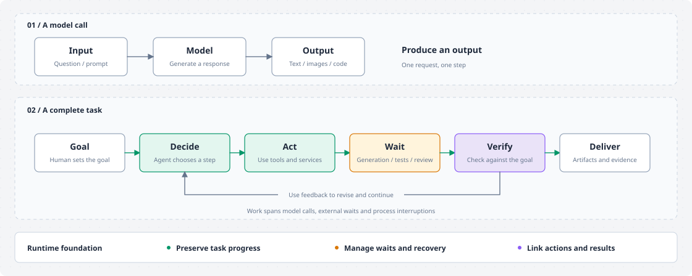
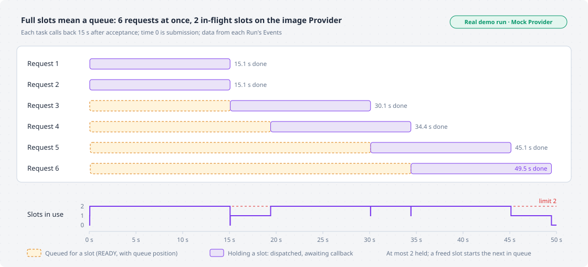
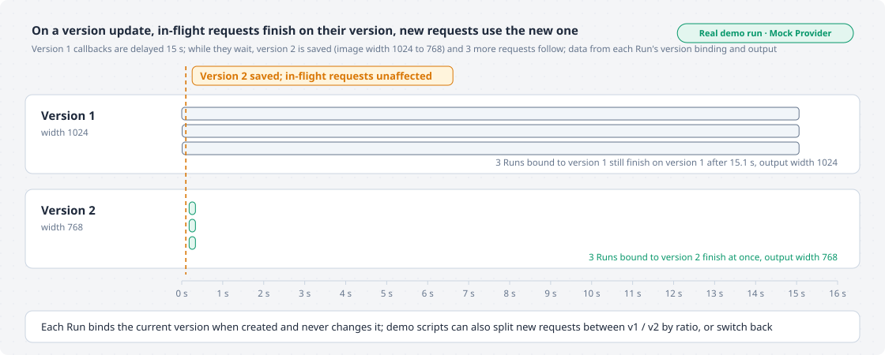
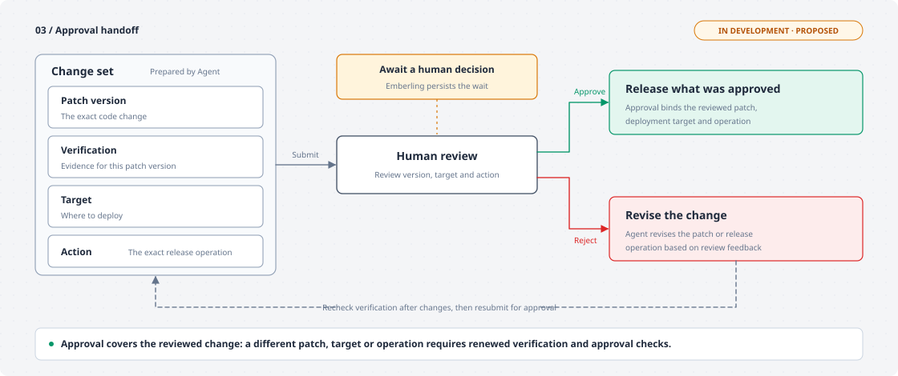
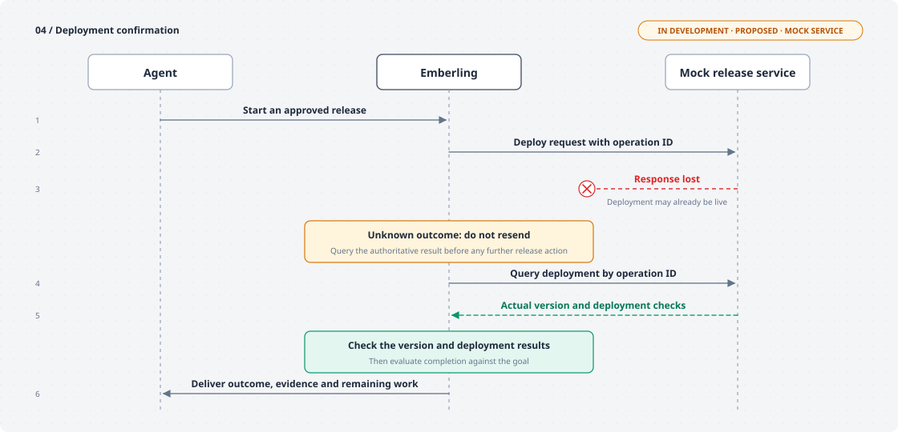
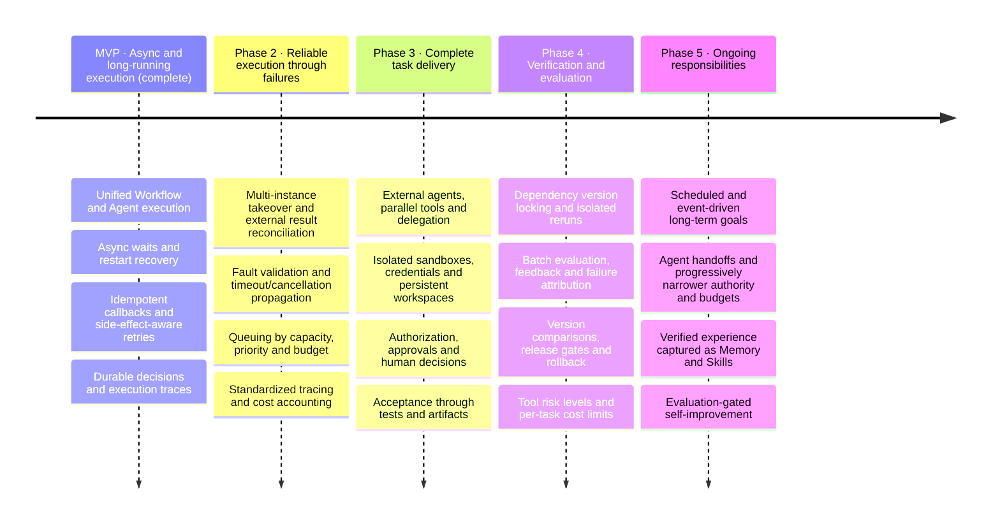

<div align="center">


<h3>A runtime foundation for agents to take on the whole job</h3>

<p>Emberling is an <strong>Agent Runtime Platform</strong> for Cloud Agent Workloads.<br>
Its durable, AI-native execution core brings together deterministic workflows and agent decisions,<br>
taking work from individual calls to sustained execution, and from generated output to complete delivery.</p>

<p><code>AI-Native Runtime</code>　<code>Durable Orchestration</code>　<code>Long-Horizon Agents</code><br>
<code>Human–Agent Collaboration</code>　<code>Verifiable Delivery</code>　<code>Full-Stack Agent Infra</code></p>

<p>English · <a href="./README.zh-CN.md">简体中文</a></p>

<p><strong><a href="#aigc">Demos</a> · <a href="#agent-infra">Agent Infra</a> · <a href="#runtime">Architecture</a> · <a href="#evolution">Roadmap</a> · <a href="#quick-start">Quick start</a></strong></p>

</div>

---

<a id="system"></a>

## When agents take on the whole job

Machines expanded what physical labor could achieve. AI is expanding the possibilities of knowledge work. As models learn to generate content and write code, people are delegating more complete goals: producing content from a creative brief, researching a question and reaching a conclusion, or investigating failures, repairing software and maintaining services. The work extends through planning, execution, collaboration and verification until there is a usable result.

An agent must act repeatedly on feedback, sometimes across hours of external execution and human review. **Models supply the ability to decide and act. Infrastructure keeps the task moving through waits and interruptions, all the way to delivery.**



<a id="agent-infra"></a>

## Agent Infra: the capabilities behind complete work

**Agents need more than models. They need infrastructure to organize actions, preserve progress, connect tools, enforce boundaries and check results.** This is the Agent Infra Emberling is building toward.


Starting with a durable execution core, Emberling develops these capabilities through three progressively demanding scenarios:

| Scenario | Focus | Problems to solve |
|---|---|---|
| **AIGC generation service**<br>Keep work running reliably | Construction and orchestration · Production runtime | How do generation rounds connect? How does work continue after a long wait? How do results reconnect after an interruption? |
| **Vulnerability repair and release**<br>Keep delivery controlled | Extend the runtime foundation with governance, control and result verification | Has the patch passed its checks? Was the release approved? Does the deployed result meet the goal? |
| **Video-editing Agent**<br>Keep the result honest | Construction and orchestration · Governance and control · Observability and evaluation | Does the clip keep the speaker’s meaning? Was it checked before rendering? Is “delivered” backed by facts? |

<a id="aigc"></a>

## Scenario 1: an AIGC generation service

**From creative refinement to a continuously running generation service.**

A usable photo effect takes repeated generation, inspection and adjustment. Once deployed, the same template serves many requests through long waits, repeated submissions and version changes. Emberling connects agent-driven refinement with workflow-based serving.


### 01 Generated does not mean ready

A successful generation does not guarantee a usable image. The agent generates a set, inspects each result and adjusts shared settings for the next round. Emberling preserves each round's decisions and results so feedback can drive the next action.

The artifacts below come from a live run: a three-photo set with the brief “handcrafted clay stop-motion style,” using Claude Opus 5.5 for decisions, Seedream 5.0 Pro for images and Claude Sonnet 5.5 for visual review. The reviewer rejected the side-profile image in the first round. The agent used that feedback to regenerate it, and the second round passed.

<table>
  <thead>
    <tr>
      <th>Input photo</th>
      <th>First generation</th>
      <th>Visual review</th>
      <th>Second generation</th>
    </tr>
  </thead>
  <tbody>
    <tr>
      <td></td>
      <td></td>
      <td>Passed. Clear clay texture, recognizable subject, no malformed features or generation artifacts.</td>
      <td></td>
    </tr>
    <tr>
      <td></td>
      <td></td>
      <td><strong>Rejected.</strong> The glasses became round, front-facing frames with an extra lens, rather than the original side-view rectangular frames. The eye and eyebrow shifted toward a three-quarter view, and the beard and hairline differed from the input.</td>
      <td></td>
    </tr>
    <tr>
      <td></td>
      <td></td>
      <td>Passed. Complete limbs and paws, intact floor tiles, and preserved subject and composition.</td>
      <td>First-round result reused</td>
    </tr>
  </tbody>
</table>

Generation settings, review verdicts and their reasons are saved as execution facts. Before delivery, the result-check node checks each image against the run and its declared settings. If a rejected image is delivered despite a later accepted version being available, the set is marked invalid.

<sub>Input photos from Unsplash by Štefan Štefančík, Nenad Novaković and Rick T.T., used under the Unsplash License.</sub>

### 02 The service restarts. The generation task continues.

An image may still be generating externally when the service restarts. Starting over can mean paying again. Emberling preserves the external task association, reconnects its result after recovery and continues delivery. Repeated submissions can also find the original work.

A [demo script](./scripts/demo/build-v1.sh) builds the refined settings into a serving template, with an independent run for each subsequent request. Idempotent submission, async task takeover and callback deduplication let work outlive a request or process.


### 03 More requests, bounded capacity

External generation services have a fixed number of available slots, while incoming requests may exceed that capacity. Emberling manages occupied slots and queued tasks, schedules the next task when capacity becomes available, and checks occupancy after failures to prevent leaks or over-admission.



### 04 Templates change. In-flight work keeps its version.

When a new effect goes live, existing generation tasks still need to finish on their original version. Emberling binds each run to an immutable execution version. Demo scripts route new requests to v1 or v2, adjust the split or switch back.



<sub>These three timelines come from local demo runs in which the Mock Provider stands in for the external generation service; times are taken from each Run's Events and the Mock Provider request record.</sub>

**Agent-driven refinement → Workflow-based serving → Durable execution and recovery → Capacity management and version binding.**

<a id="repair-release"></a>

## Scenario 2: from vulnerability alert to verified release

**In development**

A dependency vulnerability is not resolved by editing code alone. The agent must verify its patch, submit a change, wait for approval and confirm the deployed service state. Emberling connects those steps into work that can progress, be reviewed and reach a confirmed outcome.

### 01 Bound the repair. Bound the actions.

An agent needs to read code, change dependencies and run commands. Emberling provides a persistent workspace and an isolated execution environment, checking authorization before actions execute. Out-of-scope operations are rejected, with a reason returned to the agent so it can adjust its next action.


<sub>Demo run with simulated models and sandbox: the Agent first attempts to write <code>tests/auth_test.go</code>. Execution is denied because writes are limited to <code>go.mod</code> and <code>internal/auth</code>. After receiving the reason, it makes the change, verifies it and submits a change request within the permitted scope.</sub>

### 02 When the code changes, verification must follow

Code may change again after an initial test passes. An old report cannot establish that a new patch is valid. Emberling associates each change with its test and scan results, keeping the evidence submitted for review tied to the final patch.


<sub>Demo run with simulated models and sandbox: after a second patch edit, the Agent attempts verification with the old digest. Turn 6 is rejected because that digest is not the workspace's current patch. In the next turn it verifies the current patch, then submits the change request after verification passes.</sub>

### 03 Prepare the change. Bring people in to approve it.

Permission to prepare a repair does not imply permission to release it. The agent assembles the patch and verification evidence; a person reviews the specific version, deployment target and operation before approving. Emberling preserves the waiting state so work can continue after approval. Changes require verification and approval to be checked again.


<sub>Demo run with simulated models and sandbox: the task only authorizes preparing a change. After submitting it, the Agent attempts to deploy and is denied because the operation affects production and the current goal does not permit it. Human approval is still in development; the diagram below shows the intended interaction.</sub>



### 04 A release request is not a confirmed deployment

A deployment may take effect even if its API response is lost. Resending the request could repeat the operation. Emberling queries the actual state by operation ID, checks the target version and deployment checks, then evaluates completion against the task goal and delivers the result, evidence and remaining work.



**Bounded repairs. Evidence-backed verification. Approved releases. Confirmed outcomes.**

<a id="video-editing"></a>

## Scenario 3: a video-editing Agent

**In development**

Cutting a talk into a short vertical clip is creative work with a verifiable core. The clip must play, fit the target length and carry subtitles, but it must also keep what the speaker meant. The agent chooses which sentences to keep and revises on check and review results. Emberling makes the checks mandatory, bounds the revisions and decides completion from recorded facts.

### 01 A cut that passes the checks can still twist the meaning

A sentence lifted out of a talk can say the opposite of what the speaker said. “This approach does not work” is a clean cut on a sentence boundary, but the next sentence is “unless the sample is large enough.” Technical checks cannot see this. Emberling adds a semantic review: a review model, different from the agent’s own decision model, reads the selected sentences with their surrounding context and judges two things: whether the selection meets the request, and whether any sentence standing alone distorts the original meaning. A review that does not pass returns its issues with the sentences concerned, so the agent can add the second half or choose a passage that states the point in full. The verdict is recorded as a fact about the exact timeline that was reviewed.

### 02 No rendering before the timeline passes its check

Rendering is the slow step, and it is where an unchecked mistake gets baked in. The agent selects sentences, not timecodes. The media service resolves them to exact times, applies versioned rules (every sentence exists, segments do not overlap, cuts land on sentence boundaries, the duration is within range) and records the verdict against the timeline’s digest. The render tool accepts nothing but a timeline digest and requires a passed check for it: a timeline that was never checked, or whose newest check failed, is refused before any call reaches the service, with the reason returned to the agent. Failed technical checks and failed semantic reviews are counted separately, each against its own limit frozen with the run. Once a limit is passed, further calls of that kind are refused and the refusal names the limit.

### 03 Saying “delivered” proves nothing

An agent’s final message is a claim, not evidence. When the agent declares a clip delivered, Emberling checks the declared clip digest against committed facts: the clip was rendered from a checked timeline, the newest check of that clip passed and, when the agent could request a review, the newest review of that timeline passed. A claim without the facts behind it is recorded as incomplete, with what is missing named. Some requests cannot be met honestly: the material has no clearly controversial point, or the full meaning does not fit the target length. The agent may then end with “cannot satisfy” and a reason, without a clip. That is a legitimate outcome, recorded as such. It must not invent a controversy or drop a qualifier in order to deliver.

### 04 Transcription takes minutes. The service restarts. The task continues.

Transcribing and rendering real media runs for minutes on an external media service. Emberling records the task association before the work is dispatched. After a restart, the new process recovers the wait from that record and completes the same attempt from the callback or from a status query, whichever arrives. The agent’s committed decision is not asked again, and the task is not resubmitted. Transcripts and timelines stay outside the model’s context as artifacts the agent reads by range, and each turn records what it read.

**A second model reviews the meaning. Checks before rendering. Completion from facts. Work that survives restarts.**

<a id="runtime"></a>
<a id="capability-map"></a>

## How Emberling is being built

From sustained AIGC generation, through video editing that must keep the speaker’s meaning, to controlled software releases, all three scenarios share one execution foundation. **Emberling centers on a durable, AI-native Execution Runtime: workflows organize the process, while agents act on feedback.**

Around that core, the platform progressively develops orchestration, state and artifacts, governance, verification, observability and evaluation. Interfaces connect models, tools and execution environments into Agent Infra for Cloud Agent Workloads.


| Approach | Emberling's investment |
|---|---|
| **Core · Go deep on execution** | Shared state, scheduling, waits and recovery for workflows and agents; persisted decisions, side-effect-aware recovery, versions and execution records. |
| **Build · Build around delivery** | Progressively connect orchestration, workspaces and artifacts, action authorization, result verification and execution feedback, extending into release governance and evaluation. |
| **Integrate · Connect the ecosystem** | Bring models, context, knowledge, tools, Sandbox and AI Gateway capabilities together through interfaces on a shared execution foundation. |

<a id="evolution"></a>

## Toward ongoing responsibilities

From the completed execution foundation toward reliable operation, complete delivery, verification and evaluation, and eventually ongoing responsibilities.



Phases may overlap. Shipping individual capabilities within a scenario does not mean the whole phase is complete.

<a id="quick-start"></a>

## Run and explore

### Start Studio

Prepare Go `1.27.1`, Node.js `24.20.0`, pnpm `11.25.0`, Docker Compose and OpenSSL.

```sh
make bootstrap
export EMBERLING_MODEL_PROVIDER_API_KEY="$(openssl rand -hex 32)"
export EMBERLING_CALLBACK_SIGNING_SECRET="$(openssl rand -hex 32)"
make dev
```

Open **[Studio → localhost:5173](http://localhost:5173)** to explore workflows, execution details and artifacts. The default stack uses simulated services and needs no model account. Keep the same keys across restarts.

### Watch a task recover from a restart

Restart the Backend while external generation is still in progress, then watch the original task reconnect its result and complete delivery. The demo uses simulated services and pauses at key steps for inspection in Studio.

```sh
EMBERLING_DEMO_VARIANT=serving-crash-waiting make demo-studio
```

Requires Docker, `curl` and `jq`. Run `make demo-down` when finished. It stops the demo and removes simulated-service request records, while preserving PostgreSQL and artifact volumes.

### Run the video-editing demo

The media service transcribes, checks and renders real media and needs FFmpeg. See the [media service guide](./services/media/README.md) for `make media-dev` and the Compose profile. The evaluation batch, blind human scoring and judge calibration are described in the [evaluation guide](./evals/video_editing/README.md).

### Explore further

| What to explore | Start here |
|---|---|
| **Real models generating, reviewing and refining images** | [Live model demo guide](./scripts/demo/definitions/README.md), including model credential setup |
| **Turning refinement results into a serving template** | [Template build script](./scripts/demo/build-v1.sh) |
| **Splitting traffic between versions and switching back** | [Version routing script](./scripts/demo/traffic-split.sh) |
| **Checking failure outcomes, execution records and costs** | [Demo report script](./scripts/demo/evidence-report.sh) |
| **More concurrency, capacity and failure demos** | `EMBERLING_DEMO_VARIANT=serving make demo`; see [Makefile](./Makefile) for commands |

### Contribute

Issues and pull requests are welcome for execution reliability, model and tool integrations, and the Studio experience. See the [contribution guide](./CLAUDE.md) for development conventions.

<details>
<summary>Development checks</summary>

```sh
make check-fast  # Static checks and unit tests
make check       # Full checks, including integration tests and Studio build
make test-e2e    # Browser acceptance tests
```

Integration tests need an accessible test database or Docker. Browser tests require Playwright Chromium.

</details>
