<div align="center">

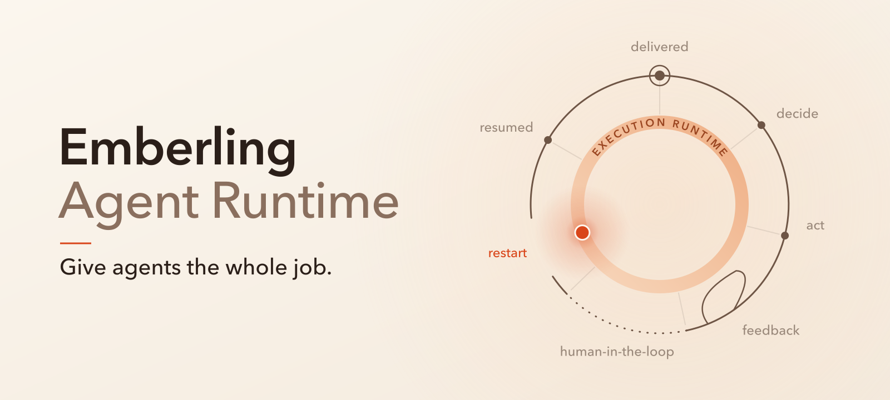

<h3>A runtime foundation for agents to take on the whole job</h3>

<p>Emberling is an <strong>Agent Runtime Platform</strong>.<br>
Its core is a durable, AI-native Execution Runtime that joins Workflow orchestration with Agent decisions.<br>
Work moves from a single call to continuous execution, and from generated output to complete delivery.</p>

<picture>
  <source media="(prefers-color-scheme: dark)" srcset="./docs/public/assets/figures/tags-dark.svg">
  
</picture>

<p>English · <a href="./README.zh-CN.md">简体中文</a></p>

<p><strong><a href="#what-is-emberling">Overview</a> · <a href="#features">Capabilities</a> · <a href="#demos">Real Work</a> · <a href="#how-it-works">Architecture</a> · <a href="#roadmap">Vision and Roadmap</a> · <a href="#quick-start">Quick Start</a></strong></p>

</div>

<a id="what-is-emberling"></a>

# Emberling · Agent Runtime Platform

**Emberling is an Agent Runtime Platform. It connects Agent decisions to a complete execution system, from action through verification to delivery.**

AI is moving from answering questions to taking on whole jobs. People can give an Agent the goal, the requirements and the boundaries, and keep their attention on direction, trade-offs and key decisions. The Agent analyzes, calls tools, checks results and adjusts its plan from feedback. People no longer drive each operation. They work with the Agent around the outcome.

Emberling is the runtime foundation for this work. Real execution, feedback and verification turn model capability into results that can be delivered.

[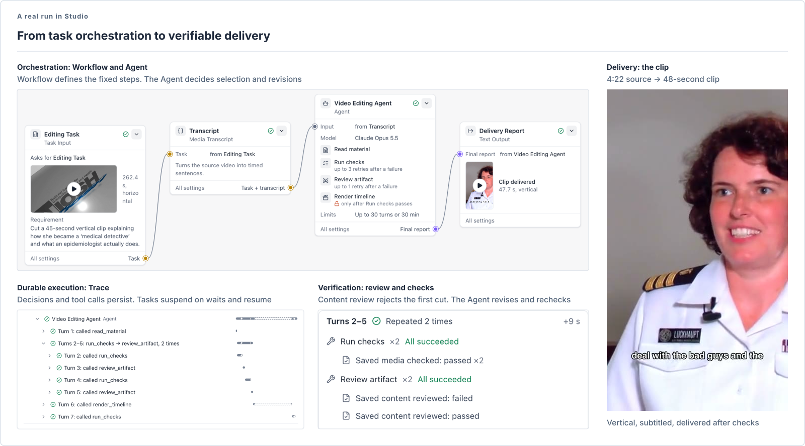](https://leungll.github.io/Emberling/diagrams/product-overview.html)

*A real video editing task. The Agent revises the timeline after an independent content review and delivers a clip that passes its checks.*

<a id="features"></a>

# Capabilities

**Emberling is built around a durable, AI-native Execution Runtime. Workflow and Agent share one execution foundation, so fixed steps and autonomous decisions can be part of the same job.**

A Workflow defines its steps in advance. An Agent chooses the next step at run time. The Runtime therefore has to understand Agent execution as well as step state. Model decisions, tool actions, the context of each turn and completion checks are execution records that the platform stores and constrains. This is what AI-native means here.

The Runtime schedules and recovers work from these records, across external waits and process restarts. Authorization, human approval and result verification are part of the same execution flow, so each application does not have to build its own. Studio shows the run and its artifacts.

[](https://leungll.github.io/Emberling/diagrams/capabilities.html)

Long waits, failure recovery and result verification do not belong to any single business. The foundation handles them, and applications focus on their own tasks, tools and completion conditions. Developers can then build domain Agents for work that runs continuously, needs repeated revision and has to stand behind its result.

<a id="demos"></a>

# From Idea to Production: Agents in Real Work

These capabilities have to be tested on real work. Emberling uses three jobs with rising demands: running continuously, revising repeatedly, and answering for the result. An AI image generation service handles many slow requests that depend on external models, so async execution, capacity control and failure recovery decide whether it stays up. A short-video editing Agent must also revise its selection from review feedback, and clip quality improves through repeated evaluation. Vulnerability repair and release takes Agent actions into production. Every step from code change to release is controlled, the delivery evidence stays consistent, and the production system confirms the outcome.

[](https://leungll.github.io/Emberling/diagrams/scenes-overview.html)

## Agentic Creation: AI Content Production

AI is lowering the barrier to content production. People now hand more of the production work to Agents and collaborate around creative intent instead of operating each tool. Creative work combines fixed production steps with judgment calls, and the balance changes by task. Image generation follows a mostly fixed process, with an Agent used for tuning before launch. In video editing, the Agent decides both the selection and the narrative. **Emberling is exploring this way of creating and the runtime that keeps it working.**

### AI Image Generation Service: From Agent Tuning to a Workflow in Production

Before launch, the effect's Prompt and parameters have to be settled. This step depends on creative judgment. An Agent revises the settings from visual review until the whole photo set passes. The tuned settings are then published as a template. Every request follows the same fixed steps, defined by a Workflow, and the focus moves to waiting, concurrency and failure recovery under load.

<table>
<thead>
<tr><th colspan="4" align="left">Creative brief: handmade clay stop-motion style, with smooth faces</th></tr>
<tr><th>Source</th><th>Round 1</th><th>Visual review</th><th>Delivered</th></tr>
</thead>
<tbody>
<tr>
<td></td>
<td></td>
<td><strong>Rejected.</strong> Wrinkle-like tool marks on the cheeks. The background is still photographic blur.</td>
<td></td>
</tr>
<tr>
<td></td>
<td></td>
<td><strong>Rejected.</strong> Limbs are misplaced, whisker-like shapes appear above the eyes, and the pose and framing changed.</td>
<td></td>
</tr>
</tbody>
</table>

<table>
<thead><tr><th align="left">Workflow: models, tools and limits are declared on nodes</th><th align="left">Trace: 12 turns of generation and review, delivery on turn 13</th></tr></thead>
<tbody>
<tr>
<td><a href="./docs/public/assets/screenshots/photo-run-workflow-tuning.png">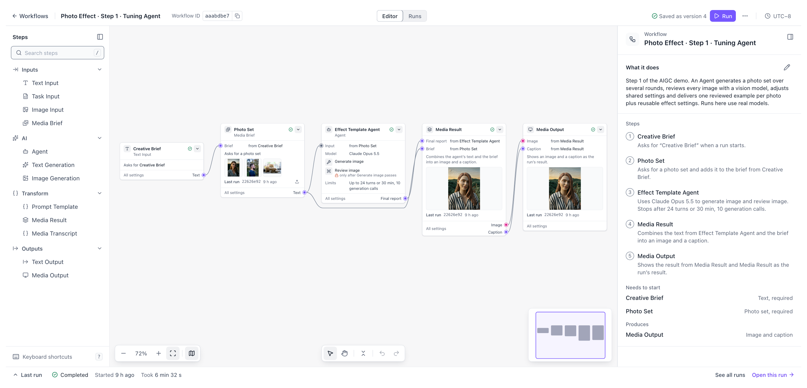</a></td>
<td><a href="./docs/public/assets/screenshots/photo-run-trace.png">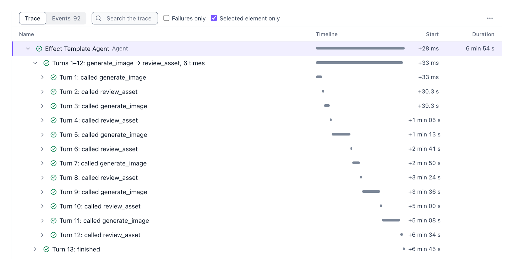</a></td>
</tr>
</tbody>
</table>

#### Effect Tuning

The first settings did not work for both people and animals, and a generation model rarely catches its own mistakes. The Effect Template Agent decides how to revise, and a separate review model judges each image against its source. Tuning makes repeated paid calls and can crash or disconnect midway. The Runtime stores each decision first, so recovery does not ask the model again. A call with an unknown result is not resent automatically.

[![Effect tuning for the image generation service. The task layer gives inputs, style requirements, deliverables and acceptance. In the scenario layer, Workflow nodes supply the brief and sample photos; inside the Agent Harness, Claude Opus decides, Seedream generates and Claude Sonnet reviews. Round 1 rejects the portrait and the cat, the reasons feed round 2, and a Completion Check gates the output. Below are the difficulties, designs and the matching Emberling capabilities on the Durable Execution Runtime](./docs/public/assets/figures/photo-tuning.svg)](https://leungll.github.io/Emberling/diagrams/photo-tuning.html)

#### Production Service

Once published as a template, the tuned settings serve many users. Each image takes one to two minutes, generation is billed per image, and model concurrency is limited. The service can also be redeployed or crash during the wait. Emberling splits submission from result handling. After submission the Run suspends, and requests beyond the Provider limit wait in a queue. Results arrive by Callback, Polling or Reconciliation after a restart. All three enter one resume path, and only one result takes effect, so a crash or lost response does not cause duplicate generation. When a template changes, in-flight requests finish on the version they were submitted with.

[](https://leungll.github.io/Emberling/diagrams/photo-serving.html)

**An Agent tunes the effect and a Workflow serves it. Both run on the same execution foundation.**

[Full walkthrough →](./docs/public/demos/photo-effects.md)

<sub>Source photos are from Unsplash. Credits are in the full walkthrough.</sub>

### Video Editing Agent: Improving Creative Quality Over Time

An image can be judged against its source. Video editing gives the Agent the whole creative job, including what to select and in what order. A clip with correct length and subtitles can still take its speaker out of context. Rules alone cannot guarantee quality. Each task needs an independent content review, and improvement across tasks depends on batch evaluation.

<table>
<thead><tr><th>Brief</th><th>First selection</th><th>Content review</th><th>Second selection</th><th>Clip</th></tr></thead>
<tbody>
<tr>
<td>Cut a 45-second clip from a 4:22 interview. Explain how Sara became a medical detective and what an epidemiologist actually does</td>
<td>Her path into the field, plus the qualities the job requires</td>
<td><strong>Rejected.</strong> The clip does not say what an epidemiologist actually does. Sentences 24–26 only cover required qualities</td>
<td>Her path into the field, plus a study of working hours and sleep</td>
<td align="center" width="170"><a href="./docs/public/assets/screenshots/video-clip-63979dab.mp4"></a><br><a href="./docs/public/assets/screenshots/video-clip-63979dab.mp4">▶ 48-second clip with sound</a></td>
</tr>
</tbody>
</table>

<table>
<thead><tr><th align="left">Workflow: rendering can start only after checks pass</th><th align="left">Trace: dashed segments are waits on the media service</th></tr></thead>
<tbody>
<tr>
<td><a href="./docs/public/assets/screenshots/video-run-workflow.png">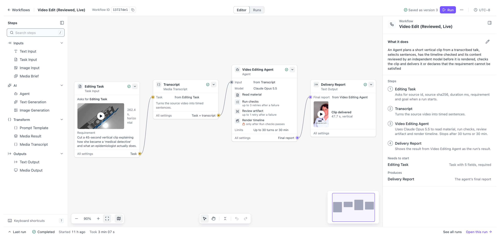</a></td>
<td><a href="./docs/public/assets/screenshots/video-run-trace.png">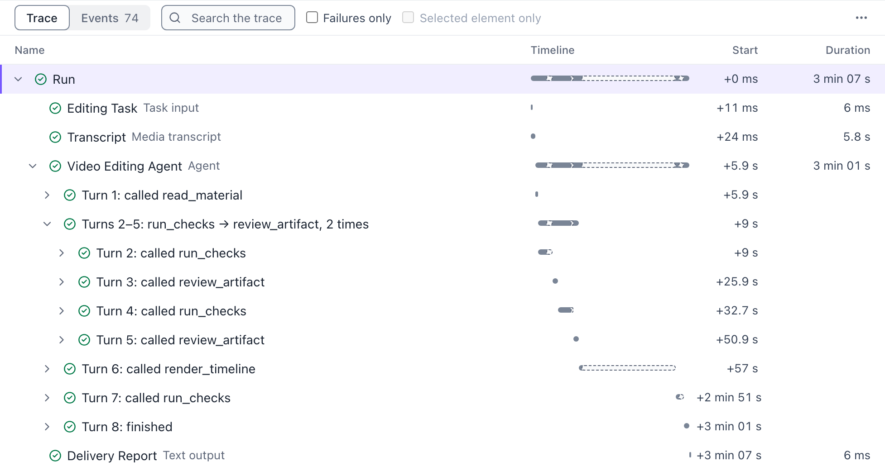</a></td>
</tr>
</tbody>
</table>

#### Editing Task

Models are good at narrative and selection but tend to cut sentences when they write timecodes. The Agent therefore selects by sentence, and tools handle timecodes and rendering. The first cut had a valid length and valid cut points, but the review model found that the content fell short, and the Agent selected again. Rendering can start only after both the technical checks and the content review pass. Transcription and rendering wait on the media service. The Run suspends meanwhile and takes over the original task after a restart.

[](https://leungll.github.io/Emberling/diagrams/video-editing-run.html)

#### Quality Evaluation

Content review can only fix the current clip. Recurring Agent problems show up only when tasks are compared. Batch evaluation runs outside the Runtime and uses the public API to run a baseline without content review and a reviewed variant on the same samples. The batch configuration is fixed before the run, and failed runs count in the statistics.

Each clip is scored by technical checks, blind human review and an LLM Judge. The Judge scores in batch after the runs finish and does not affect Agent decisions. Its verdicts may be wrong, so they are calibrated against human scores and disagreements are analyzed case by case.

The analysis decides what changes next. Repeated Agent failures are fixed in its Prompt or tools. Gaps in technical checks become new check rules. Judge errors are fixed in the Judge Prompt. The changed version is evaluated again and moves to the next round only if it improves.

[](https://leungll.github.io/Emberling/diagrams/video-evaluation.html)

**The model makes the creative calls. Delivery evidence and evaluation results trace back to execution records.**

[Full walkthrough →](./docs/public/demos/video-editing.md)

<sub>Source footage: NIOSH / Wikimedia Commons, public domain.</sub>

## Software Delivery: Agent Actions Reach Production

A weak creative result can be generated again. Software delivery acts directly on live services. In this dependency vulnerability repair, the Agent changes and verifies code in an isolated environment. Release requires human approval, and the production system confirms the deployment.

<table>
<thead><tr><th width="90">Stage</th><th width="270">What happens</th><th>Record in Studio</th></tr></thead>
<tbody>
<tr>
<td><strong>Code change</strong></td>
<td>The Agent reads the project rules, the advisory and the existing code. <code>golang-jwt</code> v3.2.2 is replaced by <code>jwt/v5</code> v5.3.1, and <code>token.go</code> is rewritten for the new API. The public interface of <code>internal/auth</code> does not change.</td>
<td><a href="./docs/public/assets/screenshots/repair-approval-patch.png">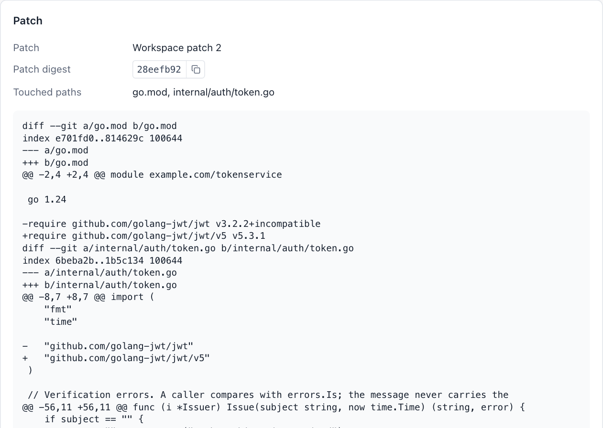</a></td>
</tr>
<tr>
<td><strong>Verification</strong></td>
<td>An isolated container checks out the baseline commit, applies this patch and runs the existing tests. The test directory is outside the writable scope, so the Agent cannot pass by editing tests. The vulnerable version is gone from the dependency list, and <code>govulncheck</code> finds nothing.</td>
<td><a href="./docs/public/assets/screenshots/repair-run-verify.png">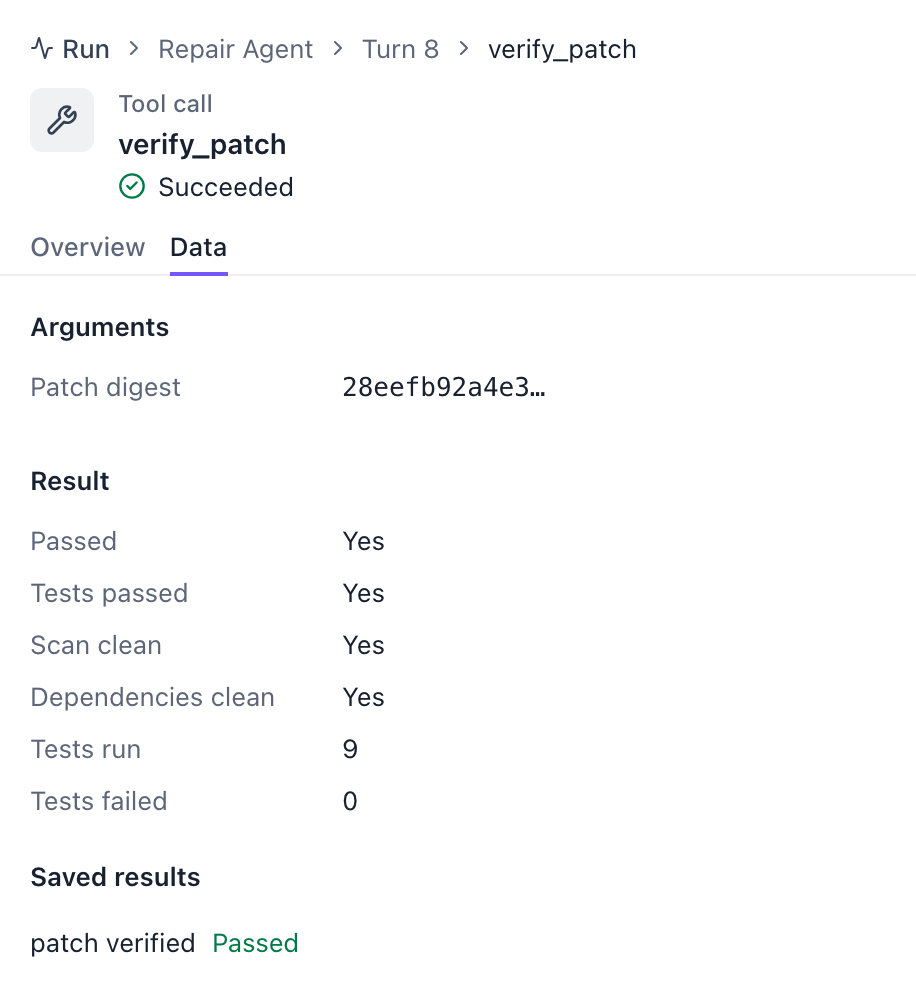</a></td>
</tr>
<tr>
<td><strong>Handoff</strong></td>
<td>The Agent writes a change request with the changes, impact and rollback plan. The change request is bound to verified patch version 2. Any further code change requires new verification.</td>
<td><a href="./docs/public/assets/screenshots/repair-approval-change.png">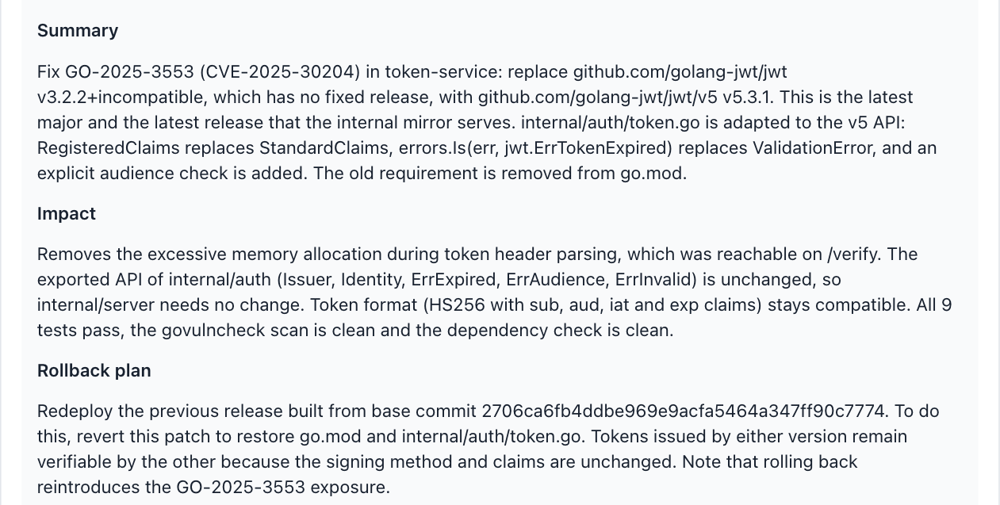</a></td>
</tr>
<tr>
<td><strong>Human approval</strong></td>
<td>The approval page shows the change request, the full diff and the verification record. Each decision basis points to the rules, advisory or code the Agent read. The approver can check the matching turn before approving the release.</td>
<td><a href="./docs/public/assets/screenshots/repair-approval-basis.png">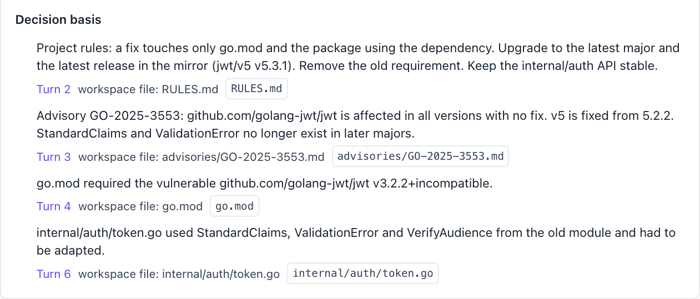</a></td>
</tr>
<tr>
<td><strong>Release confirmation</strong></td>
<td>An approval is valid for this release request only. Emberling reserves the release target, starts the deployment and queries the result by operation ID. It releases the target after confirming that version v53 is deployed and healthy.</td>
<td><a href="./docs/public/assets/screenshots/repair-run-approval.png">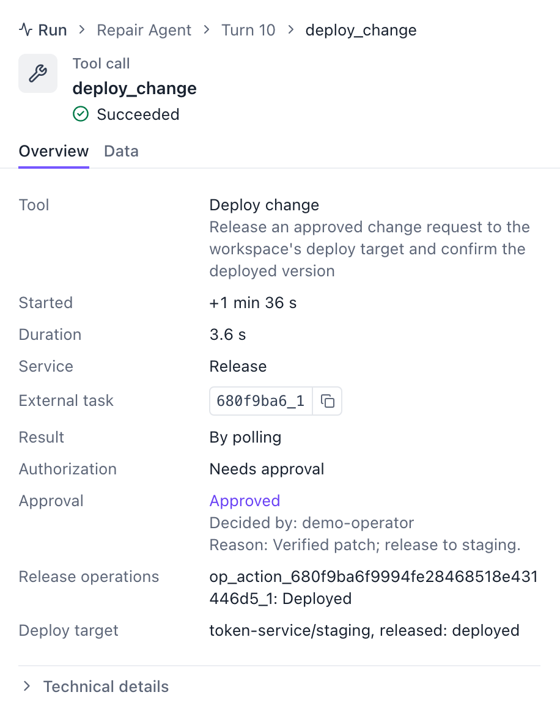</a></td>
</tr>
</tbody>
</table>

<table>
<thead><tr><th align="left">Workflow: a change request can be created only after verification passes</th><th align="left">Trace: dashed segments are waits on verification and release</th></tr></thead>
<tbody>
<tr>
<td><a href="./docs/public/assets/screenshots/repair-run-workflow.png">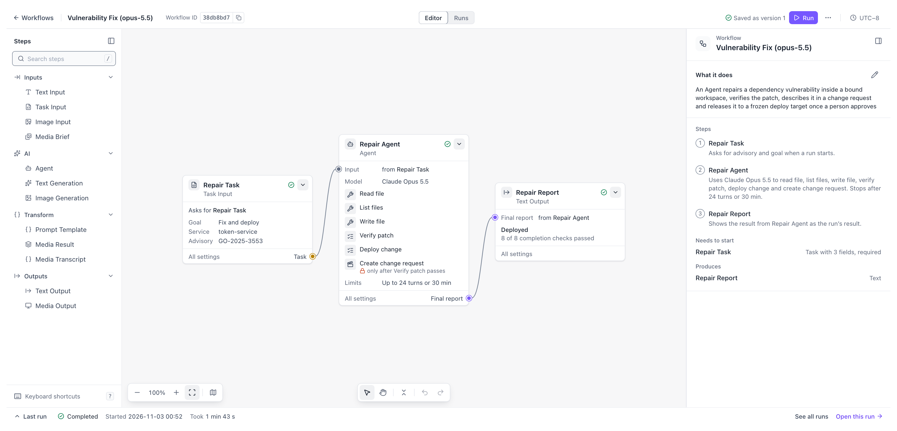</a></td>
<td><a href="./docs/public/assets/screenshots/repair-run-trace.png">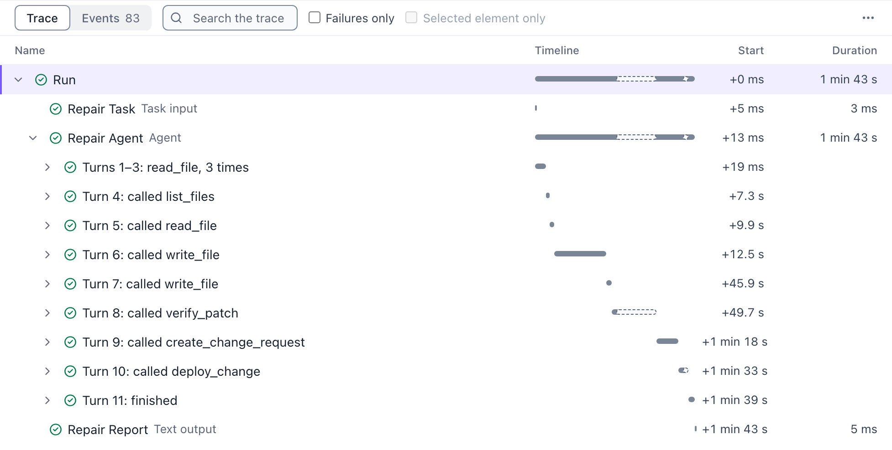</a></td>
</tr>
</tbody>
</table>

### Repair and Verification

Passing tests or an Agent's claim are not enough to approve a release, because code can change after verification. Emberling checks each action against the authorized scope before it runs. Every write creates a new patch version, and the verification result and change request are bound to the same version. A refused action does not run, and the reason goes back to the Agent so it can continue.

[](https://leungll.github.io/Emberling/diagrams/repair-verify.html)

### Approval and Release

A release waits for human approval. The approval covers this request only, and the wait does not consume the Agent's execution time limit. A release request may get no response even though the deployment happened, and resending it would release twice. Emberling queries the production system by operation ID and keeps the release target reserved until the result is confirmed. The system checks completion against the task goal.

[](https://leungll.github.io/Emberling/diagrams/repair-release.html)

**The Agent repairs. A person authorizes the release. The production system confirms the deployment.**

These mechanisms are not specific to vulnerability repair. Any Agent operating a real system needs an isolated environment, action authorization, human intervention and result confirmation. Providing them at the platform level completes the path from action through verification to delivery. This is the direction of Emberling's Agent Infra work.

[Full walkthrough →](./docs/public/demos/vuln-repair.md) &nbsp; [Agent Infra vision and roadmap →](#roadmap)

<sub>The release target is a mock production service. A demo script performs the approval. Release failures are verified with a mock Agent and fault injection.</sub>

<a id="how-it-works"></a>

# Architecture

Agent tasks run for a long time and wait on models, external services and human approval. A process can stop at any point. Emberling persists execution state in PostgreSQL, and Workflow and Agent share the same wait and recovery mechanisms.

All entry points use the same Service use cases. Decisions and state are committed first, and external systems are called afterwards. External results return through callbacks or polling to one resume path. After a restart, the Reconciler continues unfinished work. Conditional updates ensure that only one concurrent path takes effect.

[](https://leungll.github.io/Emberling/diagrams/architecture.html)

## Modules

| Module | Responsibility | Design constraint |
|---|---|---|
| [API](./backend/internal/api/) | REST, SSE, callback entry and read-only Trace queries | Parses requests and returns results. Makes no execution decisions |
| [Work](./backend/internal/work/) and [Reconciler](./backend/internal/reconciler/) | Consume persisted ready work and recover unfinished work after a restart | The in-memory queue is only a low-latency wakeup. Recovery relies on the database |
| [Service](./backend/internal/service/) | Use cases and transaction orchestration for Node execution, the Agent loop, approval and release reconciliation | External calls happen only after commit |
| [Runtime](./backend/internal/runtime/) | Compilation, scheduling, state aggregation and retry decisions, plus Agent authorization, context building and completion checks | Execution decisions only. No database or external access |
| [Store](./backend/internal/store/) | Persists execution state and provides Unit of Work and conditional updates | Conditional updates resolve concurrent races |
| [Registry](./backend/internal/registry/), [Nodes](./backend/internal/nodes/), [Tools](./backend/internal/tools/) and [Adapters](./backend/internal/adapters/) | Resolve implementations by stable name and perform a single model, tool or service call | Side-effect policy comes from registration. Implementations do not own retries or state changes |
| [Domain](./backend/internal/domain/) and [Config](./backend/internal/config/) | Shared domain types, errors, service configuration and readiness checks | No use cases or execution decisions |
| [Studio](./studio/) | Defines Workflows, shows Runs, Traces and artifacts, and handles approvals | Displays backend state. Does not copy execution rules |

## Choosing a Recovery Model

The industry uses four main approaches to continue a long task after an interruption. Each has trade-offs, and they can be combined.

| Approach | Examples | How work continues | Work to take on |
|---|---|---|---|
| In-process execution | asyncio background tasks, Celery | Progress is in memory, and the task usually runs again from the start | The application handles progress, deduplication and failures |
| Code replay | Temporal, Azure Durable Functions, DBOS | Code runs again from the entry point and reuses saved step results | In-flight tasks must stay recoverable across code updates |
| **State-based recovery (Emberling)** | **Argo Workflows, Apache Airflow** | **Reads committed state and determines the remaining work** | **Advancement, race and recovery rules for every state** |
| Process snapshot | CRIU, E2B sandbox pause and resume | Restores process state at the wait point and continues | Depends on a snapshot runtime. Task progress and artifacts need separate records |

Emberling uses state-based recovery because Workflow and Agent progress, decisions and waits can all be queried directly and governed by one set of rules. Trace and quality evaluation use the same records. The cost is explicit design of state transitions, races and recovery. The platform carries that complexity in one place.

## Where Agent Semantics Live

A recovery model does not settle which layer owns Agent decisions, actions and completion checks. The industry has three main approaches. Emberling puts them in the Runtime.

| Approach | Examples | How Agent execution is organized | Trade-offs |
|---|---|---|---|
| On a general workflow engine | OpenAI Agents SDK on Temporal or DBOS | Model and tool calls are Workflow steps, recovered from execution history | Mature scheduling and recovery with broad use. The application writes the Agent loop and tool rules |
| State kept by an Agent framework | LangGraph, Microsoft Agent Framework | Decisions and tool results are stored in graph state and resumed from Checkpoints | Close to Agent development and flexible to adopt. Recovery semantics depend on graph and state design |
| **In the Runtime (Emberling)** | **Claude Managed Agents** | **The Runtime persists Agent turns, decisions, actions and attempts, and constrains authorization, waits and completion checks** | **These guarantees are platform defaults. Flexibility is lower, and the platform verifies the state rules** |

**The model decides the next step. The Runtime guarantees execution state, action boundaries and completion criteria.**

[Architecture, implementation and design trade-offs →](./docs/public/architecture.md)

<a id="roadmap"></a>

# Vision and Roadmap

Models can now understand requirements, use tools and adjust from feedback. People have started to hand complete creative, analytical and software maintenance work to Agents. This work needs a reliable execution environment, clear authorization and results that can be verified.

Emberling starts from the execution core and is building Agent Infra for Cloud Agent Workloads. Orchestration, execution environments, governance, verification, observability and evaluation all serve the same task.

[](https://leungll.github.io/Emberling/diagrams/infra-coverage.html)

## Roadmap

From the completed execution foundation toward reliable operation, complete delivery, verification and evaluation, and ongoing responsibilities.

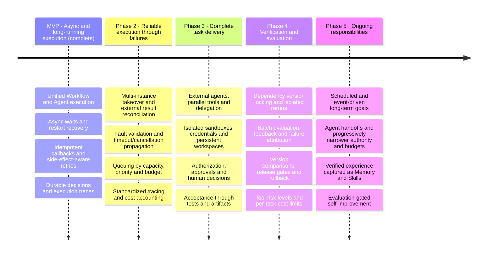

Phases can overlap. Some capabilities already run in the scenarios above.

**People define the goals and make the key decisions. Agent Infra carries sustained execution, constraints and verification.**

<a id="quick-start"></a>

# Quick Start

Install Go `1.27.1`, Node.js `24.20.0`, pnpm `11.25.0`, Docker Compose and OpenSSL.

```sh
make bootstrap
export EMBERLING_MODEL_PROVIDER_API_KEY="$(openssl rand -hex 32)"
export EMBERLING_CALLBACK_SIGNING_SECRET="$(openssl rand -hex 32)"
make dev
```

Open **[localhost:5173](http://localhost:5173)** for Studio. It uses mock services by default and needs no model account. Keep the same secrets across restarts.

Watch a task survive a restart:

```sh
EMBERLING_DEMO_VARIANT=serving-crash-waiting make demo-studio
```

The recovery demo needs `curl` and `jq`. Use `make demo-down` to stop it. This clears the mock service's request records and keeps the PostgreSQL and artifact volumes.

# Contributing

Issues and pull requests are welcome for execution reliability, model and tool integrations, and the Studio experience. See the [contributing guide](./CLAUDE.md) for development conventions.
