<div align="center">


<h3>A runtime foundation for agents to take on the whole job</h3>

<p>Emberling 是一个 <strong>Agent Runtime Platform</strong>。<br>
以 durable、AI-native Execution Runtime 为核心，衔接 Workflow 的流程编排与 Agent 的自主决策，<br>
让工作从一次调用走向持续运行，从生成结果走向完整交付。</p>

<picture>
  <source media="(prefers-color-scheme: dark)" srcset="./docs/public/assets/figures/tags-dark.svg">
  
</picture>

<p><a href="./README.md">English</a> · 简体中文</p>

<p><strong><a href="#what-is-emberling">项目概览</a> · <a href="#features">平台能力</a> · <a href="#demos">实际工作</a> · <a href="#how-it-works">架构设计</a> · <a href="#roadmap">愿景与路线</a> · <a href="#quick-start">快速开始</a></strong></p>

</div>

<a id="what-is-emberling"></a>

## Emberling · Agent Runtime Platform

**Emberling 是一个 Agent Runtime Platform，把 Agent 的自主决策接入一套从行动、验证到交付的完整执行体系。**

当 AI 从回答问题走向承担完整工作，人可以把目标、要求与边界交给 Agent，将精力放在方向、取舍与关键判断上。Agent 则围绕目标持续分析、调用工具、检查结果，并在反馈中调整方案。工作的组织方式也随之改变：人不必逐步驱动每一次操作，而是与 Agent 围绕成果协作。

Emberling 为这样的工作建设运行底座，让模型的能力通过实际执行、反馈修正和结果验证，转化为可交付的成果。

[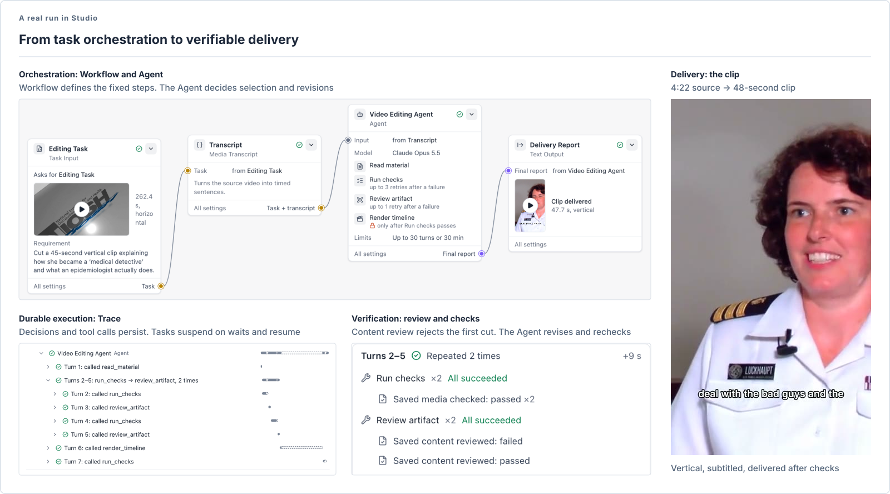](https://leungll.github.io/Emberling/diagrams/product-overview.html)

*一次真实的视频剪辑任务：Agent 根据独立内容审查修改时间线，最终交付通过检查的成片。*

<a id="features"></a>

## 平台能力

**以 durable、AI-native Execution Runtime 为核心，Emberling 让 Workflow 与 Agent 共享执行基础，将确定的流程与自主决策组织在同一项工作中。**

Workflow 预先定义步骤，Agent 则在运行中决定下一步。因此，Runtime 不仅要记录步骤状态，还要理解 Agent 的执行过程：模型决定、工具行动、每轮上下文和完成判定，都是平台保存并约束的执行记录，这也是 AI-native 的含义。

基于这些记录，Runtime 依据执行状态调度和恢复任务，跨越外部等待和进程重启继续执行。授权、人工批准与结果验证进入同一执行流程，无需每个应用各自实现，运行过程及关联产物都可以在 Studio 中查看。

[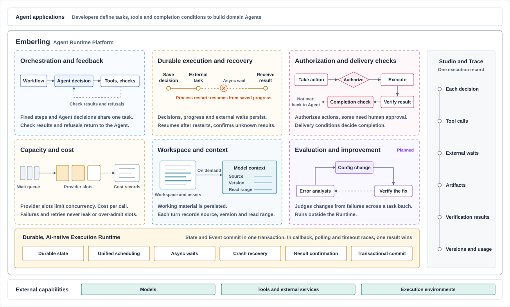](https://leungll.github.io/Emberling/diagrams/capabilities.html)

长时等待、故障恢复和结果验证并不属于某一项业务，这些要求由底座统一承担，上层应用可以专注于自己的任务、工具和完成条件。在这样的底座之上，Agent 不再局限于回答一个问题或生成一次结果，开发者可以把需要持续运行、反复修正并对结果负责的工作交给它，构建面向各自领域的 Agent 应用。

<a id="demos"></a>

## 从创意到上线：Agent 进入真实工作

这些执行能力需要在真实的工作中检验。Emberling 选取了三项要求逐步提高的工作，从持续运行、反复修正，到对结果负责。AI 图片生成服务面向大量请求，生成耗时较长且依赖外部模型，异步执行、容量与并发控制和故障恢复决定了服务能否持续运行。任务可靠完成之后，短视频剪辑 Agent 还要根据审查意见反复修改选段，成片质量依靠持续评测来改进。线上漏洞修复与发布进一步把 Agent 的行动带进生产环境，修改到发布必须全程受控，交付证据保持一致，上线结果由生产系统核实。

[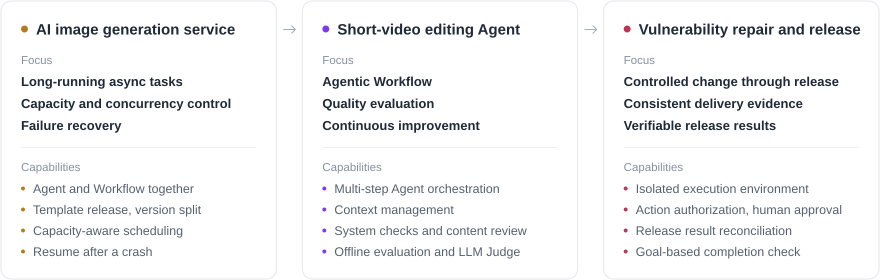](https://leungll.github.io/Emberling/diagrams/scenes-overview.html)

### Agentic Creation：AI 内容创作

AI 正在降低内容制作的门槛，人们开始把更完整的制作工作交给 Agent，从逐步操作工具，走向围绕创作意图与系统协作。创作既有确定的生产步骤，也有依赖判断的取舍，两者的比重随任务而变。图片生成的流程基本固定，Agent 主要用于上线前的效果调优，到了视频剪辑，选段和叙事都由 Agent 决定。**Emberling 正在探索这种新的创作方式，以及让它持续运转的运行基础。**

#### AI 图片生成服务：从 Agent 调优到 Workflow 上线

服务上线之前，要先确定特效的 Prompt 和参数。这一步依赖创作判断，由 Agent 根据视觉审查反复修改，直到整组照片达标。调好的设置发布为模板后，每个请求都走相同的固定步骤，由 Workflow 定义，重点转向大量请求下的等待、并发和故障恢复。

<table>
<thead>
<tr><th colspan="4" align="left">创作要求：手工黏土定格动画风，人物面部保持平滑</th></tr>
<tr><th>原图</th><th>第一轮</th><th>视觉审查</th><th>最终交付</th></tr>
</thead>
<tbody>
<tr>
<td></td>
<td></td>
<td><strong>退回。</strong>脸颊有皱纹状的工具痕迹，背景仍是照片式虚化。</td>
<td></td>
</tr>
<tr>
<td></td>
<td></td>
<td><strong>退回。</strong>四肢位置混乱，眼睛上方多出须状物，姿态和构图也变了。</td>
<td></td>
</tr>
</tbody>
</table>

<table>
<thead><tr><th align="left">Workflow：模型、工具和运行上限都在节点上声明</th><th align="left">Trace：前 12 轮生成与审查，第 13 轮交付</th></tr></thead>
<tbody>
<tr>
<td><a href="./docs/public/assets/screenshots/photo-run-workflow-tuning.png">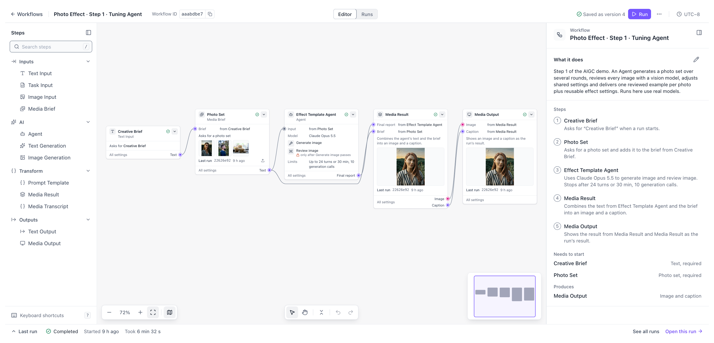</a></td>
<td><a href="./docs/public/assets/screenshots/photo-run-trace.png">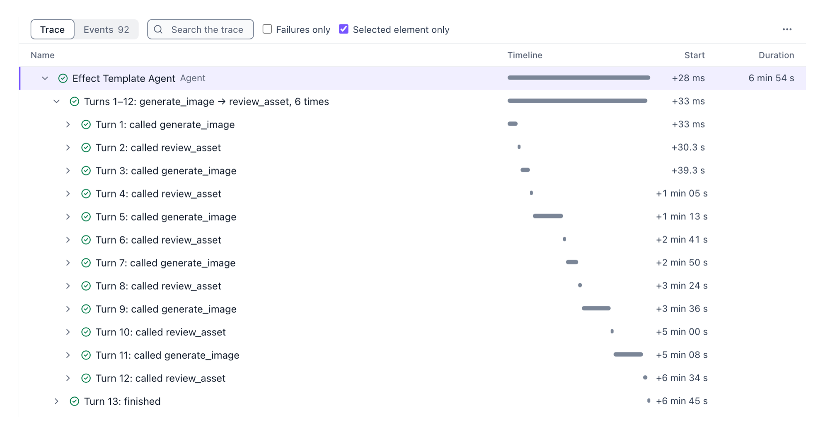</a></td>
</tr>
</tbody>
</table>

##### 效果调优

第一轮的设置没有同时适用于人像和动物，生成模型也难以发现自己的问题。因此 Effect Template Agent 负责决定如何修改，独立的审查模型对照原图逐张给出结论。调优要反复调用付费模型，中途可能崩溃或断开，Runtime 先保存每轮决策，恢复时不重新询问模型，结果未知的调用也不会自动重发。

[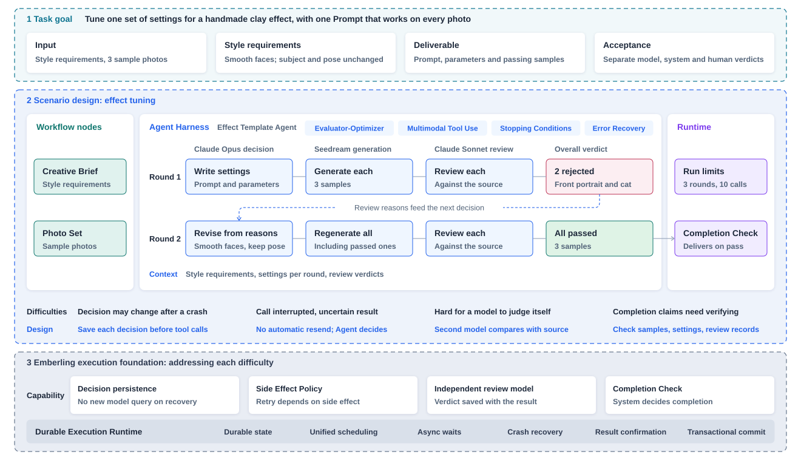](https://leungll.github.io/Emberling/diagrams/photo-tuning.html)

##### 线上服务

Agent 调好的设置发布为模板后，开始承接大量用户的请求。单张图片要等待一到两分钟，生成按张付费，模型并发有限，服务在等待期间还可能发版或崩溃。Emberling 把任务提交和结果接收拆成两段：任务提交后 Run 挂起，超出 Provider 上限的请求排队等待；结果经 Callback、Polling 或重启后的 Reconciliation 进入同一恢复入口，只有一个结果生效，崩溃或响应丢失后也不会重复生成。模板更新时，在途请求仍按提交时的版本完成。

[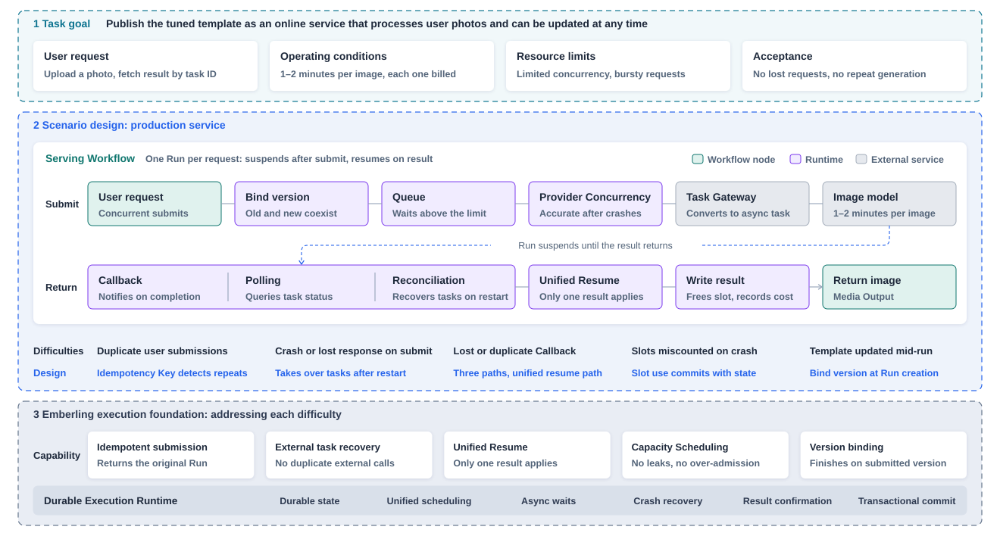](https://leungll.github.io/Emberling/diagrams/photo-serving.html)

**Agent 调出的效果经 Workflow 上线，调优和服务运行在同一套执行底座上。**

[完整过程 →](./docs/public/demos/photo-effects.zh-CN.md)

<sub>原图来自 Unsplash，署名见完整过程。</sub>

#### 视频剪辑 Agent：让创作质量持续改进

图片的好坏可以对照原图判断。视频剪辑把整段创作交给 Agent，选取哪些内容、按什么顺序讲述都由它决定，时长和字幕全部合格的短片仍可能断章取义。质量因此无法只靠规则保证，单个任务需要独立的内容审查，跨任务的改进则依靠批量评测。

<table>
<thead><tr><th>创作要求</th><th>第一版选段</th><th>内容审查</th><th>第二版选段</th><th>成片</th></tr></thead>
<tbody>
<tr>
<td>从 4 分 22 秒的采访剪出 45 秒短片，讲清 Sara 如何成为医学侦探，以及流行病学家实际做什么</td>
<td>入行经历，加上从业需要的品质</td>
<td><strong>退回。</strong>短片没有说明流行病学家实际做什么，第 24–26 句讲的只是所需品质</td>
<td>入行经历，加上一项关于工作与睡眠时长的研究</td>
<td align="center" width="170"><a href="./docs/public/assets/screenshots/video-clip-63979dab.mp4"></a><br><a href="./docs/public/assets/screenshots/video-clip-63979dab.mp4">▶ 48 秒成片，带声音</a></td>
</tr>
</tbody>
</table>

<table>
<thead><tr><th align="left">Workflow：渲染只能在检查通过后发起</th><th align="left">Trace：虚线段是等待媒体服务的时间</th></tr></thead>
<tbody>
<tr>
<td><a href="./docs/public/assets/screenshots/video-run-workflow.png">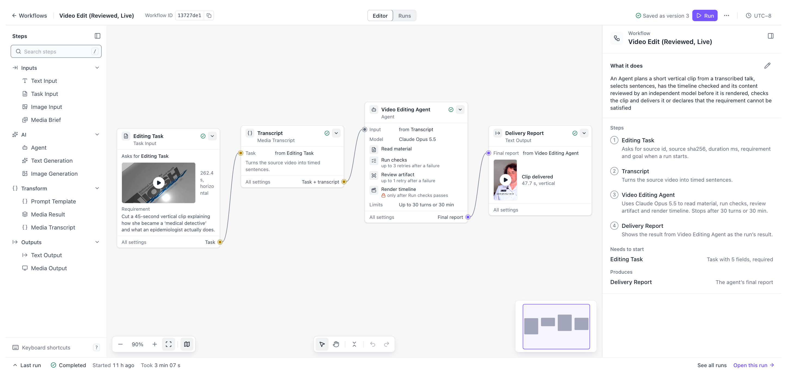</a></td>
<td><a href="./docs/public/assets/screenshots/video-run-trace.png">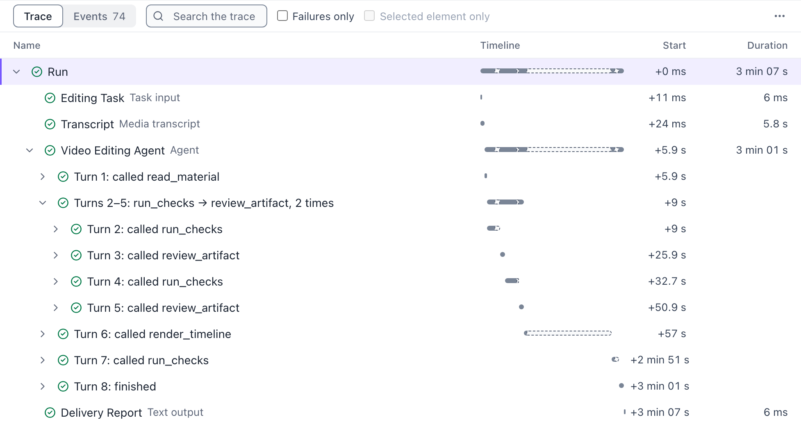</a></td>
</tr>
</tbody>
</table>

##### 剪辑任务

模型擅长叙事和取舍，写时间码却容易切断句子，因此 Agent 只按句子选段，时间码和渲染交给工具完成。第一版的时长和切点都合格，审查模型仍指出内容没有讲清，Agent 据此重新选段。技术检查和内容审查都通过后才能发起渲染。转录和渲染需要等待媒体服务，Run 在此期间挂起，重启后接管原任务。

[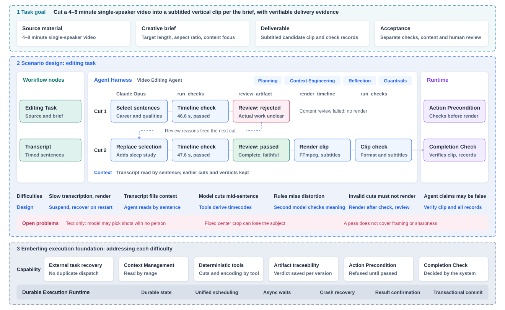](https://leungll.github.io/Emberling/diagrams/video-editing-run.html)

##### 质量评测

内容审查只能修正当前的短片，Agent 反复出现的问题要靠跨任务的比较才能发现。批量评测在 Runtime 之外运行，通过公开 API 让不带内容审查的基础版和审查版处理同一批样本。批次配置在运行前固定，失败的运行同样计入统计。

成片由技术检查、人工盲评和 LLM Judge 分别评价。LLM Judge 在运行结束后批量评分，不影响 Agent 的决策。它的判断未必可信，因此用人工评分校准，不一致的案例逐例分析。

分析结果决定下一步的改动：Agent 的同类失败通过 Prompt 或工具修正，技术检查的遗漏补进检查规则，Judge 的误判通过它的 Prompt 修正。改动后的版本重新评测，效果变好才进入下一轮。

[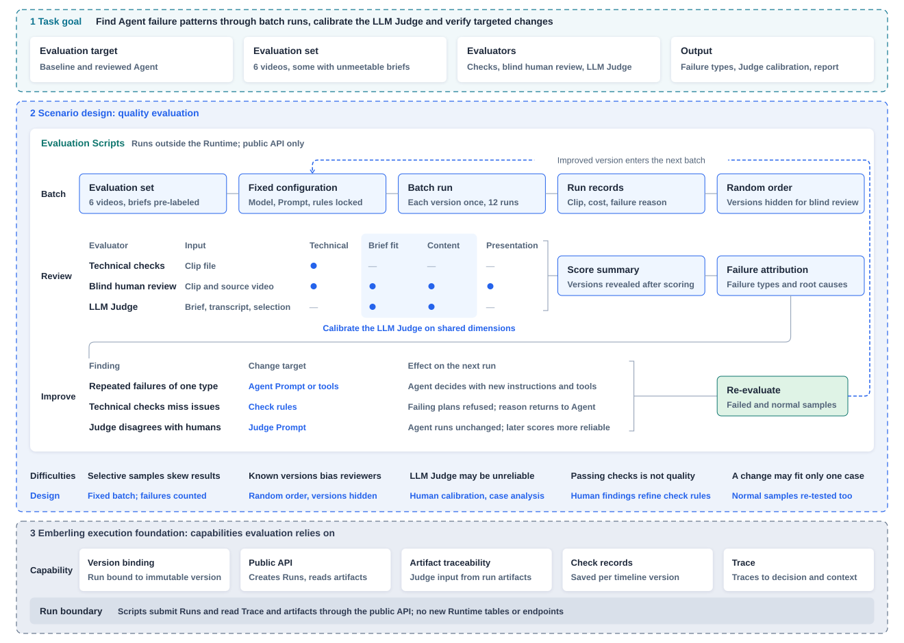](https://leungll.github.io/Emberling/diagrams/video-evaluation.html)

**模型负责创作判断，交付依据和评测结论都有可追溯的执行记录。**

[完整过程 →](./docs/public/demos/video-editing.zh-CN.md)

<sub>原素材：NIOSH / Wikimedia Commons，公有领域。</sub>

### 软件交付：Agent 的行动进入生产环境

创作结果不理想可以重新生成，软件交付的操作却直接作用于线上服务。以依赖漏洞修复为例，Agent 先在隔离环境中修改代码并完成验证，发布要经人工批准，部署结果由生产系统确认。

<table>
<thead><tr><th width="90">环节</th><th width="270">过程</th><th>Studio 中的记录</th></tr></thead>
<tbody>
<tr>
<td><strong>修改代码</strong></td>
<td>Agent 先读取项目规则、漏洞公告和现有代码。<code>golang-jwt</code> 从 v3.2.2 换成 <code>jwt/v5</code> v5.3.1，<code>token.go</code> 按新接口改写，<code>internal/auth</code> 的对外接口保持不变。</td>
<td><a href="./docs/public/assets/screenshots/repair-approval-patch.png">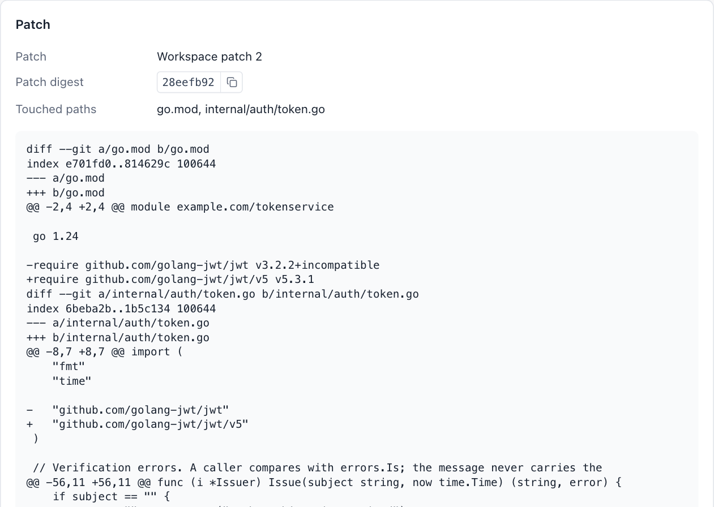</a></td>
</tr>
<tr>
<td><strong>验证与对比</strong></td>
<td>隔离容器取出基线提交的代码，应用这一版补丁后运行原有测试。测试目录不在可修改范围内，Agent 无法通过改测试过关。依赖清单中的漏洞版本已消失，<code>govulncheck</code> 没有发现。</td>
<td><a href="./docs/public/assets/screenshots/repair-run-verify.png">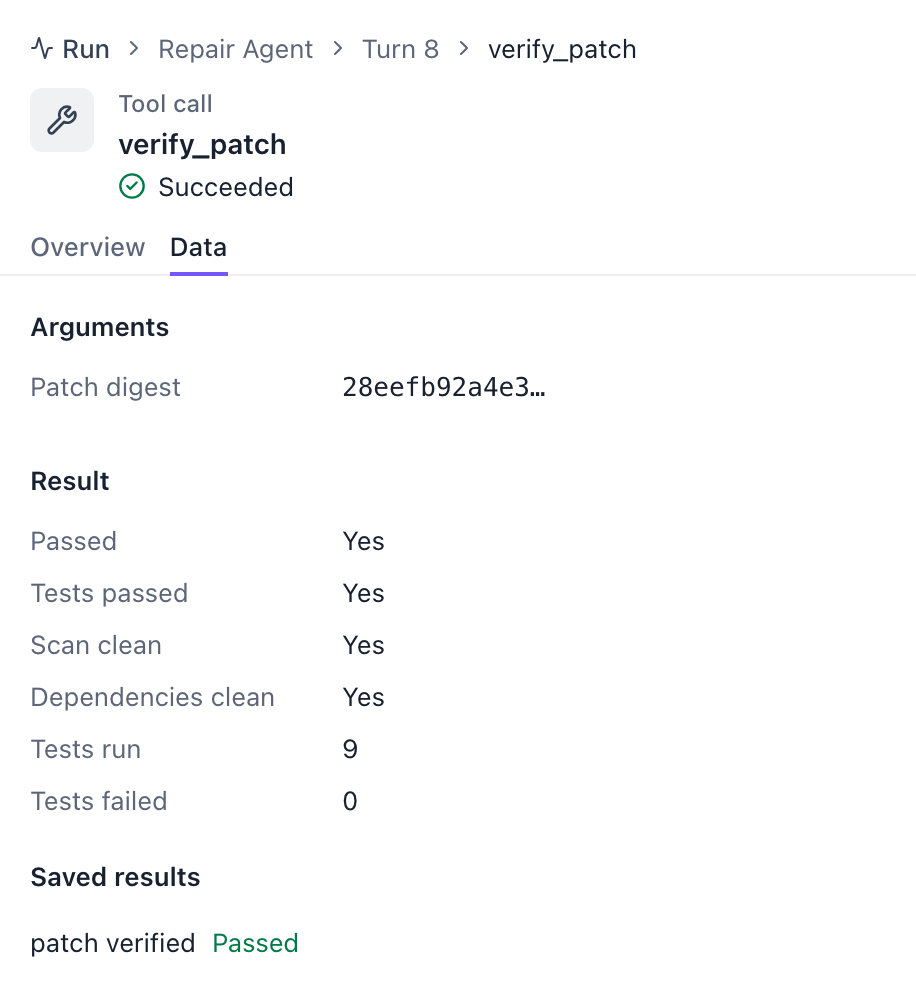</a></td>
</tr>
<tr>
<td><strong>交给人</strong></td>
<td>Agent 写好变更请求，说明修改内容、影响范围和回滚方案。变更请求绑定通过验证的第 2 版补丁，代码再有变化就需要重新验证。</td>
<td><a href="./docs/public/assets/screenshots/repair-approval-change.png">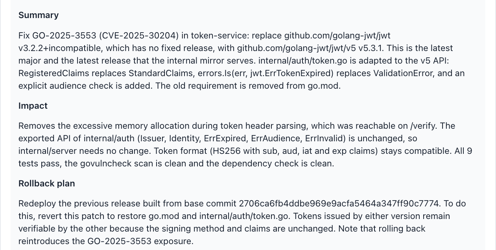</a></td>
</tr>
<tr>
<td><strong>人工审批</strong></td>
<td>审批页展示变更请求、完整 diff 和验证记录。决策依据逐条指向 Agent 当时读取的项目规则、漏洞公告和代码，审批人可以回到对应的轮次核对，确认后才批准发布。</td>
<td><a href="./docs/public/assets/screenshots/repair-approval-basis.png">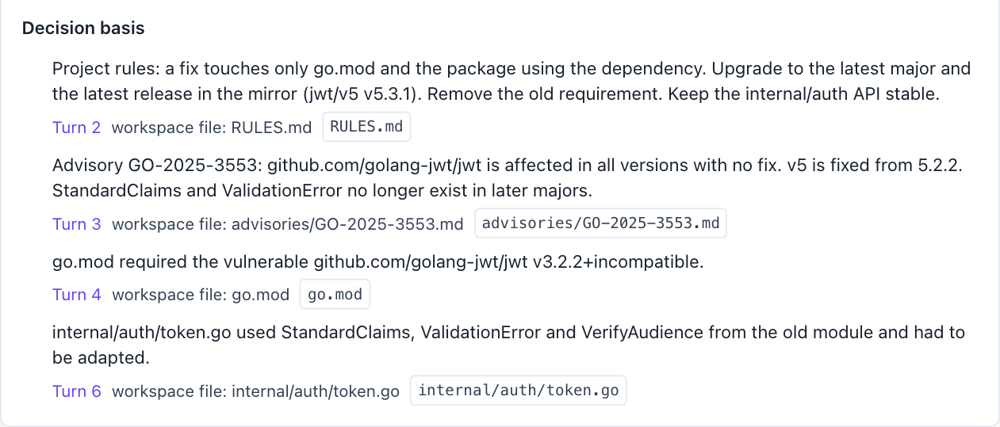</a></td>
</tr>
<tr>
<td><strong>发布确认</strong></td>
<td>批准只对这一个发布请求有效。Emberling 占用发布目标后发起部署，按操作编号查询结果，确认版本 v53 已部署且健康后解除占用。</td>
<td><a href="./docs/public/assets/screenshots/repair-run-approval.png">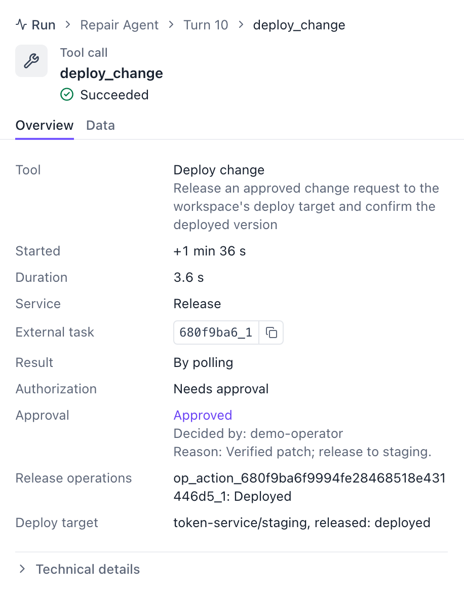</a></td>
</tr>
</tbody>
</table>

<table>
<thead><tr><th align="left">Workflow：变更请求只能在验证通过后创建</th><th align="left">Trace：虚线段是等待验证和发布的时间</th></tr></thead>
<tbody>
<tr>
<td><a href="./docs/public/assets/screenshots/repair-run-workflow.png">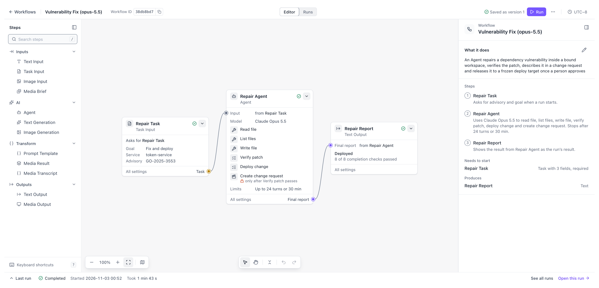</a></td>
<td><a href="./docs/public/assets/screenshots/repair-run-trace.png">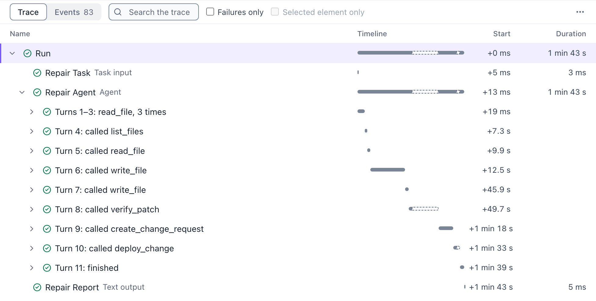</a></td>
</tr>
</tbody>
</table>

#### 修复与验证

测试通过或 Agent 声明修好，都不足以放行发布，代码在验证之后可能再次变化。Emberling 在执行前检查每个操作是否超出授权范围，每次写入都形成新的补丁版本，验证结论和变更请求绑定同一版补丁。被拒绝的操作不会执行，理由返回 Agent 继续修改。

[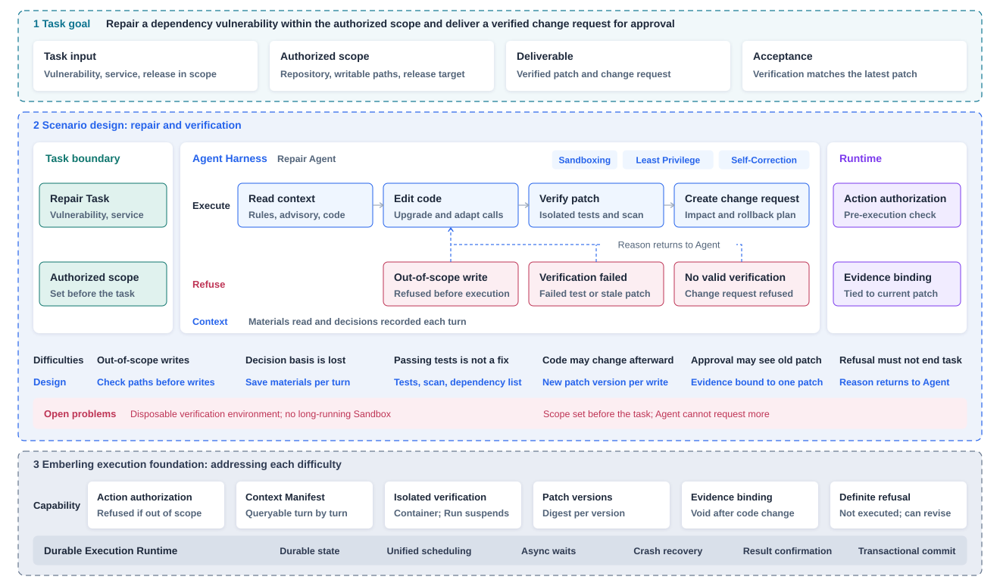](https://leungll.github.io/Emberling/diagrams/repair-verify.html)

#### 审批与发布

发布必须等人批准，批准只对本次请求有效，等待期间不消耗 Agent 的执行时限。发布请求发出后可能得不到回应，此时部署可能已经发生，重发会造成重复发布。Emberling 按操作编号向生产系统查询，结果确认前保持对发布目标的占用。任务是否完成由系统按目标核对。

[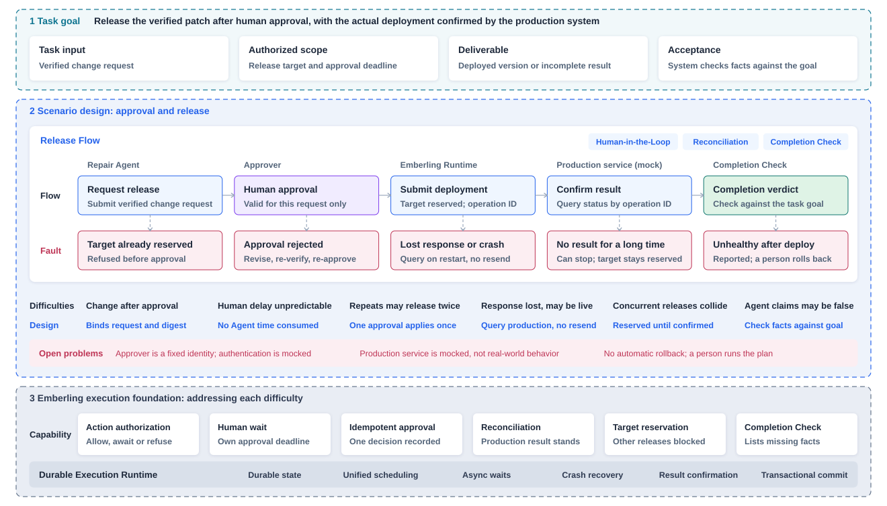](https://leungll.github.io/Emberling/diagrams/repair-release.html)

**Agent 负责修复，发布由人授权，部署结果由生产系统确认。**

这些机制并不限于漏洞修复。Agent 操作真实系统时，都需要隔离的执行环境、行动授权、人工介入和结果确认。平台统一提供这些能力，才能形成从行动、验证到交付的完整执行体系，这也是 Emberling 建设 Agent Infra 的方向。

[完整过程 →](./docs/public/demos/vuln-repair.zh-CN.md) &nbsp; [Agent Infra 愿景与路线 →](#roadmap)

<sub>发布对象为模拟生产服务，批准由演示脚本完成，发布故障通过模拟 Agent 和故障注入验证。</sub>

<a id="how-it-works"></a>

## 架构设计

Agent 任务运行时间长，中途要等待模型、外部服务和人工审批，进程随时可能中断。Emberling 把执行状态持久化到 PostgreSQL，Workflow 与 Agent 共用同一套等待和恢复机制。

所有入口都进入 Service 的同一组业务流程，决策和状态先提交，之后才调用外部系统。外部结果经回调或轮询回到统一的恢复入口，服务重启后由 Reconciler 继续未完成的任务，并发时由条件更新保证只有一方生效。

[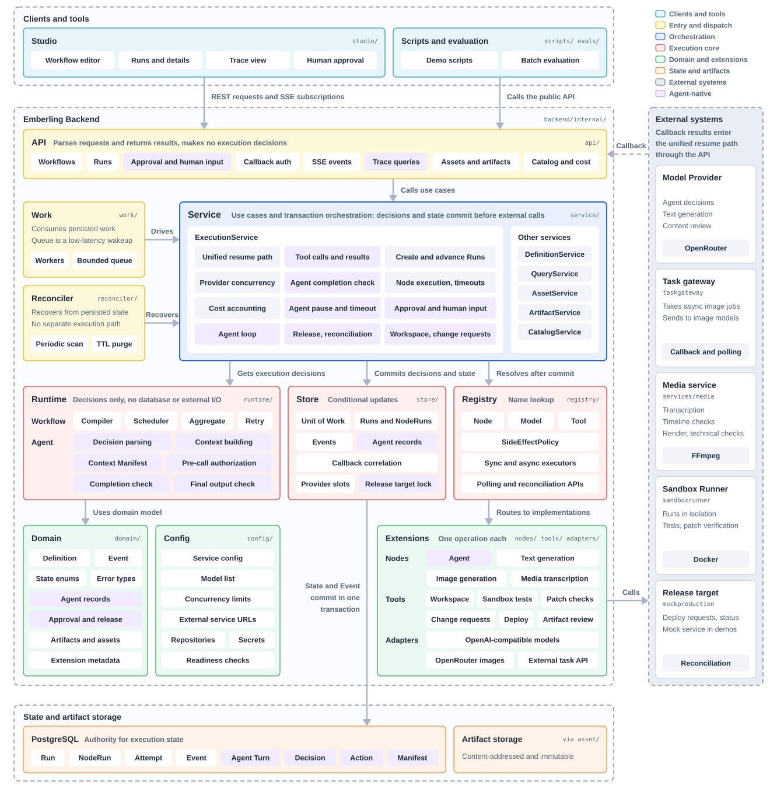](https://leungll.github.io/Emberling/diagrams/architecture.html)

### 系统模块

| 模块 | 职责 | 设计约束 |
|---|---|---|
| [API](./backend/internal/api/) | REST、SSE、回调入口和只读 Trace 查询 | 解析请求、返回结果，不参与执行决策 |
| [Work](./backend/internal/work/) 与 [Reconciler](./backend/internal/reconciler/) | 消费已持久化的就绪任务，重启后恢复未完成的任务 | 内存队列仅作低延迟唤醒，恢复以数据库为准 |
| [Service](./backend/internal/service/) | 业务流程与事务编排，覆盖 Node 执行、Agent 循环、审批和发布对账 | 外部调用只发生在事务提交之后 |
| [Runtime](./backend/internal/runtime/) | 编译、调度、状态聚合和重试决策，以及 Agent 的授权、上下文构建与完成检查 | 只做执行决策，不访问数据库和外部服务 |
| [Store](./backend/internal/store/) | 持久化执行状态，提供 Unit of Work 和条件更新 | 并发竞争由条件更新裁决 |
| [Registry](./backend/internal/registry/) 与 [Nodes](./backend/internal/nodes/)、[Tools](./backend/internal/tools/)、[Adapters](./backend/internal/adapters/) | 按稳定名称查找实现，完成单次模型、工具或服务调用 | 副作用策略来自注册信息，实现不负责重试和状态变更 |
| [Domain](./backend/internal/domain/) 与 [Config](./backend/internal/config/) | 共享领域类型、错误定义、服务配置和就绪检查 | 不包含业务流程和执行决策 |
| [Studio](./studio/) | 定义 Workflow，查看 Run、Trace 与产物，处理审批 | 只展示后端状态，不复制执行规则 |

### 恢复路线的选择

长时任务中断后如何继续，业界主要有四条路线，各有取舍，也可以组合使用。

| 路线 | 代表方案 | 中断后如何继续 | 需要承担的工作 |
|---|---|---|---|
| 进程内执行 | asyncio 后台任务、Celery | 进度在内存中，通常整体重新执行 | 由应用处理进度、去重和故障 |
| 代码重放 | Temporal、Azure Durable Functions、DBOS | 从入口重新执行代码，复用已保存的步骤结果 | 保证在途任务在代码更新后仍能恢复 |
| **状态恢复（Emberling）** | **Argo Workflows、Apache Airflow** | **读取已提交的状态，确定后续工作** | **明确每种状态的推进、竞争与恢复规则** |
| 进程快照 | CRIU、E2B 沙箱暂停与恢复 | 恢复等待点的进程状态继续运行 | 依赖快照运行环境，任务进度和产物需单独记录 |

Emberling 选择状态恢复，因为 Workflow 与 Agent 的进度、决策和等待都能直接查询，并由同一套规则管理。Trace 和质量评测也基于这些记录。代价是状态迁移、并发竞争和故障恢复都要显式设计，这部分复杂度由平台集中承担。

### Agent 语义放在哪一层

确定恢复路线后，还要决定 Agent 的决策、行动和完成检查由哪一层负责。业界主要有三种做法，Emberling 选择放进 Runtime。

| 做法 | 代表方案 | Agent 的执行如何组织 | 取舍 |
|---|---|---|---|
| 在通用工作流引擎上组织 | OpenAI Agents SDK 接入 Temporal 或 DBOS | 模型和工具调用作为 Workflow 的步骤，依靠执行历史恢复 | 调度和恢复能力成熟，适用范围广；Agent 循环和工具规则由应用编写 |
| 由 Agent 框架保存状态 | LangGraph、Microsoft Agent Framework | 决策和工具结果保存在图状态中，通过 Checkpoint 继续执行 | 贴近 Agent 开发，接入灵活；恢复语义取决于图与状态的设计 |
| **放进 Runtime（Emberling）** | **Claude Managed Agents** | **Runtime 持久化 Agent 的轮次、决策、行动和每次尝试，并约束授权、等待与完成检查** | **这些保证成为平台默认行为；灵活度相应降低，状态规则由平台验证** |

**模型负责判断下一步，执行状态、行动边界和完成标准由 Runtime 保证。**

[架构、实现方式与设计取舍 →](./docs/public/architecture.zh-CN.md)

<a id="roadmap"></a>

## 愿景与路线

模型已经能理解要求、使用工具，并根据反馈调整方法，人们开始把完整的创作、分析和软件维护工作交给 Agent。这类工作需要可靠的执行环境、明确的授权和可以核实的结果。

Emberling 从执行内核做起，逐步建设面向 Cloud Agent Workloads 的 Agent Infra，让编排、执行环境、治理、验证、观测与评估服务于同一项任务。

[](https://leungll.github.io/Emberling/diagrams/infra-coverage.html)

### 演进路线

从已完成的执行基础，逐步走向可靠运行、完整交付、验证评测与长期职责。

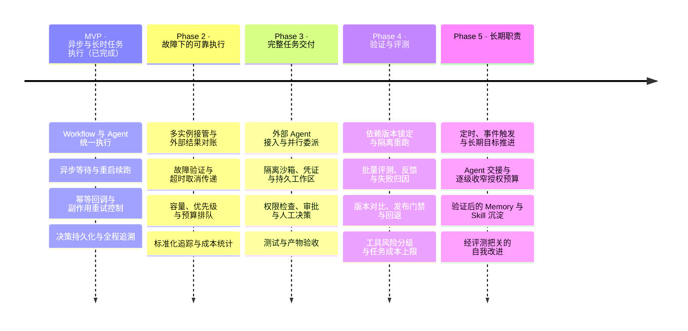

各阶段可以交叉推进，部分能力已在前面的场景中落地。

**人负责定义目标和关键判断，持续的执行、约束与验证由 Agent Infra 承担。**

<a id="quick-start"></a>

## 快速开始

准备 Go `1.27.1`、Node.js `24.20.0`、pnpm `11.25.0`、Docker Compose 和 OpenSSL。

```sh
make bootstrap
export EMBERLING_MODEL_PROVIDER_API_KEY="$(openssl rand -hex 32)"
export EMBERLING_CALLBACK_SIGNING_SECRET="$(openssl rand -hex 32)"
make dev
```

打开 **[localhost:5173](http://localhost:5173)** 进入 Studio。默认使用模拟服务，无需模型账号；重启时沿用上述密钥。

观察一次任务跨越重启：

```sh
EMBERLING_DEMO_VARIANT=serving-crash-waiting make demo-studio
```

恢复演示需要 `curl` 和 `jq`。结束后使用 `make demo-down` 停止演示；该命令清除模拟服务的请求记录，保留 PostgreSQL 与产物卷。

## 参与贡献

欢迎围绕执行可靠性、模型与工具接入、Studio 体验提交 Issue 或 PR。开发约定见[贡献指南](./CLAUDE.md)。
