<div align="center">

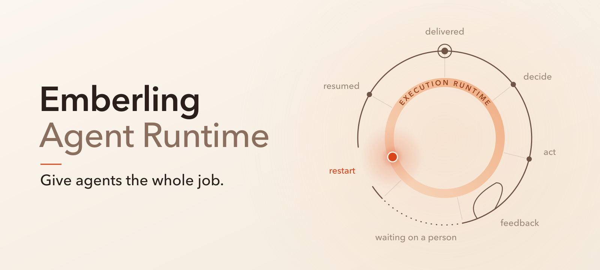

<h3>为 Agent 承担完整工作提供运行基础</h3>

<p>Emberling 是面向 Cloud Agent Workloads 的 <strong>Agent Runtime Platform</strong>。<br>
以持久化、AI 原生的执行内核，统一 Workflow 的确定性与 Agent 的自主决策，<br>
让工作从一次调用走向持续运行，从生成结果走向完整交付。</p>

<p><code>AI-Native Runtime</code>　<code>Durable Orchestration</code>　<code>Long-Horizon Agents</code><br>
<code>Human–Agent Collaboration</code>　<code>Verifiable Delivery</code>　<code>Full-Stack Agent Infra</code></p>

<p><a href="./README.md">English</a> · 简体中文</p>

<p><strong><a href="#aigc">场景演示</a> · <a href="#agent-infra">Agent Infra 全景</a> · <a href="#runtime">建设架构</a> · <a href="#evolution">演进路线</a> · <a href="#quick-start">快速开始</a></strong></p>

</div>

---

<a id="system"></a>

## 当 Agent 开始承担完整工作

机器让生产突破了体力的限制，AI 正在拓展脑力劳动的可能。随着模型能够生成内容、编写代码，人们开始把更完整的目标交给 AI：从创意出发完成内容制作，围绕问题开展研究并形成结论，或持续排查故障、修复软件、维护服务。工作由此延伸到规划、执行、协作与验证，直至交付可用的结果。

这样的工作需要 Agent 根据反馈反复行动，也可能经历数小时的外部执行与人工等待。**模型提供判断与行动的能力，基础设施则让任务跨越等待与中断，持续推进到交付。**

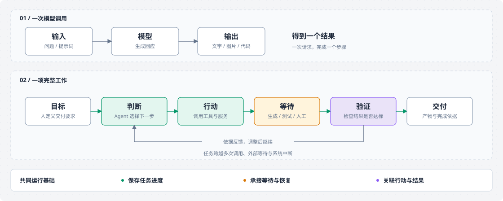

<a id="agent-infra"></a>

## Agent Infra：承载完整工作的能力全景

**Agent 需要的不只是模型，还需要一套组织行动、保存进度、连接工具、约束操作和检验结果的基础设施。** 这就是 Emberling 所面向的 Agent Infra。


Emberling 从持久化执行内核出发，通过两个递进场景展开建设：

| 场景 | 聚焦职责域 | 要解决的问题 |
|---|---|---|
| **AIGC 生成服务**<br>让工作可靠运行 | 构建与编排 · 生产运行 | 反复生成如何衔接？长时间等待如何继续？中断后如何接回结果？ |
| **漏洞修复与发布**<br>让完整交付受控推进 | 在运行基础上，进一步引入治理与控制、结果验证 | 修改是否通过检查？发布是否得到批准？线上结果是否符合目标？ |

<a id="aigc"></a>

## 场景一：AIGC 生成服务

**从创意调优，到持续运行的生成服务。**

一个可用的照片特效，需要反复生成、检查和调整。上线之后，同一套模板还要服务多个请求，面对生成等待、重复提交和版本更新。Emberling 将 Agent 的反馈调优与 Workflow 的服务流程连接起来。

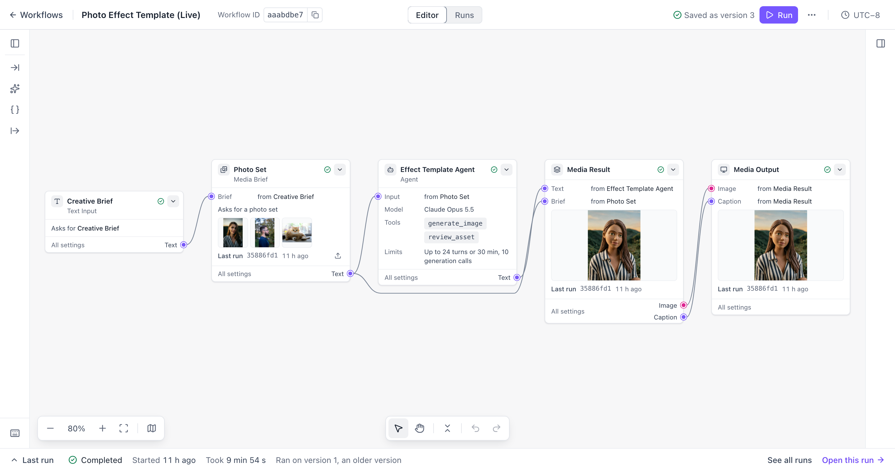

### 01 生成之后，还要改到满意

生成成功，不代表效果可用。Agent 生成一组图片，逐张检查实际效果，再调整共享设置继续生成；Emberling 保留每轮决定与结果，让反馈进入下一轮行动。

下面是一次真实运行的产物：创意要求"手工黏土定格动画风"，三张照片一组，决策模型 Claude Opus 5.5，图像模型 Seedream 5.0 Pro，审图模型 Claude Sonnet 5.5。第一轮三张图里，侧脸一张被审图打回；Agent 读到理由后重新生成，第二轮通过。

<table>
  <thead>
    <tr>
      <th>输入照片</th>
      <th>第一轮生成</th>
      <th>审图结论</th>
      <th>第二轮生成</th>
    </tr>
  </thead>
  <tbody>
    <tr>
      <td></td>
      <td></td>
      <td>通过。黏土质感清晰，主体可辨认，无畸形与生成瑕疵。</td>
      <td></td>
    </tr>
    <tr>
      <td></td>
      <td></td>
      <td><strong>未通过。</strong>眼镜画成了正面圆框并多出一片镜片，与原图侧面的方框不符；眼部与眉毛呈半正面，破坏了纯侧脸姿势；胡须与发际线和原图有出入。</td>
      <td></td>
    </tr>
    <tr>
      <td></td>
      <td></td>
      <td>通过。四肢与爪子完整，地砖结构无破损，主体与构图保留。</td>
      <td>沿用第一轮结果</td>
    </tr>
  </tbody>
</table>

每一轮的生成参数、每张图的审图结论和理由都作为执行事实保存，交付时由结果检查节点逐张核对：交付的图必须是本次运行按声明参数生成的，审图未通过而又存在更晚通过的图时，整组交付会被标记为不合格。

<sub>输入照片来自 Unsplash（Štefan Štefančík、Nenad Novaković、Rick T.T.），依 Unsplash License 使用。</sub>

### 02 服务重启，生成任务继续

图片还在外部生成，服务却可能中途重启；直接重跑，可能再次付费。Emberling 保存外部任务的关联，恢复后接回原任务的结果，继续交付；重复提交也能找到原来的工作。

调优后的设置由[演示脚本](./scripts/demo/build-v1.sh) 构建为模板，后续请求各自运行。提交幂等、异步任务接管与回调去重，支撑任务跨越请求和进程的生命周期。

### 03 请求再多，也要按容量推进

外部生成服务只有固定名额，同时提交的请求却可能更多。Emberling 管理运行名额与排队任务，名额释放后继续调度，并在故障后核对占用，避免名额泄漏或超发。

### 04 模板更新，在途任务不乱

新效果上线时，已经开始的生成任务仍需按原版完成。Emberling 为每个任务固定执行版本；演示脚本将新请求分配到 v1 / v2，可调整比例或切回旧版。

**Agent 反馈调优 → Workflow 服务化 → 持久化执行与恢复 → 容量管理与版本绑定。**

<a id="repair-release"></a>

## 场景二：从漏洞告警，到修复发布

**In development**

发现依赖漏洞之后，改完代码只是开始。Agent 还要验证补丁、提交变更、等待批准，并确认发布后的服务状态。Emberling 将这些环节连接成一项可以持续推进、审阅和确认的工作。

### 01 修复要有范围，操作要有边界

Agent 需要读取代码、修改依赖、运行命令。Emberling 为任务提供持久工作区与隔离执行环境，并在行动前检查授权范围；越界操作被拒绝，原因返回 Agent，供它调整后续行动。

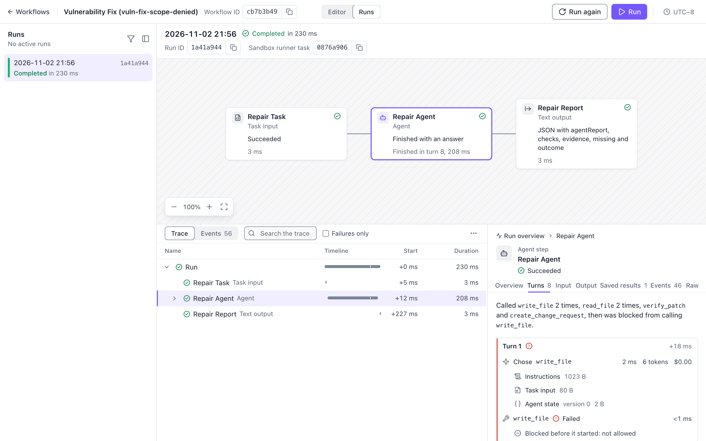

<sub>演示运行（模拟模型与沙箱）：Agent 第一步要写 <code>tests/auth_test.go</code>，在执行前被拒绝，原因是"只允许写 go.mod 与 internal/auth"。原因返回 Agent，它随后在范围内完成修改、验证并提交变更单。</sub>

### 02 代码改了，验证也要跟上

第一轮测试通过后，代码可能再次变化，旧报告便无法证明新补丁。Emberling 关联每次修改与对应的测试、扫描结果，让交给人审阅的证据对应最终修改。

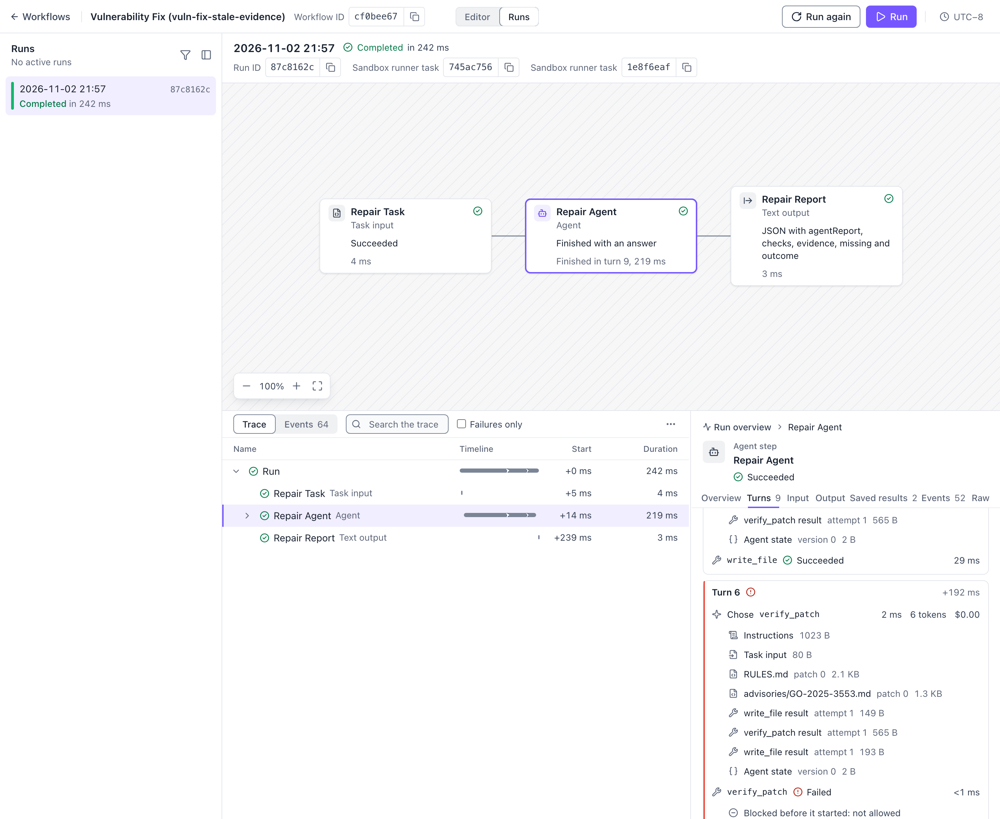

<sub>演示运行（模拟模型与沙箱）：补丁第二次修改后，Agent 仍拿旧补丁的摘要去验证，第 6 轮在执行前被拒绝，原因是"这不是工作区当前的补丁，请验证当前补丁"。下一轮它改为验证当前补丁，通过后才提交变更单。</sub>

### 03 准备好变更，再交给人批准

能准备修复，不等于能直接发布。Agent 整理补丁与验证材料，人审阅具体版本、发布目标与操作内容，再决定是否批准。Emberling 保存等待状态，让任务在批准后继续；变更内容调整后，需要重新核对验证与批准。

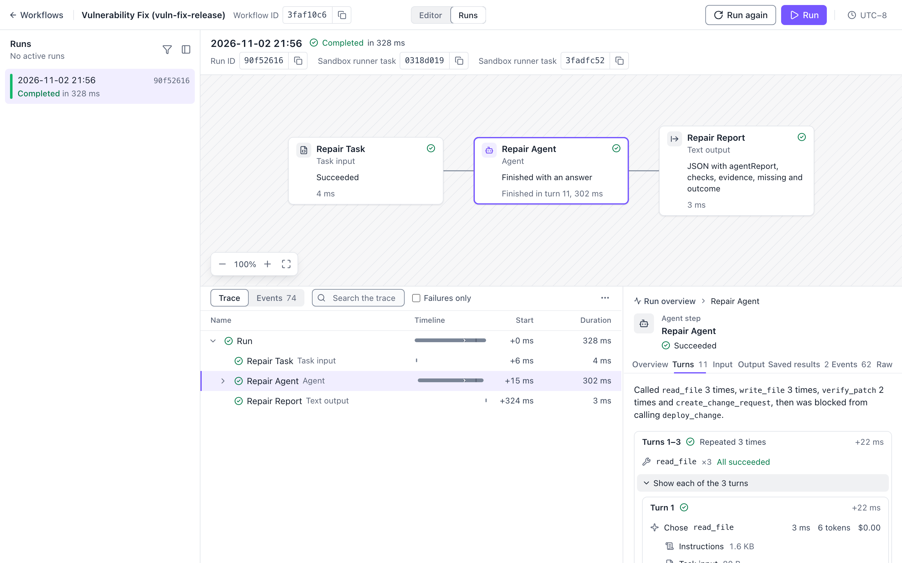

<sub>演示运行（模拟模型与沙箱）：任务目标是"只准备变更"，Agent 提交变更单后又试图直接发布，在执行前被拒绝，原因是"该工具会改动生产系统，当前目标不允许"。人工审批这一环仍在开发中，下图是它的目标设计。</sub>

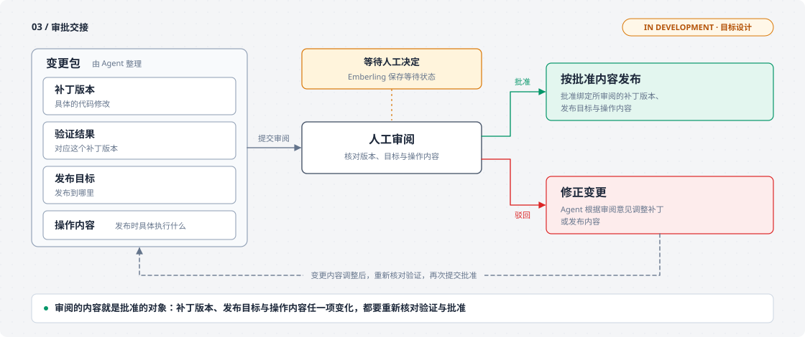

### 04 发出发布请求，还要确认结果

发布接口超时，部署可能已经生效，直接重发反而可能重复操作。Emberling 按操作编号查询实际状态，核对目标版本与部署检查结果，再按任务目标判断是否完成，并交付结果、证据与剩余事项。

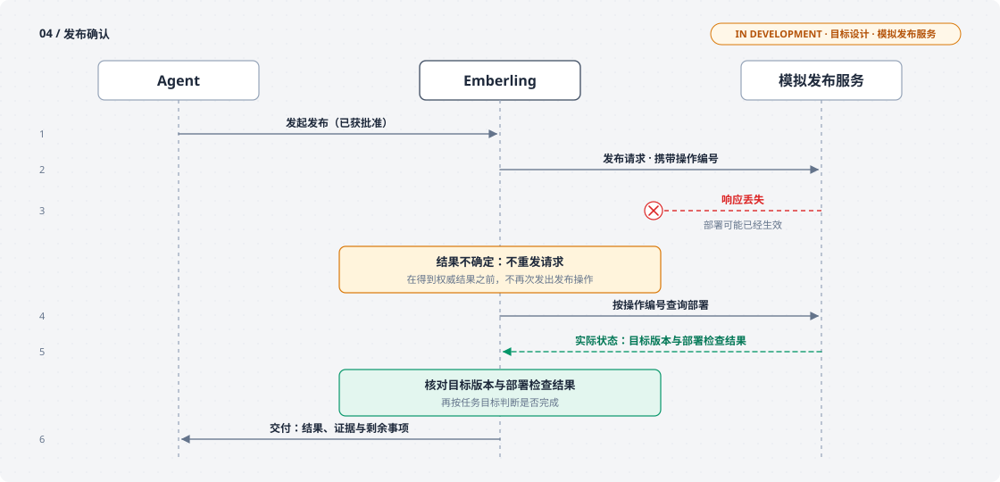

**修复有边界，验证有依据，发布有批准，完成有结果。**

<a id="runtime"></a>
<a id="capability-map"></a>

## Emberling 的建设架构

从 AIGC 的持续生成，到漏洞修复的受控发布，两个场景复用同一套执行基础。**Emberling 以 durable、AI-native Execution Runtime 为核心，让 Workflow 组织流程，让 Agent 根据反馈推进工作。**

围绕这个内核，平台逐步建设编排、状态与产物、治理、验证、观测与评估，并通过接口接入模型、工具与执行环境，形成面向 Cloud Agent Workloads 的 Agent Infra。


| 建设方式 | Emberling 的投入 |
|---|---|
| **Core · 深入执行内核** | 统一 Workflow 与 Agent 的状态、调度、等待与恢复；持久化决定，按外部操作的副作用处理恢复，并保留版本与执行记录。 |
| **Build · 围绕交付建设平台** | 将编排、工作区与产物、行动授权、结果验证和运行反馈逐步连接起来，进一步支持发布治理与评估。 |
| **Integrate · 连接生态能力** | 通过接口接入模型、上下文、知识、工具、Sandbox 与 AI Gateway，让不同能力在共同的执行基础上协作。 |

<a id="evolution"></a>

## 走向长期职责

从已完成的执行基础，逐步走向可靠运行、完整交付、验证评测与长期职责。

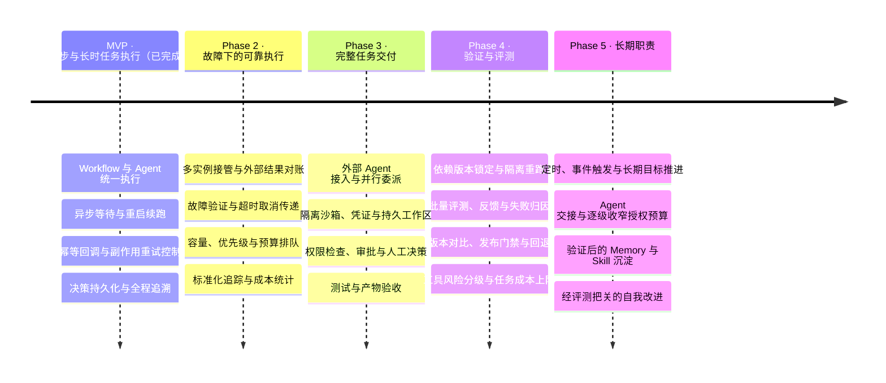

各阶段允许交叉推进；场景中部分能力落地不代表整个阶段完成。

<a id="quick-start"></a>

## 运行与探索

### 启动 Studio

准备 Go `1.27.1`、Node.js `24.20.0`、pnpm `11.25.0`，以及 Docker Compose 和 OpenSSL。

```sh
make bootstrap
export EMBERLING_MODEL_PROVIDER_API_KEY="$(openssl rand -hex 32)"
export EMBERLING_CALLBACK_SIGNING_SECRET="$(openssl rand -hex 32)"
make dev
```

打开 **[Studio → localhost:5173](http://localhost:5173)**，查看流程、执行详情与产物。默认使用模拟服务，无需模型账号；重启时沿用上述密钥。

### 观察一次重启恢复

在外部生成仍未完成时重启 Backend，观察原任务如何接回结果、继续交付。演示使用模拟服务，并在关键步骤暂停，方便在 Studio 中查看。

```sh
EMBERLING_DEMO_VARIANT=serving-crash-waiting make demo-studio
```

需要 Docker、`curl` 和 `jq`。结束后使用 `make demo-down` 停止演示；该命令会清除模拟服务的请求记录，保留 PostgreSQL 与产物卷。

### 继续探索

| 想看什么 | 从这里开始 |
|---|---|
| **真实模型如何生成、检查并调优图片** | [真实模型演示指南](./scripts/demo/definitions/README.md)，按指南配置模型凭证 |
| **调优结果如何变成服务模板** | [模板构建脚本](./scripts/demo/build-v1.sh) |
| **新版模板如何分流与切回** | [版本分流脚本](./scripts/demo/traffic-split.sh) |
| **如何核对故障结果、运行记录与费用** | [演示报告脚本](./scripts/demo/evidence-report.sh) |
| **更多并发、容量与故障演示** | `EMBERLING_DEMO_VARIANT=serving make demo`；完整命令见 [Makefile](./Makefile) |

### 参与建设

欢迎通过 Issue 或 Pull Request，改进执行可靠性、模型与工具接入，以及 Studio 的场景体验。开发约定见 [贡献指南](./CLAUDE.md)。

<details>
<summary>开发检查命令</summary>

```sh
make check-fast  # 静态检查与单元测试
make check       # 完整检查，含集成测试和 Studio 构建
make test-e2e    # 浏览器验收
```

集成测试需要可访问的测试数据库或 Docker，浏览器验收需要 Playwright Chromium。

</details>
