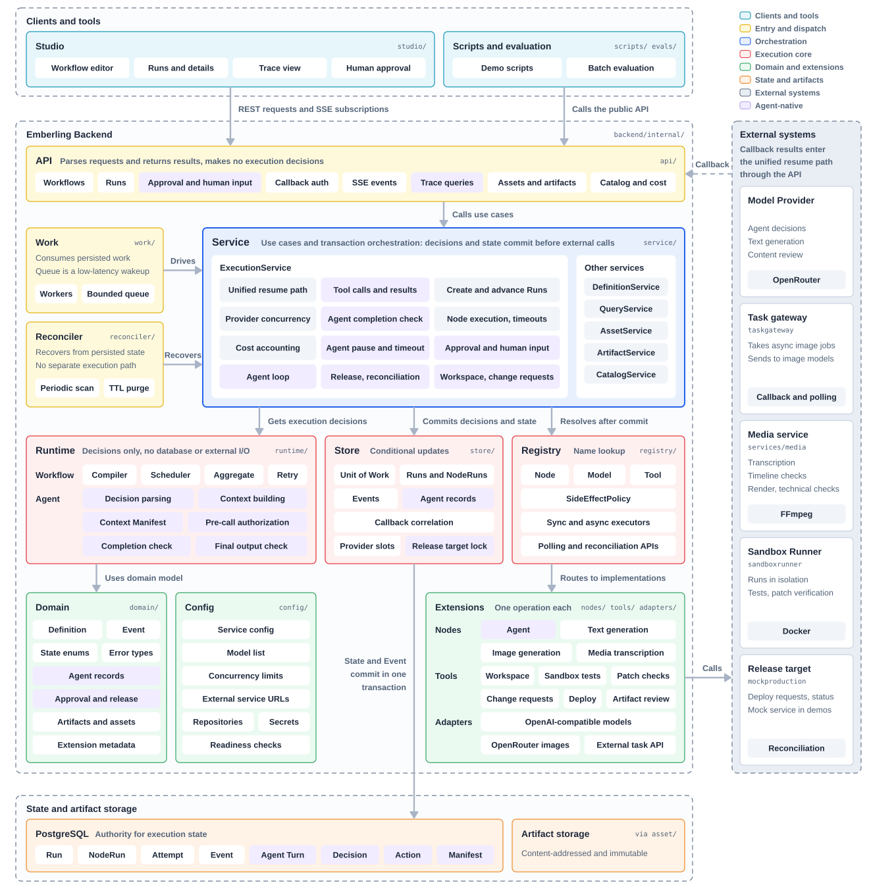

# Emberling Architecture and Design Trade-offs

[Back to README](../../README.md#how-it-works) · [简体中文](./architecture.zh-CN.md)

Emberling is an Agent Runtime Platform built around a durable, AI-native Execution Runtime. A Workflow advances through predefined steps. An Agent chooses actions from feedback. Both share state, scheduling, waits and recovery.

## How Work Advances

A user submits a task through Studio, the API or a script. The platform stores the task and its execution version, then finds the runnable steps. A Workflow organizes work by its process. An Agent reads the current information and decides the next action.

The decision and the right to execute are saved first. External models, tools and services are called afterwards. When a result returns, the platform saves it with its record and then continues. If an external task needs to wait, the platform saves its identifier and correlation. A callback or query result then continues the same work.

A task does not depend on the original connection, an in-process notification or the in-memory queue. After a restart, recovery scans find unfinished work in saved state and enter the common execution path. An external operation that was in flight also needs its protocol and actual result to decide how to continue.

## Why Durable State-Based Recovery

A long task can recover from an interruption in several ways. Each has trade-offs, and they can be combined.

| Approach | What is mainly saved | How recovery works | Design work to take on |
|---|---|---|---|
| In-process execution | Local progress in memory | Run the task again, or let the application compensate | The application owns progress, deduplication and failure handling |
| Code replay | Execution history and step results | Re-enter process code and reuse existing results | Replay rules and compatibility between old tasks and new code |
| **Durable state-based recovery** | **Step state, decisions, actions, waits and results** | **Read current facts and determine remaining work** | **Advancement, race and recovery rules for every state** |
| Process snapshot | Process state at the wait point | Restore process state and continue | A snapshot runtime, plus handling of changes that already happened in external systems |

Emberling uses state-based recovery so that Workflow and Agent progress can be queried and managed directly. The cost is explicit design of state transitions, races and failure recovery. The execution layer carries this work in one place.

An Agent adds uncertainty that a static process does not have: asking the model again can produce a different decision. The platform saves decisions the model has made and continues the work not yet executed. For an external operation already sent, it confirms the result before deciding the next step.

### Exception Handling During Agent Execution

The Runtime handles common exceptions during Agent execution with fixed rules.

| Situation | Runtime behavior |
|---|---|
| Recovery after an interruption | Continue from the committed model decision. Do not ask the model again |
| Unknown tool result | Do not resend because of the interruption. Query the result or return it to the Agent according to the side-effect policy |
| Action outside authorization | Refuse before execution and return the reason to the Agent for its next decision |
| Waiting on a person | Pause the Agent's execution time limit. The human wait has its own deadline |
| Building context for a turn | The Context Manifest records the material used in that turn |
| Agent declares completion | The completion check decides from the delivery conditions |

## Responsibilities in the Code

| Module | Responsibility | Why it is separated |
|---|---|---|
| [API](../../backend/internal/api/) | Parses requests, calls use cases, and builds responses and read-only execution views | HTTP and Studio interaction make no execution decisions |
| [Service](../../backend/internal/service/) | Use cases, transaction orchestration and post-commit external work | Makes the save-then-act boundary explicit |
| [Runtime](../../backend/internal/runtime/) | Compilation, scheduling and pure Workflow and Agent execution decisions | Execution rules can be checked without a database or Provider |
| [Store](../../backend/internal/store/) | Persisted state, conditional updates and transactions | Records facts without deciding what runs next |
| [Registry](../../backend/internal/registry/) | Stable resolution of Nodes, Models and Tools | New capabilities connect through extension interfaces |
| [Reconciler](../../backend/internal/reconciler/) | Finds saved pending work and calls the shared use cases | Recovery reuses the normal execution path |
| [Studio](../../studio/) | Defines tasks and shows progress, decisions and artifacts | The interface shows backend facts and does not copy the execution engine |

## Choices That Affect Reliability

**The database is the basis for execution facts.** A state change and its Event are saved in the same transaction. External calls and further advancement happen after commit. The in-memory queue reduces latency, and recovery still starts from persisted facts.

**Recovery has to understand side effects.** Reading data, submitting a generation and releasing software have different consequences when repeated. The platform uses registered policies and external protocols to separate safe retries, takeover of the original task and results awaiting confirmation. Not every interruption becomes a resend.

**The execution version is fixed at start.** A Run binds to one immutable Definition version. A template update can affect new tasks, and in-flight tasks finish on their original version. Demo scripts handle traffic splitting.

**Completion needs evidence.** Agent responses, patches, test results and external release facts each have their own role. The delivery decision ties them to the task goal, and execution records feed later diagnosis and evaluation.

Recovery currently assumes a single instance. Multi-instance takeover, general execution environment management, cross-task evaluation and fuller release governance will build on this foundation.

## Agent Infra Vision and Roadmap

Machines extended the scale of physical labor. AI is extending what is possible in knowledge work. As models learn to understand requirements, use tools and adjust from feedback, people hand Agents more complete goals: creative production, analysis, software maintenance and ongoing responsibilities.

This work needs continuous execution, execution environments, clear authorization and results that can be checked. Emberling starts at the execution layer, builds an Agent Runtime Platform, and is growing toward Agent Infra for Cloud Agent Workloads.

### Building Outward From a Shared Runtime

| Investment | Scope |
|---|---|
| **Core** | Deepen the durable, AI-native Execution Runtime so Workflow and Agent share state, scheduling, waits and recovery |
| **Build** | Build orchestration, workspaces and artifacts, execution constraints, verification, observability and evaluation around task delivery |
| **Integrate** | Connect models, context, knowledge, tools, Sandboxes, media services and invocation channels |

Core, Build and Integrate in the figure describe the type of investment. Maturity is separate. The shared execution foundation and run records exist. Workspaces, verification, authorization and human approval have implementations and mock demo records. General environment management, cross-task evaluation and full release governance still need to be built.

### How the Five Domains Work Together

The business defines goals and delivery requirements. Construction and orchestration organize decisions, actions and feedback. Production runtime saves progress and connects real execution environments. Governance constrains permissions, versions and releases. Observability and evaluation turn execution results into diagnosis and improvement.

Each real job goes deeper into part of this picture. Video editing shows how checks drive Agent revisions. Image effects show how exploration becomes a continuous service. Vulnerability repair shows how action scope, patch evidence and delivery goals constrain actions together. They share one execution foundation, and their demo results do not mean an entire domain is complete.

### Roadmap

| Phase | Status | Existing foundation and remaining work |
|---|---|---|
| **Execution foundation** | Complete | Shared Workflow and Agent execution; durable state and decisions, async waits, restart recovery, version binding and execution records |
| **Reliable operation** | Partly complete | The generation service demonstrates recovery, capacity and versioning. Result reconciliation, scheduling and multi-instance takeover continue |
| **Complete delivery** | Partly complete | Workspaces, patch verification, authorization and approval have implementations and mock demos. Real environment integration and full business delivery continue |
| **Verification and evaluation** | Planned | Single-task checks and content review have run examples. Cross-task batch evaluation, version comparison and release gates remain to be built |
| **Ongoing responsibilities** | Planned | Event and scheduled triggers, long-term goals, Agent handoffs and reuse of verified experience |

Phases show priorities and dependencies, and they can overlap. Verifying one generation, repair or approval path builds a base for later work. It does not complete broader governance, evaluation or long-term autonomy.

[Real work](../../README.md#demos)
