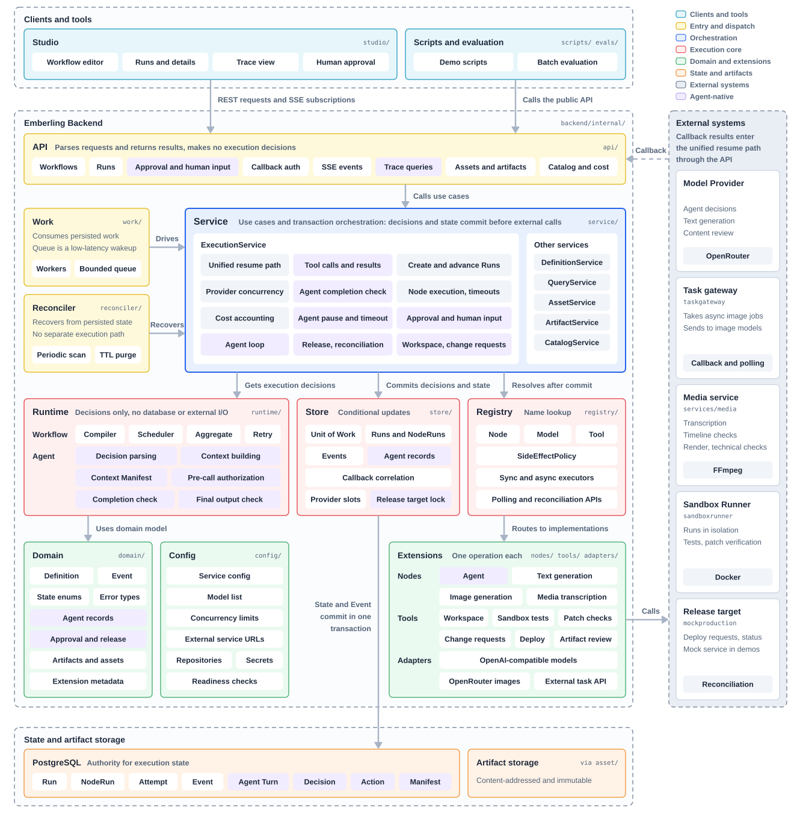

# Emberling 的架构与设计取舍

[返回 README](../../README.zh-CN.md#how-it-works) · [English](./architecture.md)

Emberling 是一个以 durable、AI-native Execution Runtime 为核心的 Agent Runtime Platform。Workflow 按预先定义的步骤推进，Agent 根据反馈选择行动，两者共用状态、调度、等待与恢复基础。

## 一项工作如何推进

用户通过 Studio、API 或脚本提交任务。平台保存任务及其执行版本，找出可执行的步骤；Workflow 按流程组织工作，Agent 则读取当前信息、决定下一步行动。

决定与执行权先保存，之后才调用外部模型、工具或服务。结果回来后，平台保存结果及对应记录，再继续推进。外部任务需要等待时，保存其标识与关联；回调或查询得到结果后，继续同一项工作。

任务的存在与原来的连接、进程内通知或内存队列分开。服务重启后，恢复扫描从保存的状态中发现未完成工作，再进入共同的执行路径。正在执行中的外部操作，还要结合它的协议和实际结果决定如何继续。

## 为什么选择持久化状态恢复

长任务中断后可以有几种恢复方式。它们各有取舍，也可以组合使用：

| 方式 | 主要保存什么 | 恢复如何进行 | 要承担的设计工作 |
|---|---|---|---|
| 进程内执行 | 内存中的局部进度 | 重新执行任务，或由应用自行补偿 | 应用负责进度、去重和故障处理 |
| 代码重放 | 执行历史与步骤结果 | 重新进入流程代码，复用已有结果 | 管理重放规则以及旧任务与新代码的兼容 |
| **持久化状态恢复** | **步骤状态、决定、行动、等待与结果** | **读取当前事实，确定后续工作** | **明确每种状态的推进、竞争与恢复规则** |
| 进程快照 | 进程在等待点的状态 | 恢复进程状态继续执行 | 提供快照运行环境，并处理外部系统已发生的变化 |

Emberling 选择状态恢复，是为了让 Workflow 与 Agent 的执行进度可以直接查询和管理。代价是需要显式设计状态迁移、并发竞争和故障恢复；这些工作由执行层集中承担。

Agent 比静态流程还多一层不确定性：重新询问模型，可能得到不同的决定。因此，平台保存模型已经作出的决定，恢复时继续尚未执行的工作；对已经发出的外部操作，核实其结果后再决定下一步。

### Agent 执行中的异常处理

Agent 执行中的常见异常，由 Runtime 按固定规则处理。

| 执行中的情况 | Runtime 的处理 |
|---|---|
| 中断后恢复 | 读取已提交的模型决策继续执行，不重新询问模型 |
| 工具结果不明 | 不因中断而重发，按副作用策略查询结果或交回 Agent |
| 行动超出授权 | 执行前拒绝，并把原因返回 Agent，作为下一轮决策的依据 |
| 等待人工处理 | 暂停 Agent 的执行时限，人工等待有独立期限 |
| 构建每轮上下文 | Context Manifest 记录该轮使用的材料 |
| Agent 声明完成 | 由完成检查根据交付条件判定 |

## 代码中的职责划分

| 模块 | 负责什么 | 为什么这样分 |
|---|---|---|
| [API](../../backend/internal/api/) | 解析请求、调用用例、构造响应与只读执行视图 | HTTP 与 Studio 交互不承担执行决策 |
| [Service](../../backend/internal/service/) | 用例、事务编排，以及提交后的外部工作 | 明确“先保存，再行动”的边界 |
| [Runtime](../../backend/internal/runtime/) | 编译、调度和 Workflow / Agent 的纯执行决策 | 执行规则可以独立于数据库和 Provider 检查 |
| [Store](../../backend/internal/store/) | 持久化状态、条件更新与事务能力 | 记录事实，不决定后续执行 |
| [Registry](../../backend/internal/registry/) | 节点、模型与工具的稳定解析 | 新能力通过扩展接口接入 |
| [Reconciler](../../backend/internal/reconciler/) | 发现保存下来的待处理工作，调用共同用例 | 恢复复用正常执行路径 |
| [Studio](../../studio/) | 定义任务、查看进度、决定与产物 | 界面展示后端事实，不复制执行引擎 |

## 几个影响可靠性的选择

**数据库是执行事实的依据。** 状态变化与对应事件在同一事务中保存，外部调用和后续推进发生在事务提交后。内存队列用于降低延迟，恢复仍从持久化事实出发。

**恢复要理解行动的副作用。** 查询资料、提交一次生成和发布软件，重复执行的后果不同。平台依据注册的策略和外部协议区分安全重试、原任务接管与结果待确认，不把所有中断都处理成重发。

**执行版本在开始时固定。** 一个 Run 绑定不可变的 Definition 版本。模板更新可以影响新任务，在途任务仍沿原来的版本完成；Demo 的流量分配由脚本承担。

**工作完成需要检查依据。** Agent 的回答、补丁、测试结果与外部发布事实各有职责。交付判断把它们与任务目标关联，执行记录也为后续诊断和评估提供输入。

当前采用单实例恢复语义。多实例接管、通用执行环境管理、跨任务评测与更完整的发布治理继续沿这套基础演进。

## Agent Infra 愿景与演进路线

机器拓展了体力劳动的规模，AI 正在拓展脑力劳动的可能。随着模型能够理解要求、使用工具并依据反馈调整方法，人们开始把更完整的目标交给 Agent：完成创作、开展分析、维护软件，乃至持续承担一项职责。

这些工作需要持续运行、执行环境、明确的授权和可以检查的结果。Emberling 从执行层切入，建设 Agent Runtime Platform，并逐步发展面向 Cloud Agent Workloads 的 Agent Infra。

### 从共同运行基础向外建设

| 投入方式 | 要做什么 |
|---|---|
| **Core** | 深入 durable、AI-native Execution Runtime，让 Workflow 与 Agent 共用状态、调度、等待与恢复 |
| **Build** | 围绕任务交付建设编排、工作区与产物、执行约束、验证、观测与评估 |
| **Integrate** | 接入模型、上下文、知识、工具、Sandbox、媒体服务与调用通道 |

图中的 Core、Build、Integrate 表示投入方式。成熟度另行说明：共同执行基础与运行记录已有，工作区、验证、授权和人工批准有实现与模拟演示记录；通用环境管理、跨任务评测和完整发布治理仍需建设。

### 五个职责域如何协作

业务定义目标和交付要求；构建与编排组织判断、行动与反馈；生产运行保存进度并连接实际执行环境；治理约束权限、版本与发布；观测和评估把执行结果转化为诊断与改进依据。

这几项实际工作分别深入其中的一部分。视频剪辑展示检查如何驱动 Agent 修正，照片特效展示探索如何转为持续服务，漏洞修复展示操作范围、补丁证据和交付目标如何共同约束行动。它们使用共同执行基础，各自的演示结果不等同于整个职责域已经完成。

### 演进路线

| 阶段 | 状态 | 已有基础与继续建设的部分 |
|---|---|---|
| **执行基础** | 已完成 | Workflow 与 Agent 共享执行；持久化状态与决定、异步等待、重启恢复、版本绑定与执行记录 |
| **可靠运行** | 部分完成 | 生成服务已展示恢复、容量与版本场景；继续深化结果对账、调度及多实例接管 |
| **完整交付** | 部分完成 | 工作区、补丁验证、授权与审批已有实现和模拟演示；继续完善实际环境接入及完整业务交付 |
| **验证与评测** | 规划中 | 单任务检查和内容审查已有运行示例；跨任务批量评测、版本比较与发布门禁仍待建设 |
| **长期职责** | 规划中 | 事件与定时触发、长期目标推进、Agent 交接，以及经过验证的经验复用 |

阶段表达建设重点与依赖，允许交叉推进。验证一次生成、修复或审批路径，能够为后续工作建立基础，但不会自动完成更广泛的治理、评测或长期自治能力。

[实际工作](../../README.zh-CN.md#demos)
