# Image Effects: From Tuning to a Running Service

[Back to README](../../../README.md#demos) · [简体中文](./photo-effects.zh-CN.md)

This record expands the image effects section of the README. The creative brief is a handmade clay stop-motion style with smooth faces. The decision model is Claude Opus 5.5, the image model is Seedream 5.0 Pro, and visual review uses Claude Sonnet 5.5. Run IDs below show the first 8 characters and can be opened in Studio.

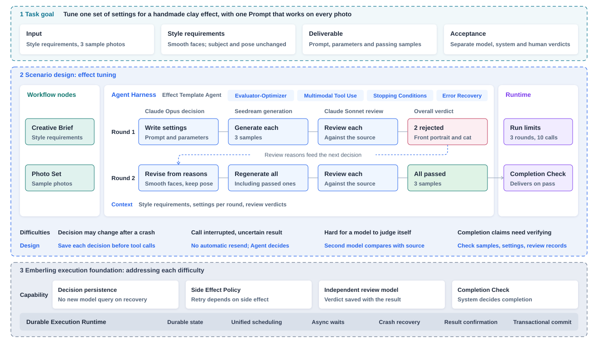

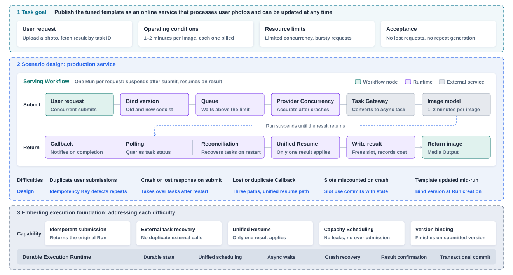

One successful generation is not enough. During tuning, one set of settings has to work for every photo, and quality can only be judged against the source. In production, each image costs money and takes one to two minutes. Provider concurrency is limited. The Backend can restart during a wait, an external task may already be accepted, and its result may be unknown. Templates also keep changing while requests are in flight.

## A Complete Tuning Run

Run `916a0688`: two rounds, 13 decision turns, 6 minutes 54 seconds, 92 events.

Claude Opus 5.5 decides, Seedream 5.0 Pro generates and Claude Sonnet 5.5 reviews. The limits are 3 rounds and 10 generation calls.

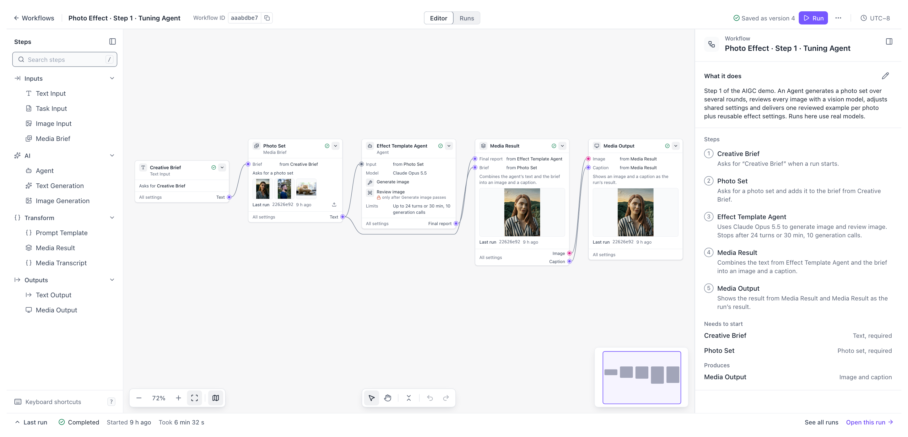

| Source | Round 1 | Visual review | Round 2, delivered |
|---|---|---|---|
|  | 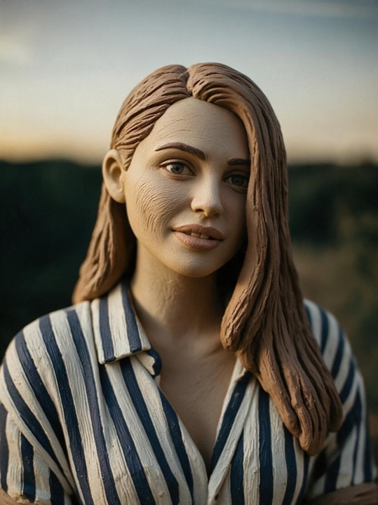 | Rejected. Wrinkle-like tool marks on the cheeks, and the background is still photographic blur | 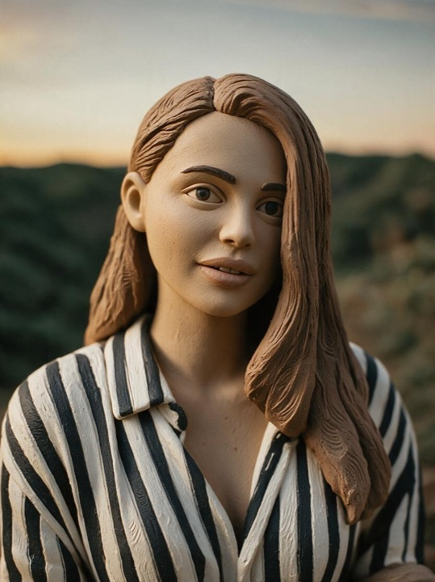 |
| 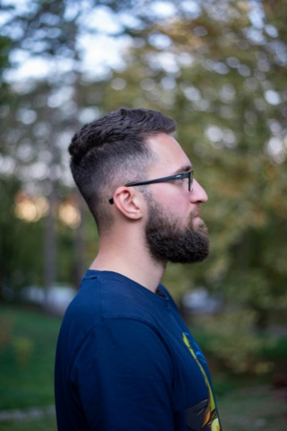 | 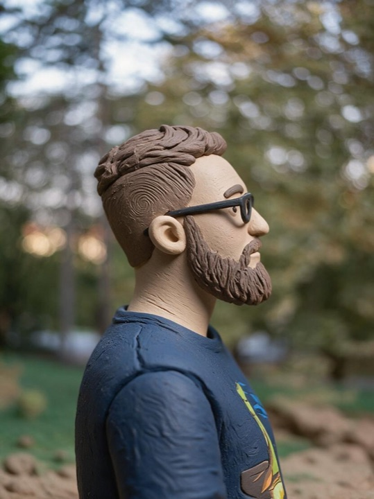 | Passed. Profile, glasses, beard and clothing are preserved | 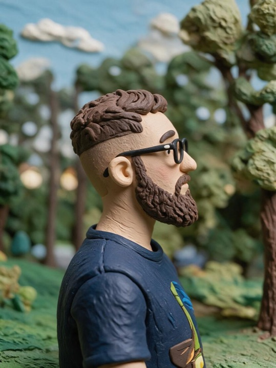 |
|  | 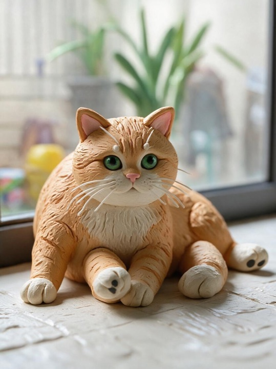 | Rejected. Limbs are misplaced, whisker-like shapes appear above the eyes, and the pose and framing changed |  |

After the first rejection, the Agent rewrote the Prompt. Faces must have no wrinkles or tool marks. Handmade marks stay on hair, fur, clothing and background. The background must also look like clay, and the original pose and framing must be kept. Round 2 regenerated all three images with one set of settings and all passed review. The delivery check confirmed that the samples, settings digest and review records matched. The review still noted one minor issue: the portrait background is soft-focus and its clay texture is weak.

The cost comes from Provider responses and totals about $0.89: $0.52 for decisions, $0.27 for 6 generations and $0.10 for 6 reviews.

### Step-by-Step Record

<table>
<thead><tr><th>Moment</th><th>Agent or system action</th><th>What Emberling does</th><th>Record in Studio</th></tr></thead>
<tbody>
<tr>
<td width="120"><strong>Round 1 generation</strong></td>
<td width="190">The Agent writes one set of settings, generates each image and sends it for review. Each generation takes 21 seconds to 1 minute 23 seconds</td>
<td width="210">Saves the Agent's decision before the paid call. Settings, duration and cost are recorded per call</td>
<td>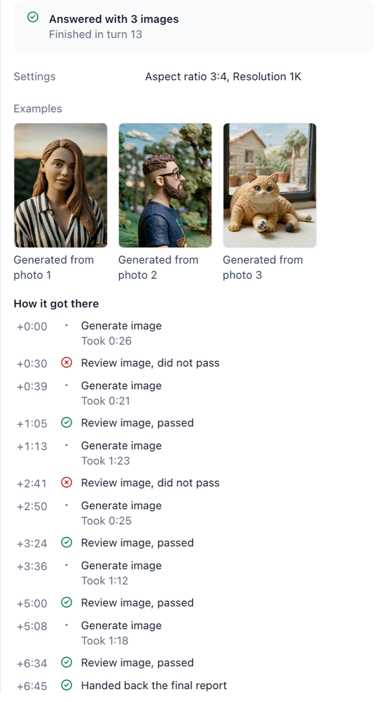</td>
</tr>
<tr>
<td><strong>Review rejection</strong></td>
<td>The review model judges each image against its source and rejects the portrait and the cat</td>
<td>Saves the verdict and reasons with the result, as a tool result for the Agent's next decision</td>
<td>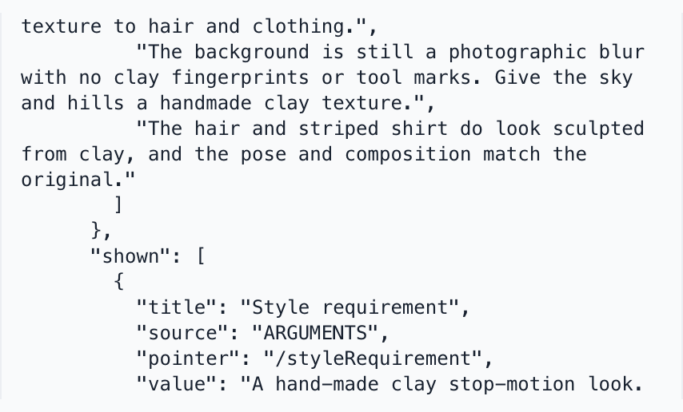</td>
</tr>
<tr>
<td><strong>Settings rewrite</strong></td>
<td>The Agent rewrites the Prompt from the reasons and regenerates all three photos, including the profile that passed</td>
<td>Binds each result to the digest of its settings, so results from two rounds cannot mix</td>
<td>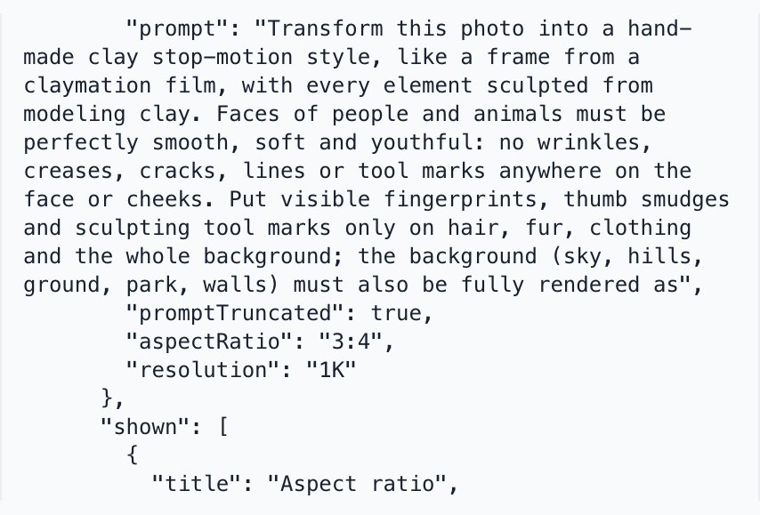</td>
</tr>
<tr>
<td><strong>Delivery check</strong></td>
<td>The Agent declares delivery of the three round 2 images and these settings</td>
<td>Checks that samples, settings digest and review records match. Old samples that failed review cannot be delivered. All 3 passed</td>
<td>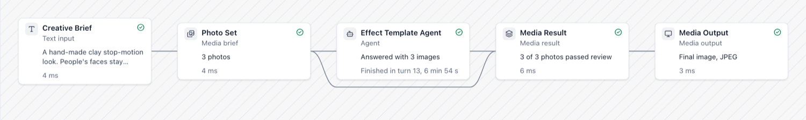</td>
</tr>
</tbody>
</table>

### Trace and Event Log

<table>
<thead><tr><th>Trace</th><th>Event log</th></tr></thead>
<tbody>
<tr>
<td>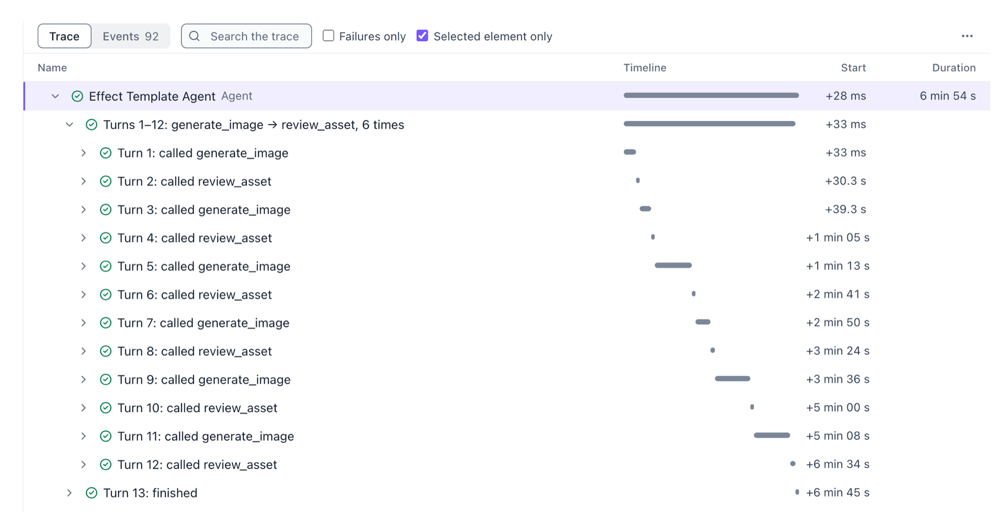</td>
<td>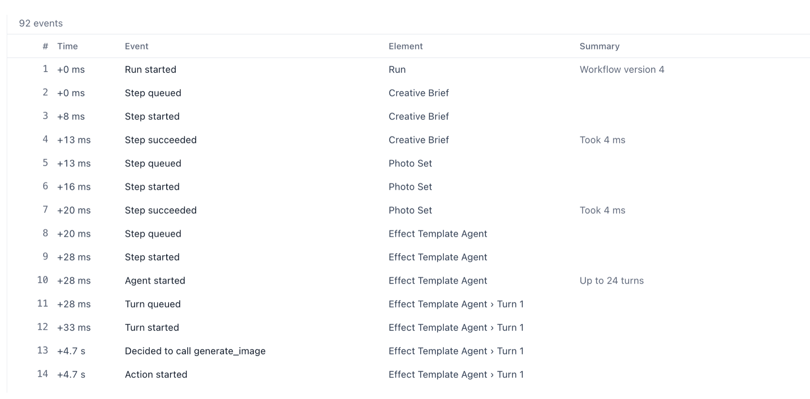</td>
</tr>
</tbody>
</table>

### What the Review Can Show

The review has three criteria: the subject is recognizable, the style matches the brief, and there are no deformities or obvious generation defects. It does not judge aesthetic appeal.

Run `35886fd1` was an earlier tuning run. Its brief asked only for a handmade clay stop-motion style, and its Prompt asked for visible fingerprints and tool marks. The first-round face was covered in wrinkle-like lines. The review model still passed it and cited those lines as evidence of clay texture. The run delivered, and only human inspection found the image unacceptable. The later brief therefore requires smooth faces. Run `916a0688` has a similar case: the glasses in the round 2 profile are rounder than in the source, and the review did not flag it.

Only conditions written in the brief enter the review. A model pass and human acceptance of quality are separate conclusions.

### Two Failed Runs

Runs `85715952` and `24879cdd` used the same Workflow and both failed in round 3, on turns 17 and 16. The decision model returned a tool call with empty arguments. The Runtime recorded the decision as `INVALID_ACTION` and ended the Run without asking the model again. Both failures kept the Trace of earlier turns. Recorded costs were about $1.19 and $1.14. The model response and cost of the failing turn were not saved. Replaying each position 6 times with the same context returned complete tool calls all 12 times, so the problem is intermittent. The reason the model returned empty arguments is still unknown.

## From Tuning Result to Service Template

The [template build script](../../../scripts/demo/build-v1.sh) reads the delivered settings from the completed tuning Run and saves them as a new version of the service Workflow. The Prompt goes into the Prompt template, and the resolution becomes the node width. The node has no aspect ratio setting, so the script lists it in its output. Through the task gateway the width is not passed to the image model, and the result is the model default of 2048×2048.

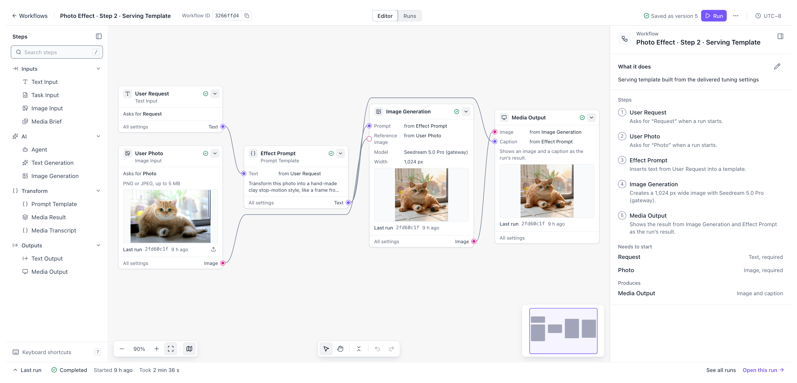

There is no release management product here. The [traffic split script](../../../scripts/demo/traffic-split.sh) chooses a version for new requests. It runs outside the Runtime and was not run for this record. The Runtime is responsible for binding each Run to its version at creation.

## Four Fault Drills in the Service

The service path calls a real model. The task gateway wraps the synchronous image API as an async task with a task ID, at $0.09 per image. Faults were created by manually force-stopping the Backend.

A real Provider cannot supply request records to compare one by one. The conclusions below rely on Emberling execution records, gateway logs and Provider-reported cost.

**Backend force-stopped after an external task was accepted.** Run `ba9128f2`. The Backend was force-stopped right after the task was sent. At 49 seconds the gateway started delivering the callback and failed. At 51 seconds the Backend restarted. It queried by the saved task ID and completed the original Attempt, with the completion source recorded as query. The gateway's retried callback then received 200 and produced no further execution events. The Run had one dispatch and one Attempt.

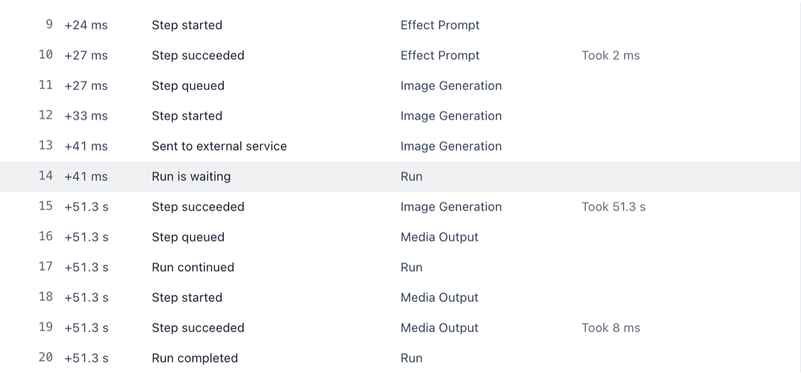

**Requests beyond the Provider concurrency limit.** Runs `7f0dadc8`, `9a072c75`, `9b8545a2`, `ea5f293e`, `dd6f730d` and `6b6ab4e0`. The Provider limit was 2, and 6 requests were submitted together. Two dispatched immediately, and 4 waited with a visible queue position. Across 505 samples taken every half second, peak usage was 2. All 6 Runs finished, 5 minutes 10 seconds from first dispatch to last completion. This drill did not inject a crash while the limit was full.

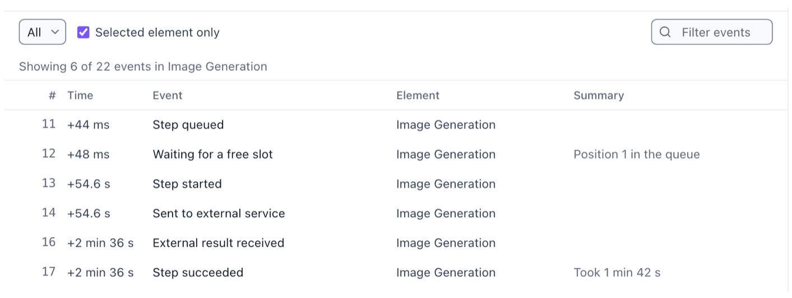

**Template updated while requests were in progress.** While `a8027814`, `c69e82f3` and `6b36c5a2` on version 4 waited for external results, version 5 was saved with a warm light requirement. `ac85d420`, `aac600c0` and `2fd60c1f` were then submitted. The first 3 finished on version 4, and the next 3 used version 5.

| Version 4 | Version 5 | Runs list |
|---|---|---|
| 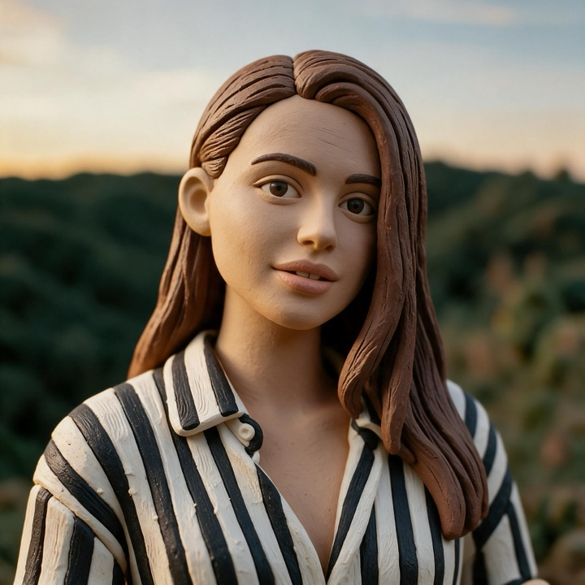 | 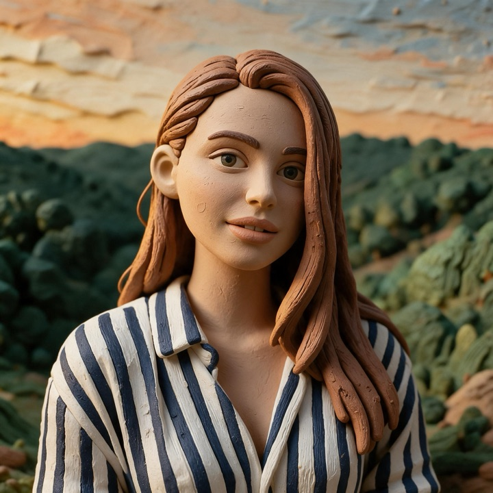 | 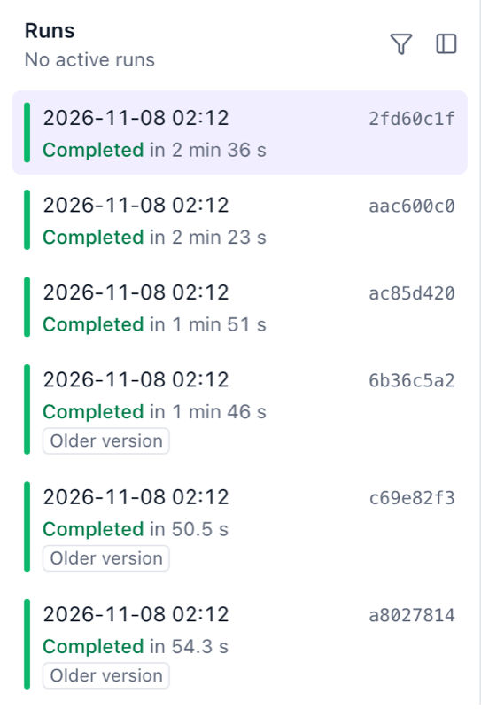 |

**Backend force-stopped during a synchronous call.** Run `22626e92`, on the tuning Workflow. The Backend was force-stopped about 20 seconds into the first generation call. After restart, the call was marked as unknown, was not resent, and counted against the generation allowance with no cost estimate. The Agent received this fact and regenerated the same photo. It finished two rounds, all 3 images passed, and it used 7 generations in total.

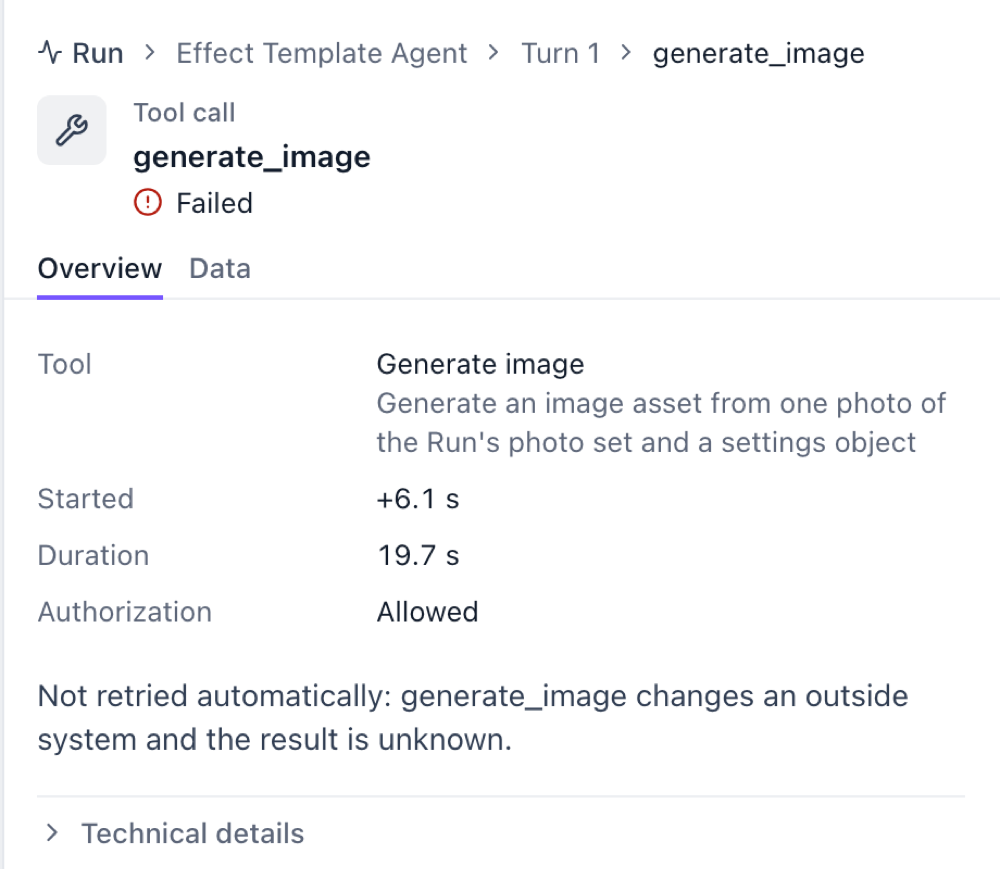

## Repeatable Verification

The real drills above depend on manual timing and cannot be repeated with one command. For precise fault injection, use the mock Provider demo set, which can compare Provider-side request records one by one. This is a separate verification from the real runs above.

```bash
EMBERLING_DEMO_VARIANT=serving make demo
```

- [Real model configuration and run guide](../../../scripts/demo/definitions/README.md)
- [Generation service evidence report script](../../../scripts/demo/evidence-report.sh)

Source photos are from Unsplash, by Štefan Štefančík, Nenad Novaković and Rick T.T., used under the Unsplash License.

[Execution foundation and trade-offs](../architecture.md) · [Back to real work](../../../README.md#demos)
