# 图片特效：从效果调优到持续服务

[返回 README](../../../README.zh-CN.md#demos) · [English](./photo-effects.md)

这份记录展开 README 中的图片特效章节。创作要求是手工黏土定格动画风，人物面部保持平滑。决策模型使用 Claude Opus 5.5，图像模型使用 Seedream 5.0 Pro，视觉审查使用 Claude Sonnet 5.5。下文的 Run 编号取前 8 位，可以在 Studio 中打开对应记录。

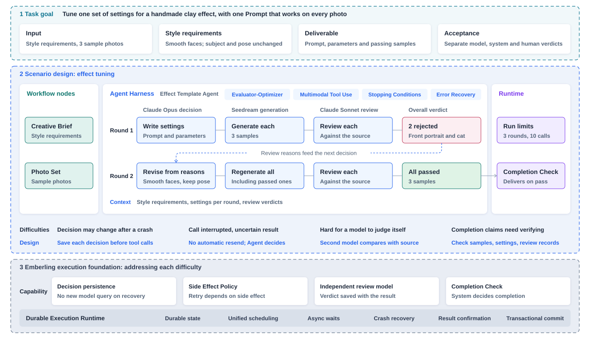

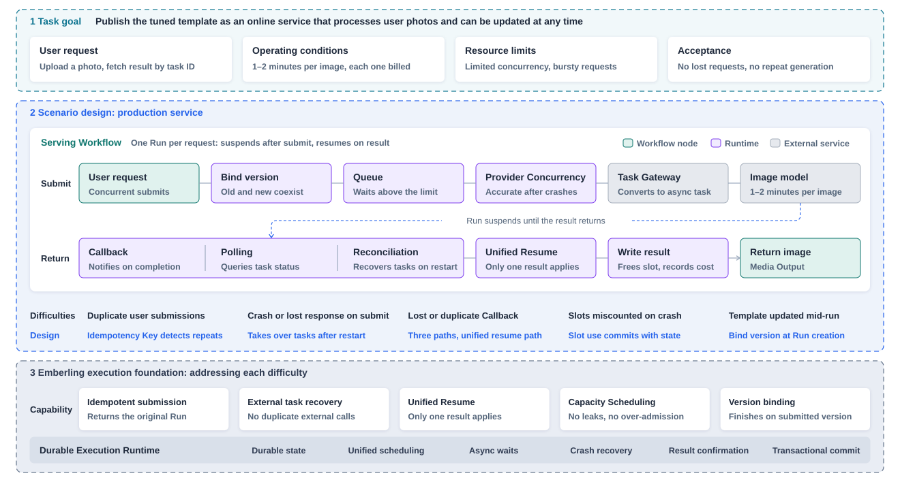

一次生成成功还不够。调优时，同一组设置要对所有照片成立，好坏要对照原图才能判断。进入服务后，每张图都要付费并等待一两分钟，Provider 的并发名额有限，等待期间 Backend 可能重启，外部任务可能已被受理，结果也可能不确定。模板还会继续更新，而更新时总有请求在途。

## 一次完整的调优

Run `916a0688`，两轮，13 个决策轮次，6 分 54 秒，92 条事件。

Claude Opus 5.5 做决策，Seedream 5.0 Pro 生成图片，Claude Sonnet 5.5 做视觉审查，最多 3 轮、10 次生成调用。

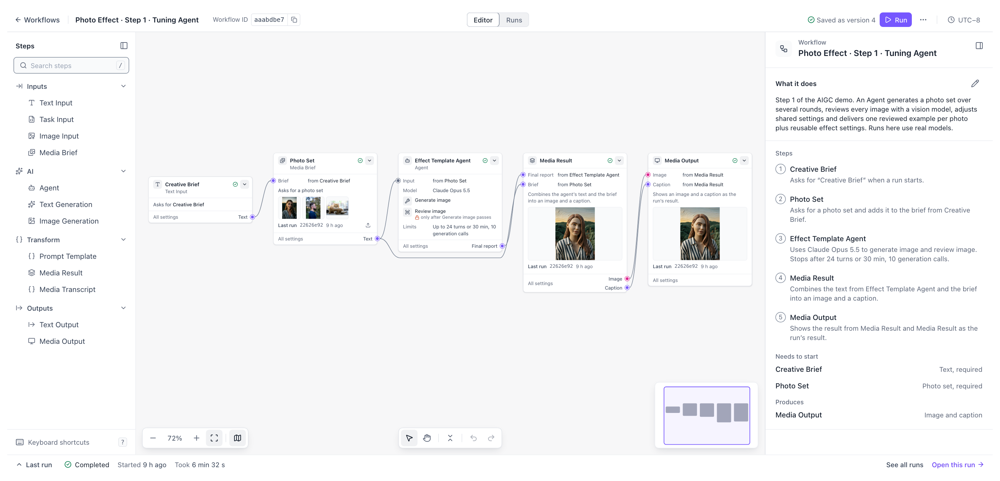

| 原图 | 第一轮 | 视觉审查 | 第二轮，实际交付 |
|---|---|---|---|
|  | 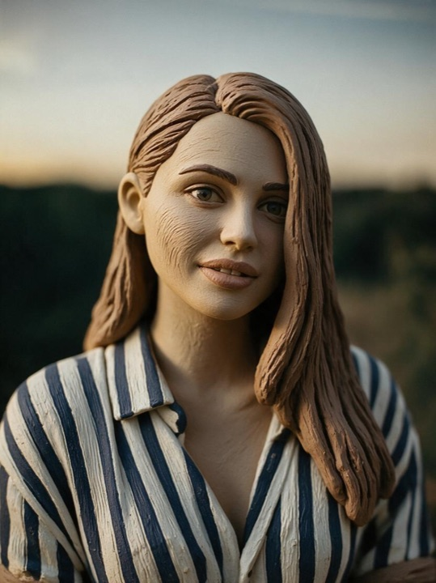 | 退回。脸颊有皱纹状的工具痕迹，背景仍是照片式虚化 | 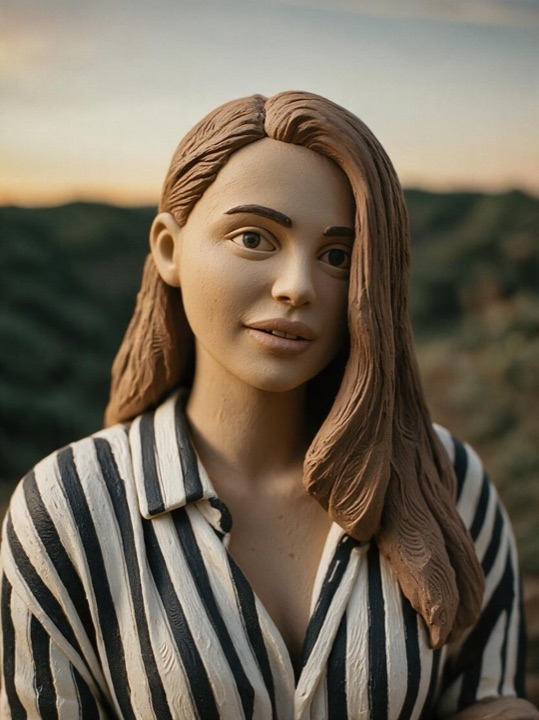 |
| 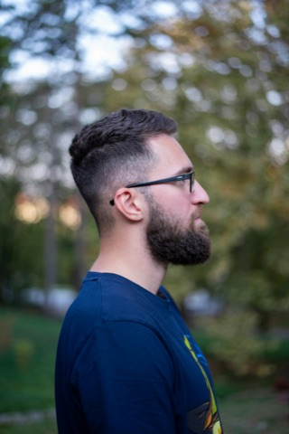 | 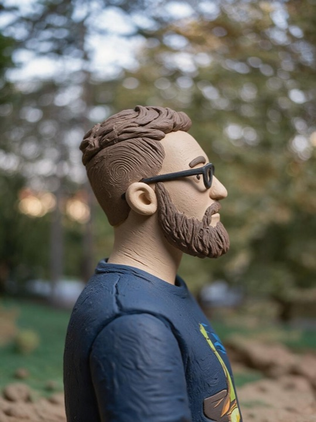 | 通过。侧脸、眼镜、胡须和衣服得到保留 | 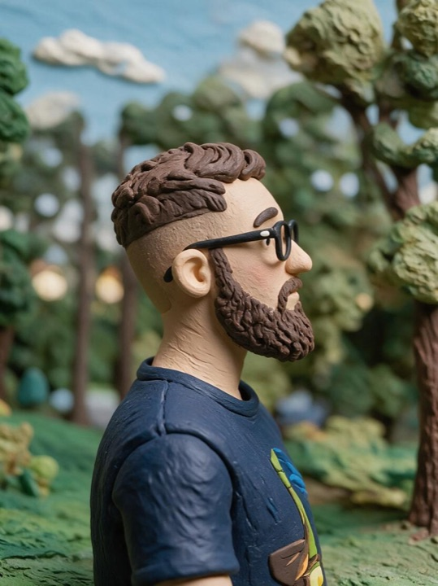 |
|  | 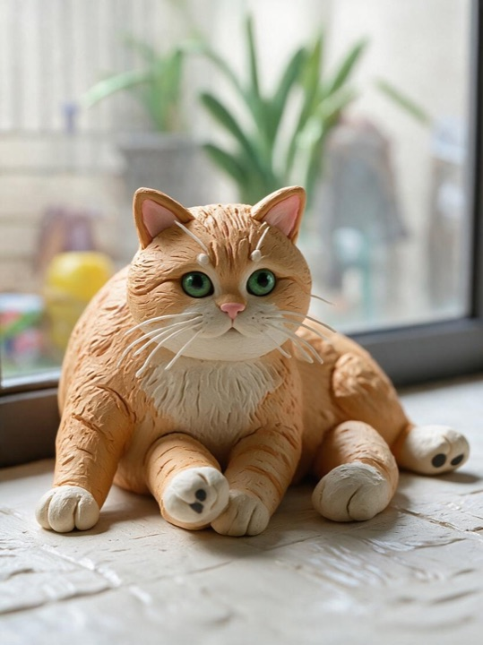 | 退回。四肢位置混乱，眼睛上方多出须状物，姿态和构图也变了 | 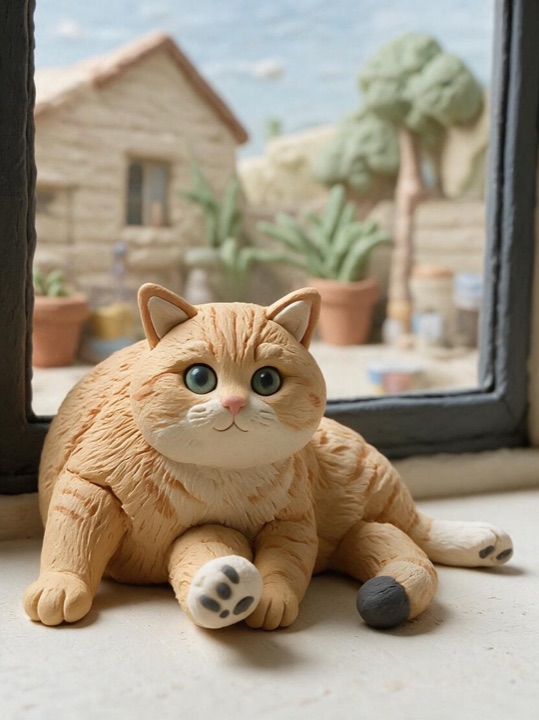 |

第一轮退回后，Agent 重写了提示词：面部不得出现皱纹和工具痕迹，手工痕迹只留在头发、毛发、衣物和背景，背景也要做成黏土质感，并要求保留原有姿态和构图。第二轮用同一组设置重新生成全部三张，审查全部通过，交付检查确认样例、设置摘要和审查记录相互对应。审查仍记下了一处次要问题：正面人像的背景是柔焦，黏土质感不明显。

这次运行的费用来自 Provider 的返回值，合计约 0.89 美元：决策 0.52 美元，6 次生成 0.27 美元，6 次审查 0.10 美元。

### 逐步记录

<table>
<thead><tr><th>时刻</th><th>Agent 或系统的行动</th><th>Emberling 的处理</th><th>Studio 中的记录</th></tr></thead>
<tbody>
<tr>
<td width="120"><strong>第一轮生成</strong></td>
<td width="190">Agent 写下一组设置，逐张生成并送审。单张生成耗时 21 秒到 1 分 23 秒</td>
<td width="210">先保存 Agent 的决定，再发起付费调用。每次调用的设置、耗时和费用单独记录</td>
<td>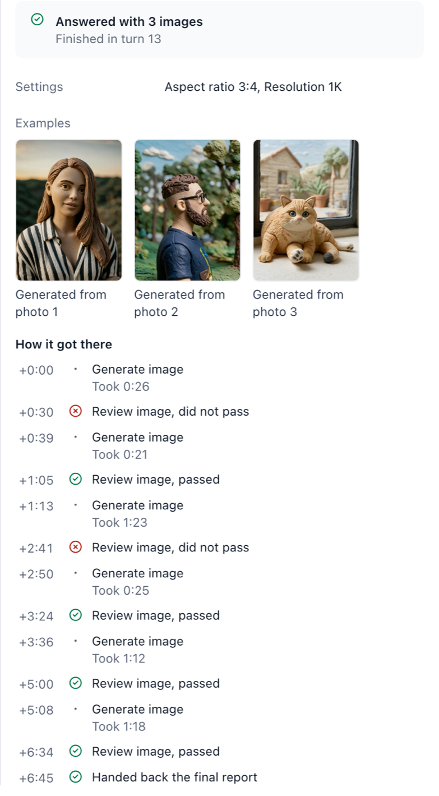</td>
</tr>
<tr>
<td><strong>审查退回</strong></td>
<td>审查模型对照原图逐张判断，退回正面人像和橘猫</td>
<td>结论和理由随结果保存，作为工具结果进入 Agent 的下一轮决策</td>
<td>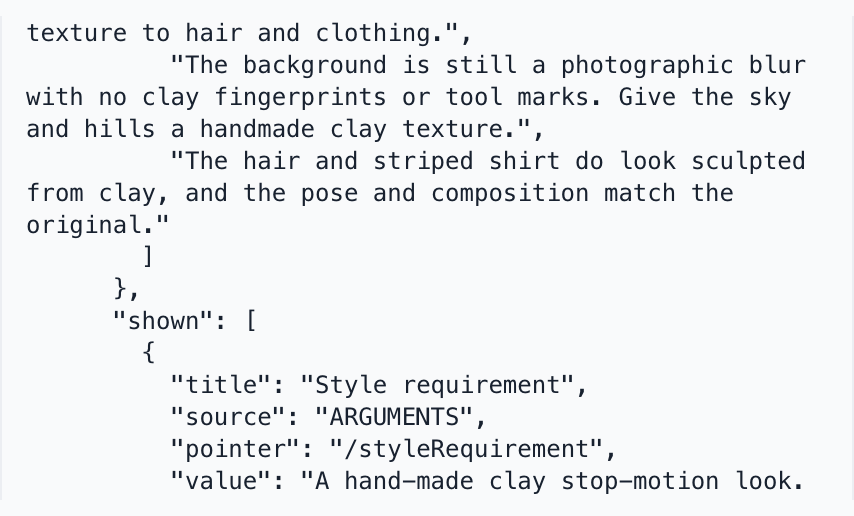</td>
</tr>
<tr>
<td><strong>改写设置</strong></td>
<td>Agent 按理由改写提示词，三张照片全部重新生成，已通过的侧脸也不例外</td>
<td>每张结果绑定所用设置的摘要，新旧两轮的结果不会混在一起</td>
<td>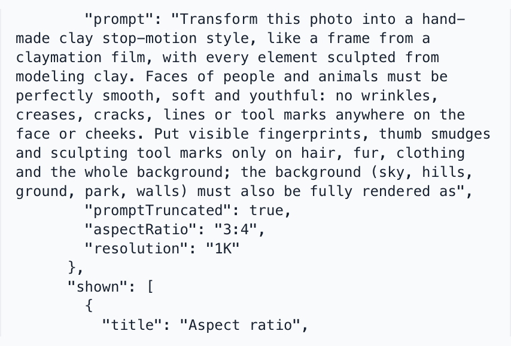</td>
</tr>
<tr>
<td><strong>判定交付</strong></td>
<td>Agent 声明交付第二轮的三张图和这组设置</td>
<td>核对样例、设置摘要和审查记录是否对应，未过审的旧样例不能交付。结果为 3 张全部通过</td>
<td>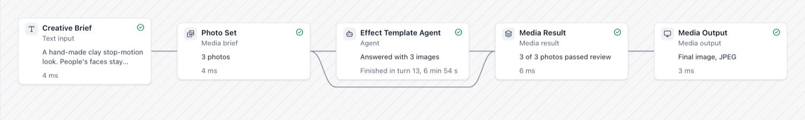</td>
</tr>
</tbody>
</table>

### Trace 与事件记录

<table>
<thead><tr><th>Trace</th><th>事件记录</th></tr></thead>
<tbody>
<tr>
<td>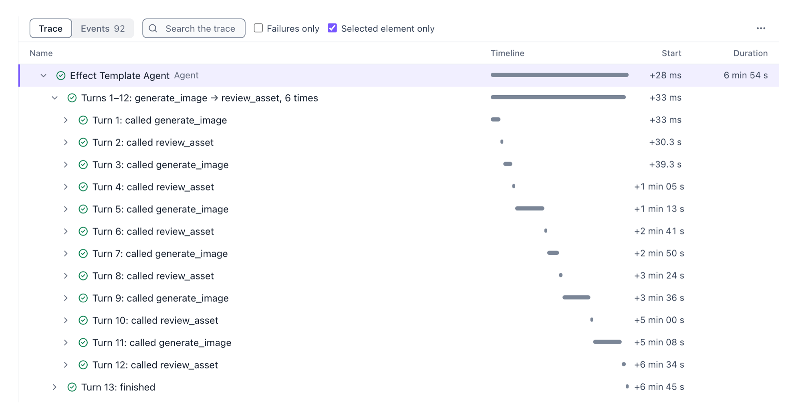</td>
<td>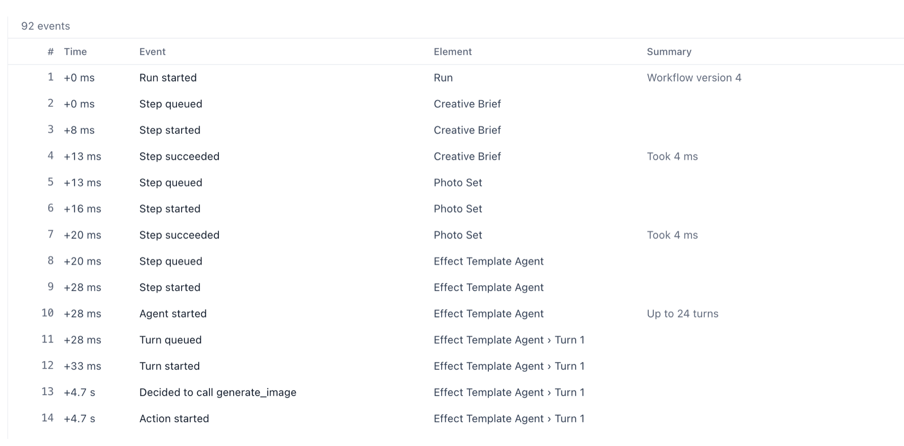</td>
</tr>
</tbody>
</table>

### 审查能说明什么

审查标准有三项：主体可辨认，符合风格要求，没有畸形和明显的生成瑕疵。它不评价观感。

Run `35886fd1` 是更早的一次调优，风格要求只写了手工黏土定格动画风，提示词要求可见的指纹和工具痕迹。第一轮的人物脸上布满皱纹状的纹路，审查模型仍判定通过，并把这些纹路当作黏土质感的依据。这次运行完成了交付，人工查看时才发现这张图不合格，后来的风格要求因此写明面部保持平滑。Run `916a0688` 也有类似的情况：第二轮侧脸的眼镜比原图更圆，审查没有指出。

因此，风格要求里写明的条件才会进入审查，模型审查通过与人工认可质量是两个结论。

### 两次失败的运行

Run `85715952` 和 `24879cdd` 使用同一个 Workflow，都在第三轮失败，分别停在第 17 轮和第 16 轮。决策模型返回了工具调用，但参数为空。Runtime 把这种决定记为 `INVALID_ACTION` 并结束 Run，不会重新询问模型。两次失败都保留了此前各轮的 Trace，已记录的费用分别约 1.19 美元和 1.14 美元，失败那一轮的模型响应和费用没有保存。用相同的上下文把这两个位置各重放 6 次，12 次都返回了完整的工具调用，因此这是偶发问题，模型为何返回空参数目前还没有查明。

## 从调优结果到服务模板

[模板构建脚本](../../../scripts/demo/build-v1.sh)从完成的调优 Run 读取交付设置，保存为服务 Workflow 的新版本。提示词写入提示词模板，分辨率换算为节点的宽度。节点没有画幅比例配置，脚本会在输出中列出这一项。经任务网关调用时宽度不会传给图像模型，结果是模型默认的 2048×2048。

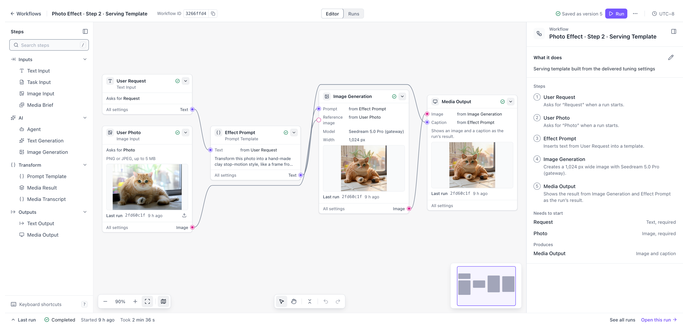

这里没有发布管理产品。[版本分流脚本](../../../scripts/demo/traffic-split.sh)为新请求选择版本，它运行在 Runtime 之外，本次记录没有运行它。Runtime 负责的是每个 Run 绑定创建时的版本。

## 服务中的四次故障演练

服务路径调用真实模型，任务网关把同步的图片接口包装成带任务编号的异步任务，每张图 0.09 美元。故障由人工强制停止 Backend 制造。

真实 Provider 无法提供可逐条核对的请求记录，下面的结论依据 Emberling 的执行记录、网关日志和 Provider 返回的费用。

**外部任务受理后，Backend 被强制停止。** Run `ba9128f2`。任务发出后立刻强制停止 Backend，第 49 秒网关开始投递回调并失败，第 51 秒重启。重启后 Backend 按保存的任务编号查询，完成了原来的 Attempt，完成来源记录为查询。随后网关重试的回调收到 200，但没有再产生执行事件。整个 Run 只有一次派发和一个 Attempt。

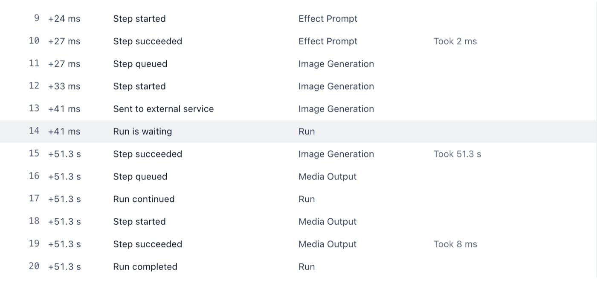

**请求超过 Provider 的并发名额。** Run `7f0dadc8`、`9a072c75`、`9b8545a2`、`ea5f293e`、`dd6f730d`、`6b6ab4e0`。Provider 名额设为 2，6 个请求同时提交，2 个立即派发，4 个进入等待并显示队列位置。每半秒采样一次，共 505 次，占用峰值为 2。6 个 Run 全部完成，从首次派发到最后完成共 5 分 10 秒。这次演练没有在名额占满时注入崩溃。

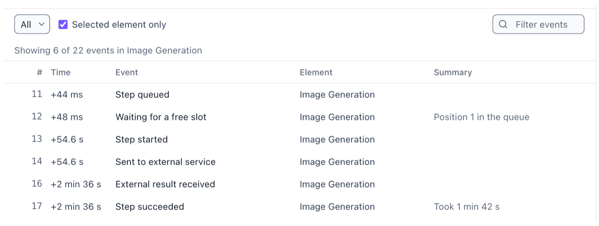

**模板在请求进行中更新。** 第 4 版的 `a8027814`、`c69e82f3`、`6b36c5a2` 都在等待外部结果时，保存了加入暖光要求的第 5 版，随后提交 `ac85d420`、`aac600c0`、`2fd60c1f`。前 3 个按第 4 版完成，后 3 个使用第 5 版。

| 第 4 版 | 第 5 版 | Runs 列表 |
|---|---|---|
| 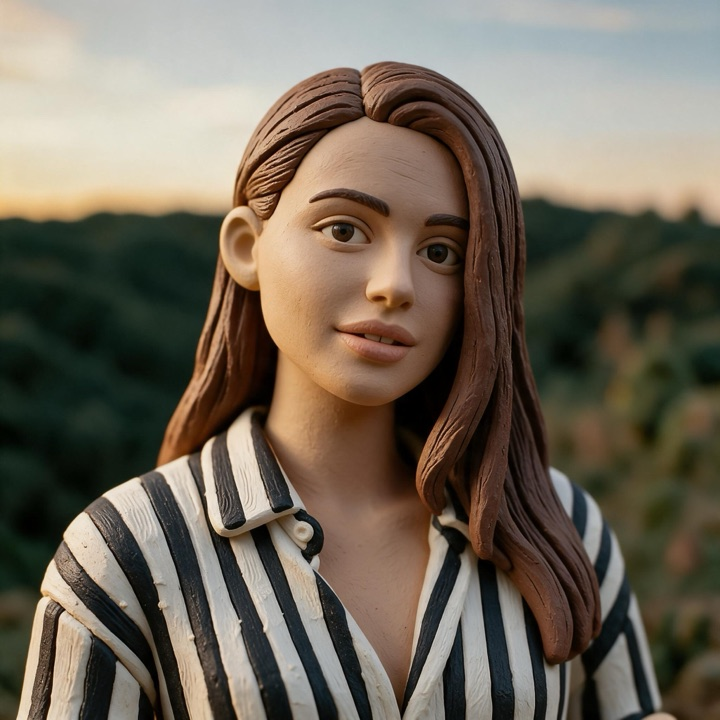 | 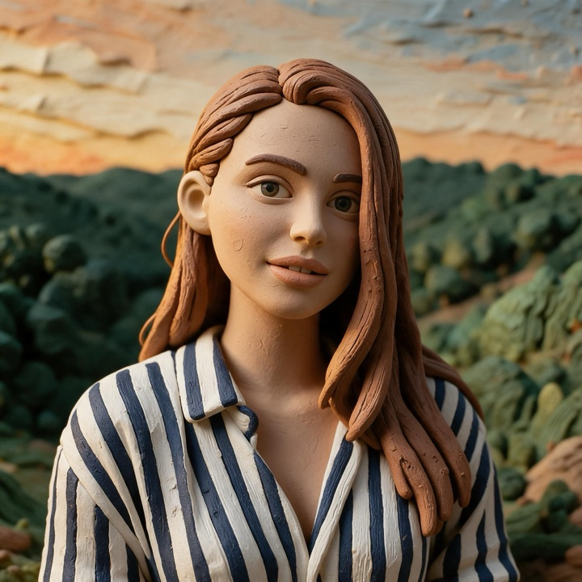 | 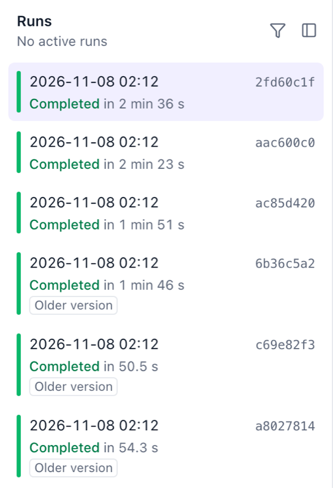 |

**同步调用进行中，Backend 被强制停止。** Run `22626e92`，走调优 Workflow。第一次生成调用进行约 20 秒时强制停止 Backend，重启后这次调用被标记为结果未知，不自动重发，并计入生成额度，费用不作估算。Agent 收到这一事实后重新生成同一张照片，继续完成了两轮调优，3 张全部通过，共使用 7 次生成额度。

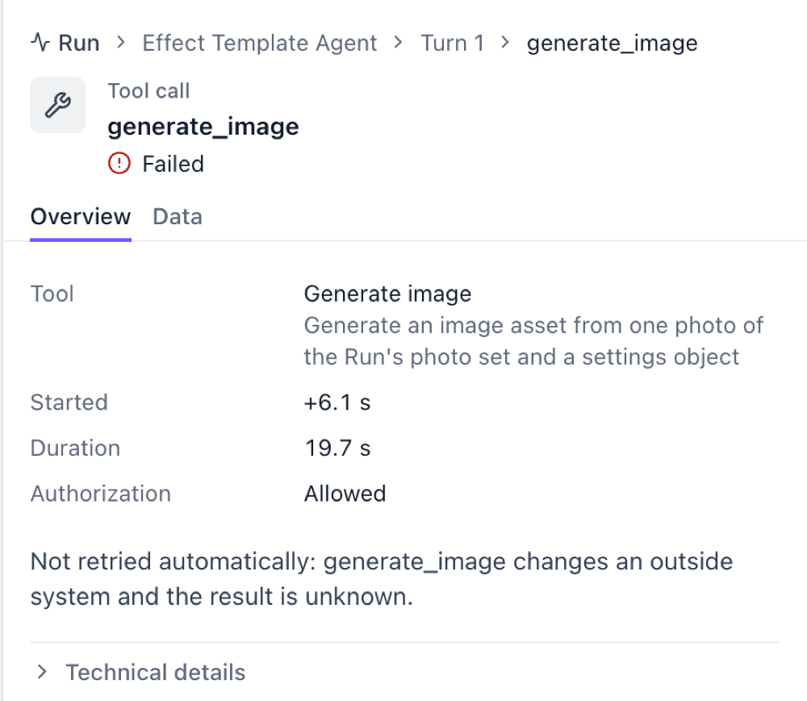

## 可重复的验证

上面的真实演练依靠手动时机，不能一键重复。需要精确注入故障时，使用模拟 Provider 的演示组，它能逐条核对 Provider 侧的请求记录。这是另一套验证，与上面的真实运行分开。

```bash
EMBERLING_DEMO_VARIANT=serving make demo
```

- [真实模型配置和运行指南](../../../scripts/demo/definitions/README.md)
- [生成服务证据报告脚本](../../../scripts/demo/evidence-report.sh)

原图来自 Unsplash，摄影署名 Štefan Štefančík、Nenad Novaković、Rick T.T.，按 Unsplash License 使用。

[执行基础与取舍](../architecture.zh-CN.md) · [返回实际工作](../../../README.zh-CN.md#demos)
