# Video Editing Agent: One Real Run End to End

[Back to README](../../../README.md#demos) · [简体中文](./video-editing.zh-CN.md)

This task cuts an interview of just over four minutes into a vertical clip. The brief: "Cut a 45-second clip that explains how she became a medical detective and what an epidemiologist actually does." The Agent uses Claude Opus 5.5 to select sentences and adjust the timeline. Checks and an independent content review provide the basis for revision. External media tools handle transcription, rendering and clip checks.

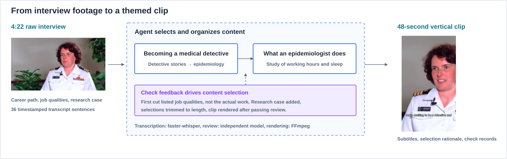

## Tools and Check Rules

| Participant | Work performed |
|---|---|
| Editing Agent · Claude Opus 5.5 | Reads the transcript, plans the clip and selects by sentence number. Revises from check and review feedback |
| faster-whisper | Transcribes source speech with word-level timestamps, then organizes it into readable sentence material |
| FFmpeg | Cuts and joins audio and video by timeline, crops to a fixed 9:16 window, scales to 1080×1920 and burns in subtitles |
| Independent content review model | Compares the brief, source transcript and selected sentences. Checks topic coverage and whether the original meaning is distorted |
| FFmpeg / ffprobe and rule checks | Check timeline, clip and subtitle data, and return results the Agent can act on |
| Emberling | Orchestrates Workflow and Agent. Saves committed decisions, tool calls, external tasks and artifact links, and continues after results return |

The Agent reads the transcript by range with `read_material`, submits timeline or clip checks with `run_checks`, starts content review with `review_artifact`, and starts rendering with `render_timeline`. Tools convert sentence numbers to exact cut points. The Agent does not write timecodes.

| Stage | Checks | Effect on the task |
|---|---|---|
| Timeline | Sentence references exist, segments do not overlap, cuts fall on sentence boundaries, and total length is within ±10% of the 45-second target | On failure, specific problems return and the Agent revises and checks again |
| Content review | Whether both parts of the brief are answered, and whether sentences change meaning out of context | On failure, the sentences and reasons return. The Agent revises, then checks and reviews again |
| Clip | Decodes fully with audio and video streams; 1080×1920; actual length within 0.5 seconds of the timeline; subtitle data covers selected sentences in the right time range; no black screen longer than 1 second | Delivery requires all blocking items to pass. Continuous silence over 2 seconds is a warning |

The subtitle check compares subtitle data with the transcript and timing. It does not replace human review of layout or appearance. The content review model reads text material and does not judge picture or sound directly.

**5 of 5 passed** in Studio refers to five delivery conditions: the Agent declared completion, the Agent declared a clip delivered, the named clip was rendered, the named clip passed its checks, and the matching timeline passed content review. It is not a count of technical video checks.

## Why the Two Timelines Differ

| Version | Selection | System verdict | Next action |
|---|---|---|---|
| First · 46.6 s | Sentences 1 and 3–9 cover her path into the field; sentences 24–26 cover required qualities | Timeline check passed. Content review failed: the clip does not say what an epidemiologist actually does, and sentences 24–26 cover qualities | Replace with an example from a study |
| Second · 47.6 s | Sentences 5–9, plus sentences 30–34 on a study of working hours and sleep | Timeline check and content review passed. Clip check passed after rendering | Deliver the video and result summary |

The second timeline is recorded as 47.640 seconds, and the rendered result as 47.681 seconds.

## Agent Action Sequence

| Turn | Action | Recorded result |
|---|---|---|
| 1 | Read transcript | 36 timed sentences |
| 2 | Check first timeline | Passed |
| 3 | Independent content review | Failed: actual work not explained |
| 4 | Check second timeline | Passed |
| 5 | Review second version | Passed |
| 6 | Render timeline | Vertical video generated |
| 7 | Check clip | Passed |
| 8 | Final delivery | Result, reasons and check evidence returned |

Both timelines passed technical checks in this run. Content review decided the direction of the revision. Technical and content results are recorded per timeline version, and first-version results do not count for the second.

## Stage-by-Stage Record

The Workflow for this run has three steps: transcription, Agent and delivery report. The Agent's tools, retry counts and run limits are declared on the node. Rendering can start only after checks pass.

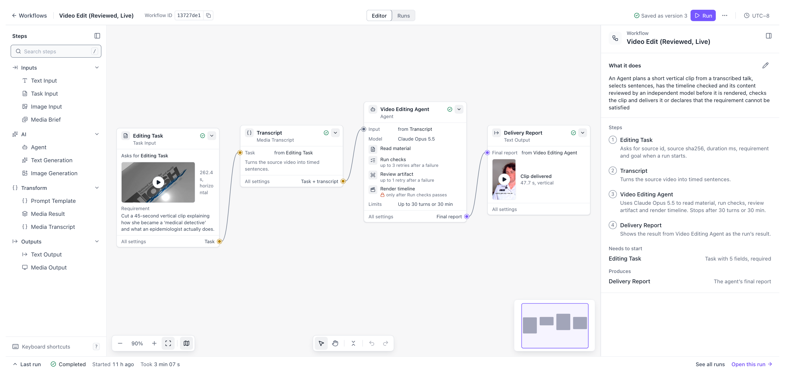

<table>
<thead><tr><th>Stage</th><th>Agent action</th><th>What Emberling does</th><th>Record in Studio</th></tr></thead>
<tbody>
<tr>
<td width="170"><strong>Transcribe source</strong>  </td>
<td width="170">Not started</td>
<td width="220">Dispatches the transcription task, saves the external task ID, and the Run enters a wait</td>
<td>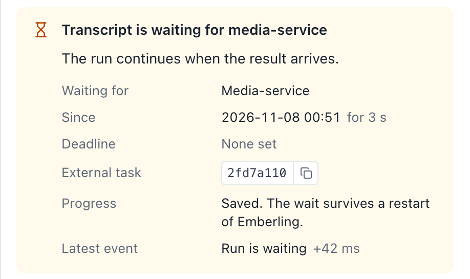</td>
</tr>
<tr>
<td width="170"><strong>Plan first cut</strong></td>
<td width="170">Reads 36 sentences, selects 1, 3–9 and 24–26, and submits a timeline check</td>
<td width="220">The transcript enters context by reference. The range and size read each turn are recorded</td>
<td>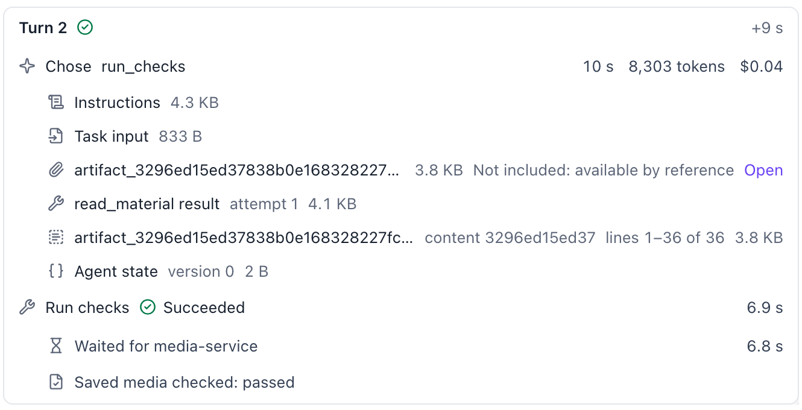</td>
</tr>
<tr>
<td width="170"><strong>First review</strong></td>
<td width="170">Selects her path into the field and required qualities, then starts content review</td>
<td width="220">Records the failed review and returns the problem to the Agent: sentences 24–26 cover qualities, not actual work</td>
<td>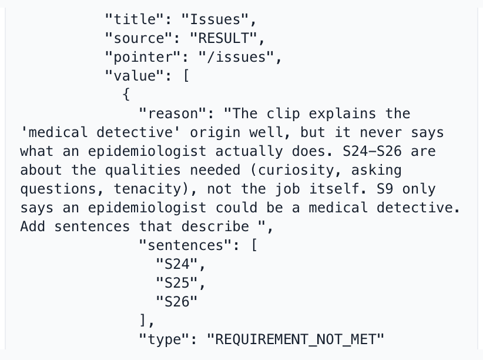</td>
</tr>
<tr>
<td width="170"><strong>Revise and re-review</strong></td>
<td width="170">Replaces them with a study of working hours and sleep, then checks and reviews again</td>
<td width="220">Records check and review results per timeline version. First-version results do not count for the new plan</td>
<td>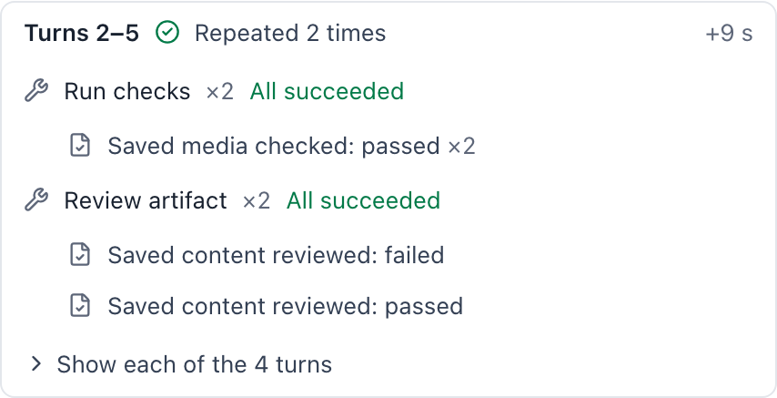</td>
</tr>
<tr>
<td width="170"><strong>Render clip</strong></td>
<td width="170">Starts rendering</td>
<td width="220">Confirms the timeline passed its checks, dispatches the task, and the Run waits again. The result returns after about two minutes</td>
<td>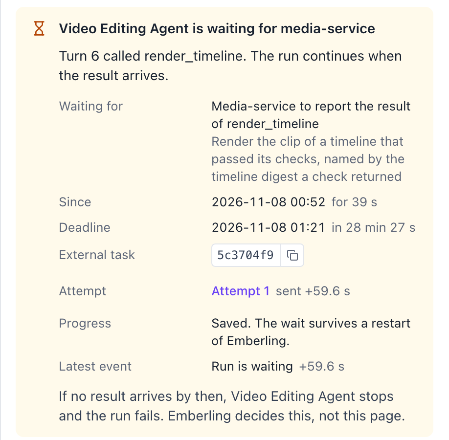</td>
</tr>
<tr>
<td width="170"><strong>Delivery check</strong>   <a href="../assets/screenshots/video-clip-63979dab.mp4">▶ Watch the clip with sound</a></td>
<td width="170">Declares delivery of this clip</td>
<td width="220">Checks 5 delivery conditions. The clip, checks and review records must match</td>
<td>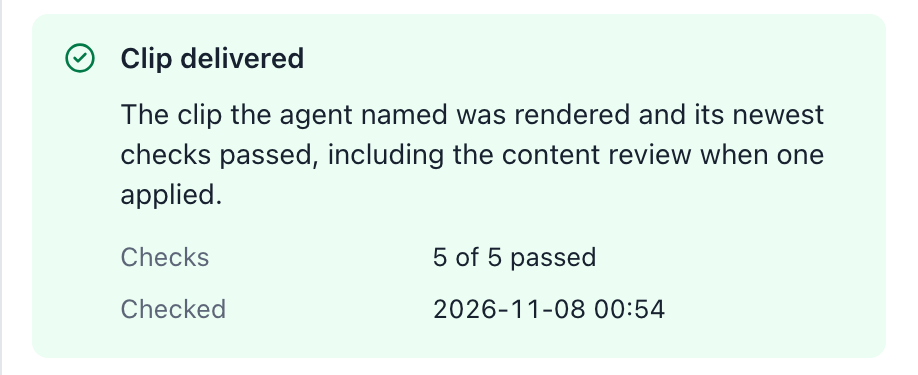</td>
</tr>
</tbody>
</table>

Passing checks means the specification is met and the selection does not distort the original meaning. Framing and appearance still need human judgment. Feedback during the task helps the Agent revise the current clip. System improvement comes from cross-task human review, Judge calibration and re-testing of changes.

## Trace and Event Log

Trace shows each decision, tool call and external wait by turn. The event log keeps this run's 74 state changes in commit order. The Agent's selection rationale is saved with the result and explains why the selection changed after the first rejection.

<table>
<thead><tr><th>Trace</th><th>Event log</th></tr></thead>
<tbody>
<tr>
<td>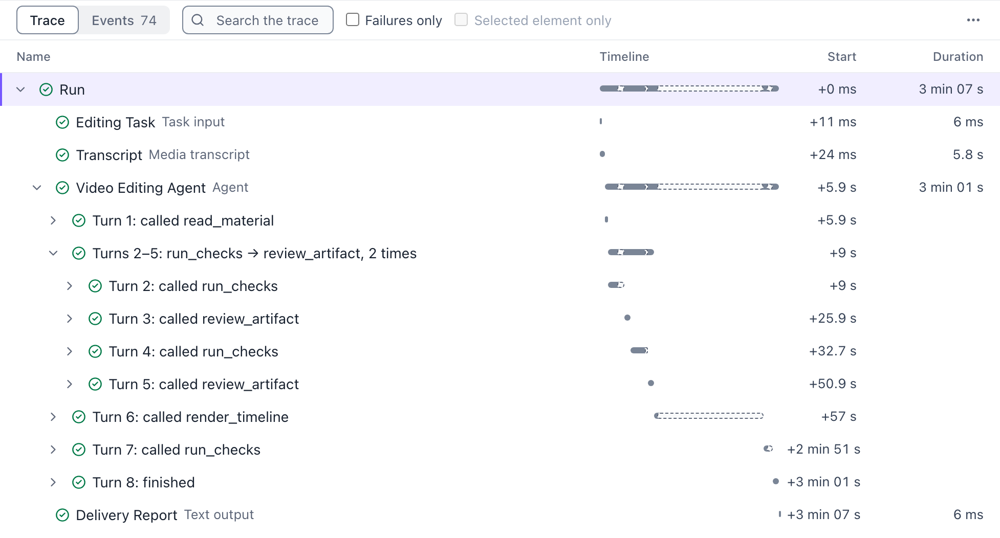</td>
<td>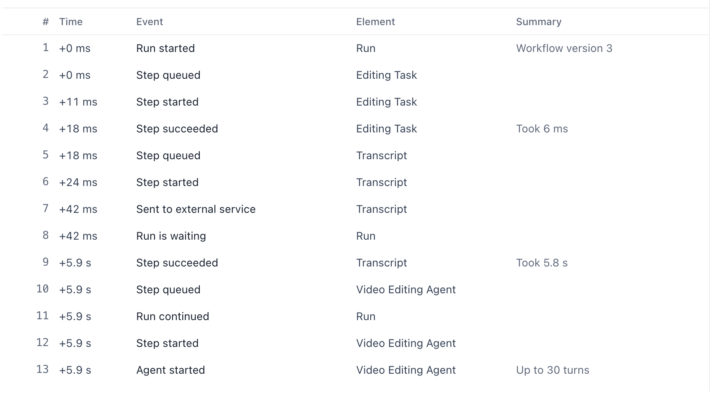</td>
</tr>
<tr>
<td colspan="2"><strong>Agent selection rationale</strong>  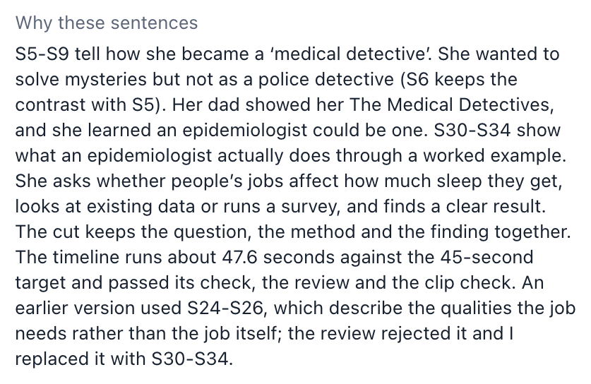</td>
</tr>
</tbody>
</table>

## Studio and Final Clip

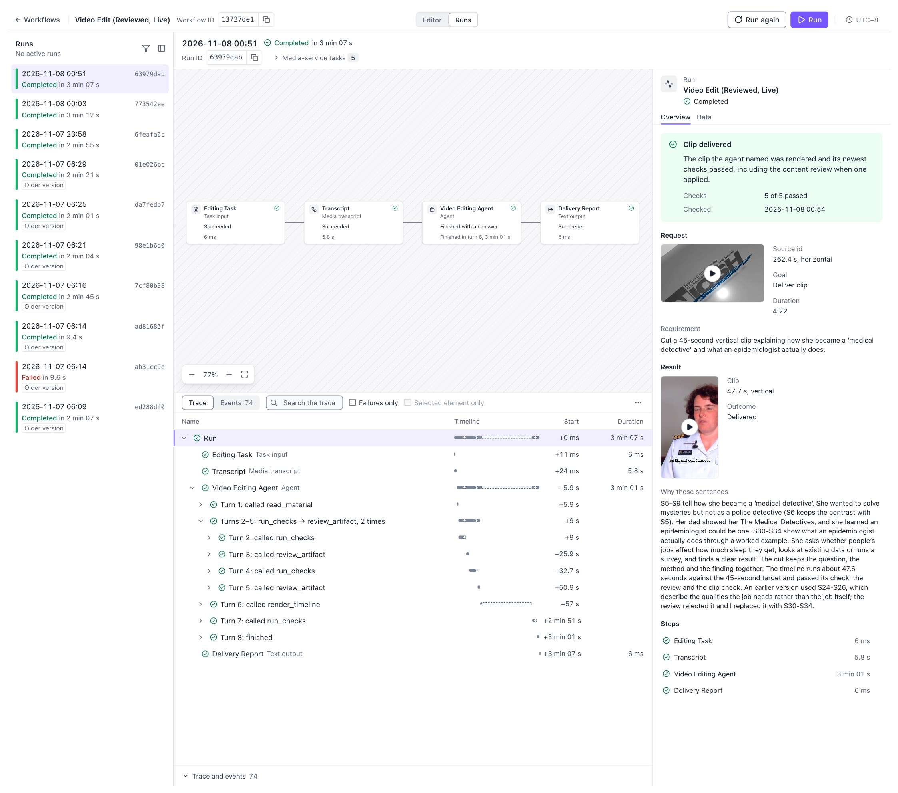

 <a href="../assets/screenshots/video-clip-63979dab.mp4">Watch the full 48-second clip · compressed preview with sound</a>

The Run for this record is `run_63979dab967642c587f5f7c79a503b6f`. The SHA-256 of the original clip is `d977d8ed40994378df228cce21d8da2a6d653cf577ab24abfdf328375575934d`. The video in the repository is a compressed preview.

Source footage: Science Speaks: Talking to Women in Science (Sara, Epidemiologist), published by NIOSH, Wikimedia Commons, public domain.

[How the foundation works](../architecture.md) · [Back to real work](../../../README.md#demos)
