# 视频剪辑 Agent：一次真实运行的完整过程

[返回 README](../../../README.zh-CN.md#demos) · [English](./video-editing.md)

这次任务把一段四分多钟的采访剪成竖屏短片。要求是：“剪一条 45 秒短片，讲清她如何成为医学侦探，以及流行病学家实际做什么。” Agent 使用 Claude Opus 5.5 选择句子和调整时间线，检查与独立内容审查给出修改依据，外部媒体工具完成转录、渲染和成片检查。

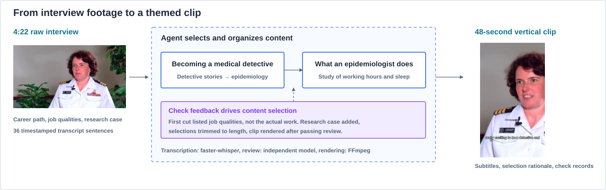

## 工具分工与检查规则

| 参与者 | 实际完成的工作 |
|---|---|
| 剪辑 Agent · Claude Opus 5.5 | 读取转录、制定短片计划、按句子编号选段；根据检查与审查反馈修改方案 |
| faster-whisper | 将原片语音转成带词级时间戳的转录，再按句子整理为可读取的素材 |
| FFmpeg | 按时间线剪切、拼接音视频，固定窗口裁成 9:16、缩放到 1080×1920，并烧录字幕 |
| 独立内容审查模型 | 对照创作要求、原始转录和入选句子，检查主题是否完整、原意是否被歪曲 |
| FFmpeg / ffprobe 与规则检查 | 检查时间线、成片和字幕数据，返回可供 Agent 继续决策的结果 |
| Emberling | 编排 Workflow 与 Agent，保存已提交决定、工具调用、外部任务及产物关联；接回结果后继续任务 |

Agent 通过 `read_material` 按范围读取转录，使用 `run_checks` 提交时间线或成片检查，使用 `review_artifact` 发起内容审查，使用 `render_timeline` 发起渲染。句子编号由工具换算为精确切点，Agent 不直接编写时间码。

| 阶段 | 检查内容 | 如何影响任务 |
|---|---|---|
| 时间线 | 句子引用存在、片段不重叠、切点位于句子边界；总时长在 45 秒目标的 ±10% 内 | 未通过时返回具体问题，Agent 修改后重新检查 |
| 内容审查 | 是否回应两个创作要求；句子脱离原始上下文后是否改变原意 | 未通过时返回涉及的句子和理由，修改后重新检查与审查 |
| 成片 | 完整解码并具有音视频流；1080×1920；实际时长与时间线相差不超过 0.5 秒；字幕数据覆盖入选句子并位于相应时间范围；无超过 1 秒的连续黑屏 | 阻断项通过后才可交付；超过 2 秒的连续静音作为警告 |

字幕检查核对的是字幕数据与转录、时间的关系，不等同于人工确认排版或观感。内容审查模型读取文字材料，不直接评判画面和声音。

Studio 的 **5 of 5 passed** 是五项交付条件：Agent 已声明完成、已声明交付短片、指定短片确已渲染、指定成片的检查通过、对应时间线的内容审查通过。它不是视频技术检查项的数量。

## 两版时间线为何不同

| 版本 | 选句 | 系统判断 | 后续行动 |
|---|---|---|---|
| 第一版 · 46.6 秒 | 第 1、3–9 句介绍入行经历，第 24–26 句介绍从业品质 | 时间线检查通过。内容审查未通过：短片没有说明流行病学家实际做什么，第 24–26 句讲的是所需品质 | 换成一项研究的例子 |
| 第二版 · 47.6 秒 | 第 5–9 句，加上第 30–34 句关于工作与睡眠时长的研究 | 时间线检查和内容审查通过；渲染后成片检查也通过 | 交付视频与结果说明 |

时间线的第二版记录为 47.640 秒，渲染结果记录为 47.681 秒。

## Agent 的行动顺序

| 轮次 | 行动 | 记录中的结果 |
|---|---|---|
| 1 | 读取转录稿 | 取得带时间的 36 个句子 |
| 2 | 检查第一版时间线 | 通过 |
| 3 | 独立内容审查 | 未通过，未讲清实际工作内容 |
| 4 | 检查第二版时间线 | 通过 |
| 5 | 审查第二版内容 | 通过 |
| 6 | 渲染时间线 | 生成竖屏视频 |
| 7 | 检查成片 | 通过 |
| 8 | 最终交付 | 返回结果、理由与检查依据 |

这次运行中，两版时间线都通过了技术检查，决定修改方向的是内容审查。技术检查和内容审查的结论按时间线版本分别记录，第一版的结论不计入第二版。

## 逐阶段记录

这次运行使用的 Workflow 由转录、Agent 和交付报告三步组成。Agent 可用的工具、失败后的重试次数和运行上限都在节点上声明，渲染只能在检查通过后发起。

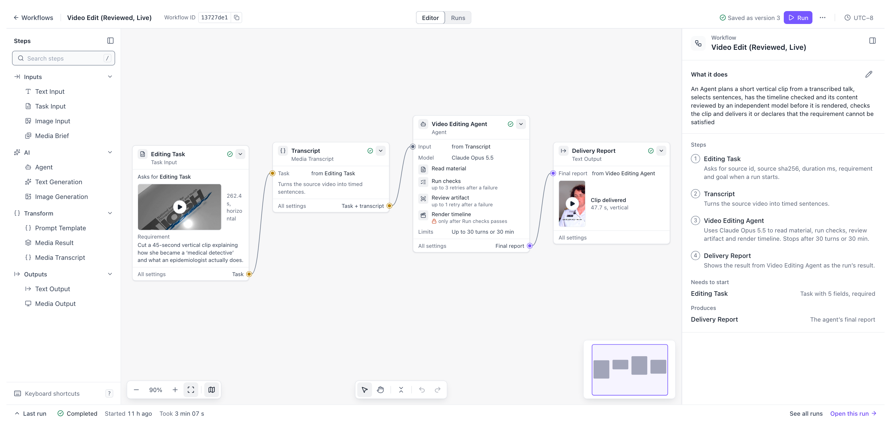

<table>
<thead><tr><th>阶段</th><th>Agent 的行动</th><th>Emberling 的处理</th><th>Studio 中的记录</th></tr></thead>
<tbody>
<tr>
<td width="170"><strong>转录原片</strong>  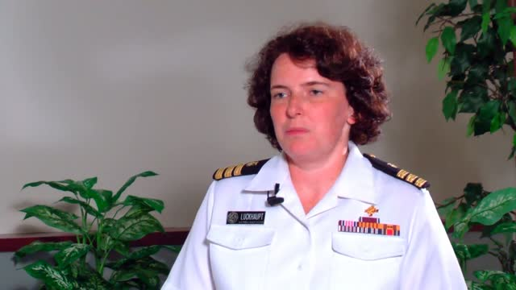</td>
<td width="170">尚未开始</td>
<td width="220">派发转录任务，保存外部任务编号，Run 进入等待</td>
<td>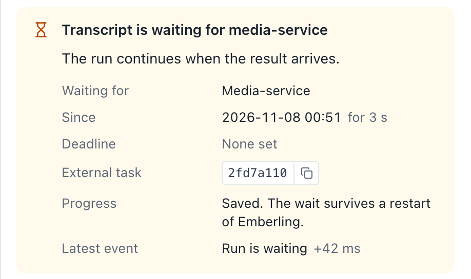</td>
</tr>
<tr>
<td width="170"><strong>规划首版</strong></td>
<td width="170">读取 36 句转录，选定第 1、3–9、24–26 句，提交时间线检查</td>
<td width="220">转录按引用进入上下文，每一轮读取的范围和内容大小都有记录</td>
<td>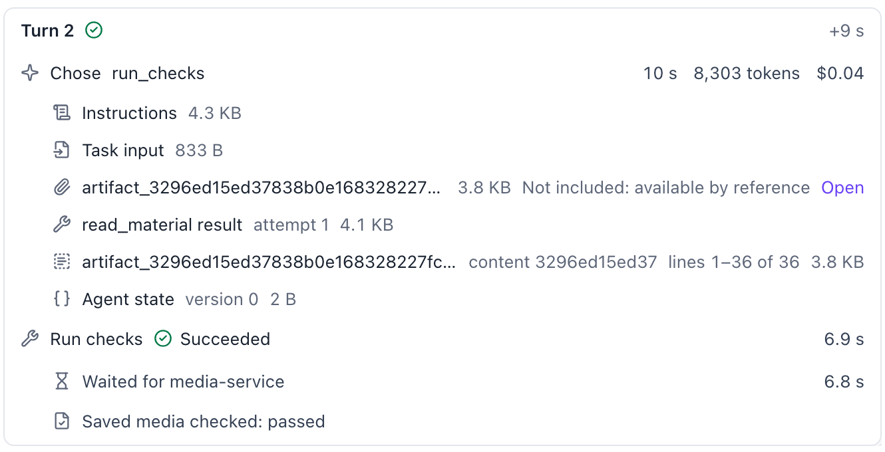</td>
</tr>
<tr>
<td width="170"><strong>第一版审查</strong></td>
<td width="170">选取入行经历和从业品质，发起内容审查</td>
<td width="220">记录审查未通过，把问题返回 Agent：第 24–26 句讲的是所需品质，并非实际工作</td>
<td>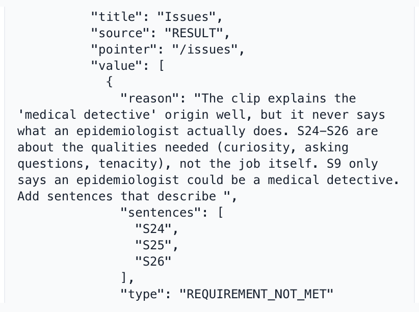</td>
</tr>
<tr>
<td width="170"><strong>修改与复审</strong></td>
<td width="170">换成一项关于工作与睡眠时长的研究，重新校验和审查</td>
<td width="220">校验和审查结论按时间线版本分别记录，第一版的结论不计入新方案</td>
<td>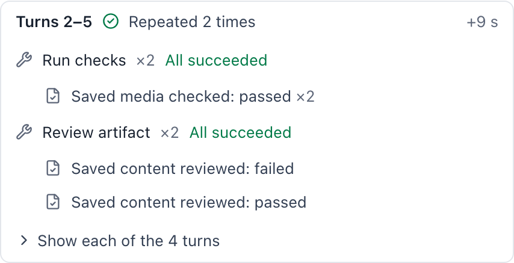</td>
</tr>
<tr>
<td width="170"><strong>渲染成片</strong></td>
<td width="170">发起渲染</td>
<td width="220">确认时间线已通过校验后派发任务，Run 再次等待，约两分钟后接回结果</td>
<td>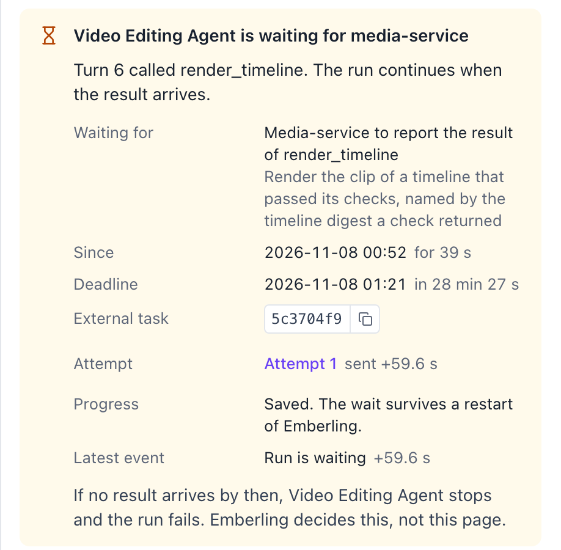</td>
</tr>
<tr>
<td width="170"><strong>判定交付</strong>   <a href="../assets/screenshots/video-clip-63979dab.mp4">▶ 观看成片 · 带声音</a></td>
<td width="170">声明交付这条短片</td>
<td width="220">核对 5 项交付条件，成片、校验和审查记录必须相互对应</td>
<td>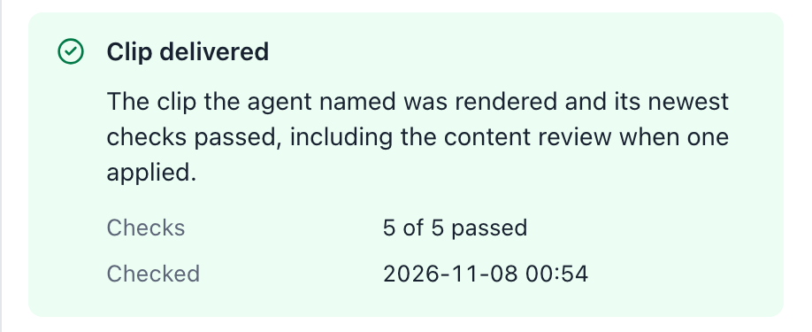</td>
</tr>
</tbody>
</table>

通过检查说明规格合格、选段没有歪曲原意，构图和观感仍需要人工判断。任务中的反馈帮助 Agent 修改当前短片，系统本身的改进则来自跨任务的人工评审、judge 校准和改动复验。

## Trace 与事件记录

Trace 按轮次展示每次决定、工具调用和外部等待，事件记录按提交顺序保存这次运行的 74 条状态变化。Agent 的选段理由随结果一起保存，其中说明了第一版被退回后为何更换选段。

<table>
<thead><tr><th>Trace</th><th>事件记录</th></tr></thead>
<tbody>
<tr>
<td>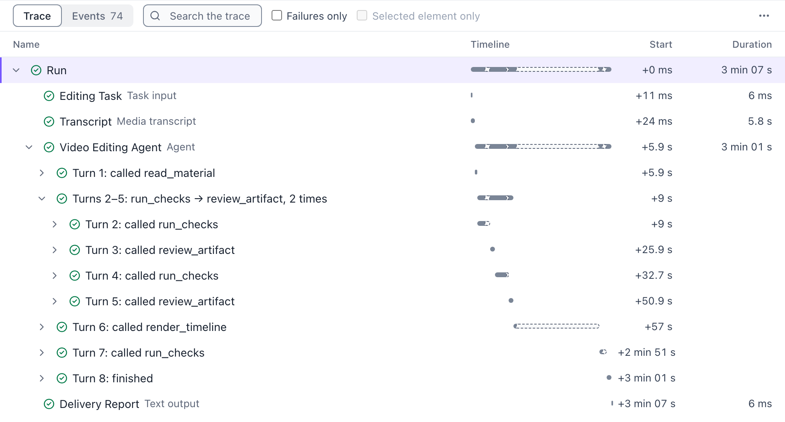</td>
<td>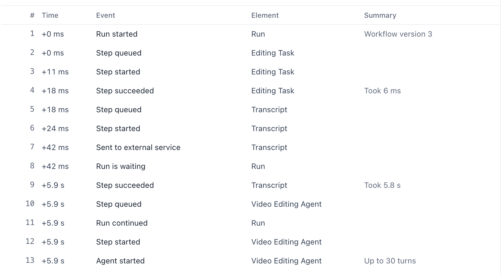</td>
</tr>
<tr>
<td colspan="2"><strong>Agent 的选段理由</strong>  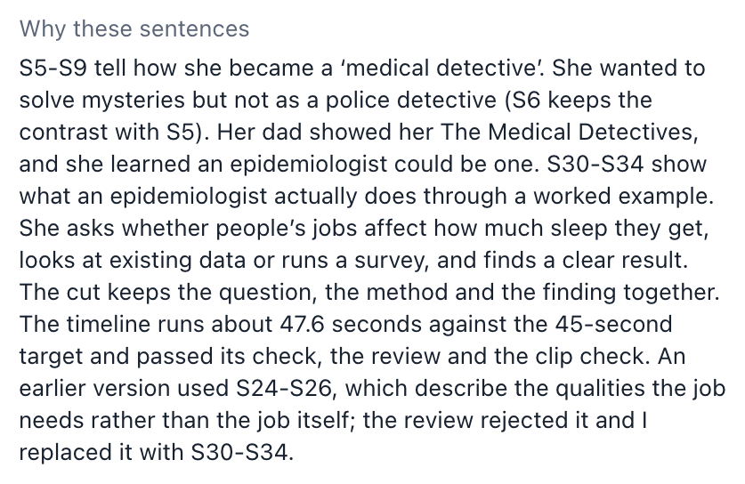</td>
</tr>
</tbody>
</table>

## 实机与成片

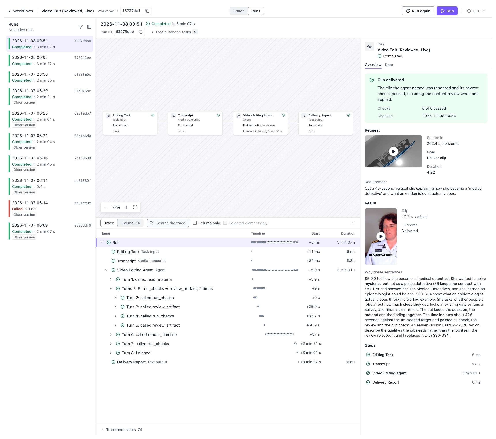

 <a href="../assets/screenshots/video-clip-63979dab.mp4">观看完整 48 秒成片 · 带声音的压缩预览</a>

这次运行的 Run 为 `run_63979dab967642c587f5f7c79a503b6f`。原始成片 SHA-256 为 `d977d8ed40994378df228cce21d8da2a6d653cf577ab24abfdf328375575934d`，仓库中的视频是它的压缩预览。

原素材：Science Speaks: Talking to Women in Science（Sara, Epidemiologist），发布方 NIOSH，Wikimedia Commons，公有领域。

[底座如何实现](../architecture.zh-CN.md) · [返回实际工作](../../../README.zh-CN.md#demos)
