# Vulnerability Repair and Release: Actions, Evidence and Outcomes

[Back to README](../../../README.md#demos) · [简体中文](./vuln-repair.zh-CN.md)

An Agent repairs a dependency vulnerability, verifies the patch, writes a change request, releases after approval and confirms the actual deployment. This record explains what two kinds of runs prove. One real model run shows that the main path works. Mock Agents and fault injection show that the constraints hold when something goes wrong. The production service is always a mock, and no real production release took place.

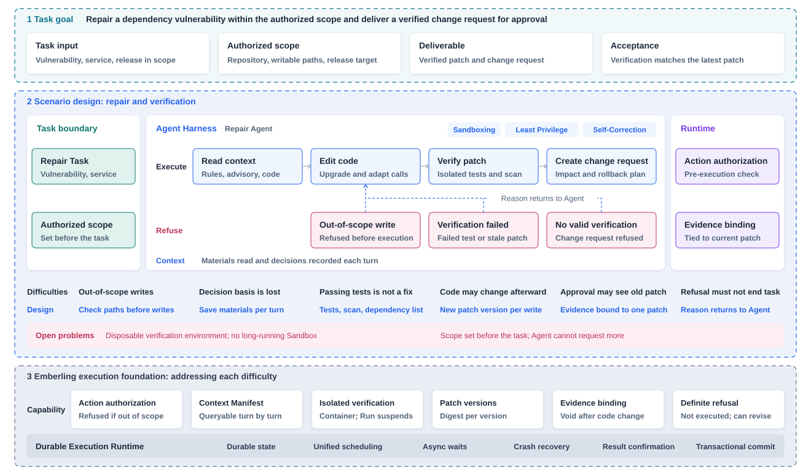

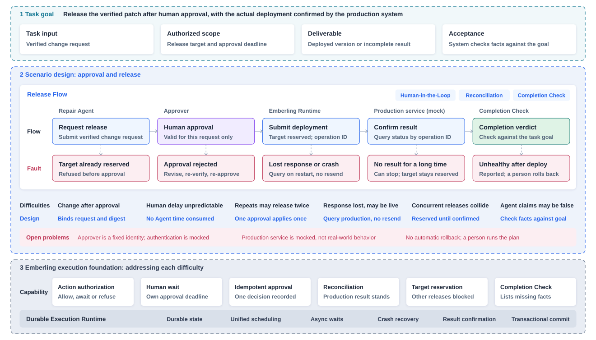

## Why It Is Designed This Way

Passing tests or an Agent's claim are not enough to approve a release. Tests only show that one copy of the code passed. The Agent may change files afterwards, and the approver may see an older version. Emberling ties the verification result, change request and release request to the same final patch. Once the code changes, earlier verification and approval are no longer valid. Preparing a change and executing a release carry different risks, so they are authorized separately. A change request is created directly after checks pass. A release must wait for human approval. Human response time is unpredictable, so this wait does not consume the Agent's execution time limit, and the approval has its own deadline.

The hardest case after a release request is no response. The deployment may already have happened. Resending would release twice, and marking it failed would ignore a change that took effect. Emberling queries the production service by operation ID and keeps the release target reserved until the result is confirmed, so no other release can enter. If the wait is too long, a person can stop waiting but cannot decide on behalf of the production service whether the release took effect. The target stays reserved until the production service gives a definite answer. Completion also does not depend on the Agent's claim. The system checks facts against the task goal and lists what is missing.

## Real Run

Run `ff426940`, 2026-11-03, model Claude Opus 5.5 through OpenRouter.

| Item | Record |
|---|---|
| Task | Repair dependency vulnerability GO-2025-3553 in `token-service`, with release in scope |
| Writable scope | `go.mod`, `internal/auth/` |
| Process | 11 turns in 1 minute 43 seconds; 2 writes, 1 passing verification, 1 change request, 1 release |
| Patch | Version 2, digest `28eefb92a4e3` |
| Dependency change | `golang-jwt/jwt` v3.2.2 upgraded to `jwt/v5` v5.3.1, with `token.go` rewritten for the new API |
| Verification | All 9 baseline tests passed; `govulncheck` found nothing; the dependency list has no vulnerable version |
| Release | `token-service/staging` on the mock production service, version v53, health check passed |
| Completion check | All 8 conditions passed, result deployed |

**What is real.** Model calls, code changes, tests and vulnerability scans are real. The verification log contains actual output from `git apply`, `go list`, `go test -json` and `govulncheck`. The mock verification backend does not produce this output.

**What is not.** The production service is a mock. A demo script submitted the approval with the fixed identity `demo-operator`, about 0.25 seconds after the request. No person reviewed it, and this run did not enter a human wait state. The Agent time limit did pause and extend, but approval and release paused it for only 3.82 seconds in total. The real model finished the code before its first verification, so there was no multi-round repair.

The Workflow for this run has three steps: task input, Agent and result report. The Agent's tools and run limits are declared on the node. Writable directories and the release target are set before the task starts and cannot change during execution.

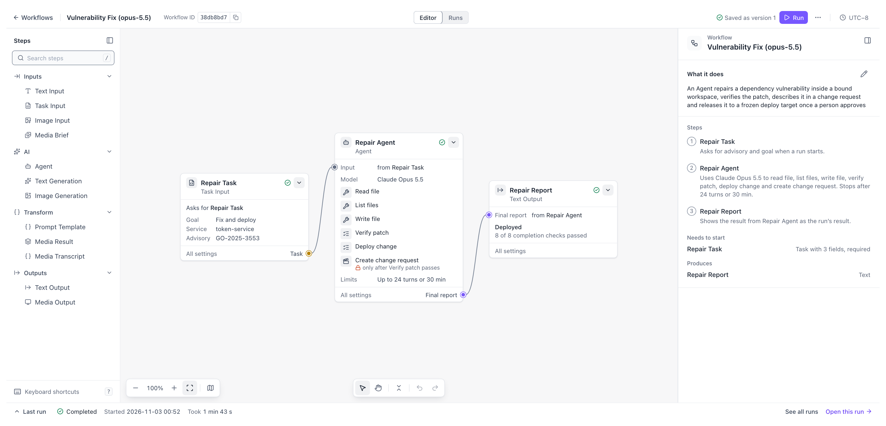

<table>
<thead><tr><th>Stage</th><th>Agent action</th><th>What Emberling does</th><th>Record in Studio</th></tr></thead>
<tbody>
<tr>
<td width="110"><strong>Read and change</strong></td>
<td width="190">Reads project rules, the advisory and existing code, rewrites <code>token.go</code> for the v5 API, then updates <code>go.mod</code></td>
<td width="220">Checks each write path before execution, allowing only <code>go.mod</code> and <code>internal/auth/</code>. Every write creates a patch version, and material read each turn is recorded</td>
<td>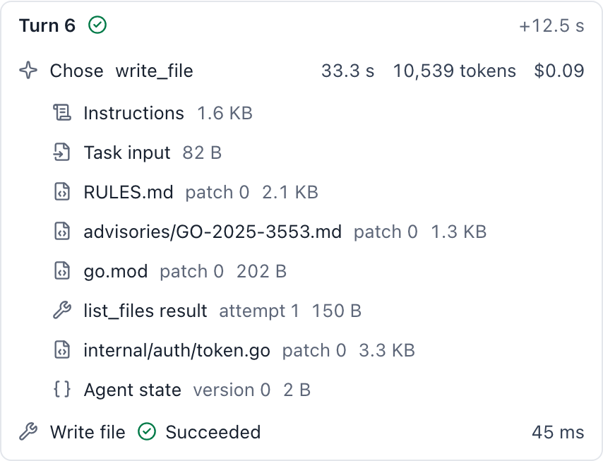</td>
</tr>
<tr>
<td width="110"><strong>Verify patch</strong></td>
<td width="190">Starts verification of patch version 2</td>
<td width="220">Runs all baseline tests in an isolated container, then the vulnerability scan and dependency check. The Run suspends meanwhile. The result is valid for this patch version only</td>
<td>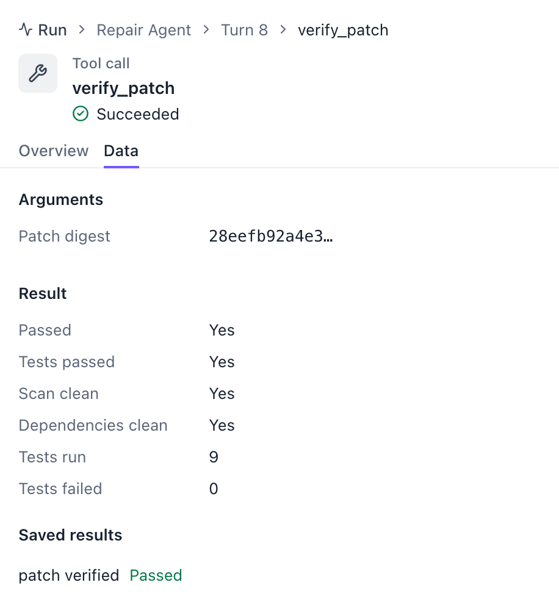</td>
</tr>
<tr>
<td width="110"><strong>Create change request</strong></td>
<td width="190">Writes the changes, impact, rollback plan and 4 decision bases</td>
<td width="220">Confirms the patch is the latest and verified, then allows it directly. The change request is bound to this patch version</td>
<td>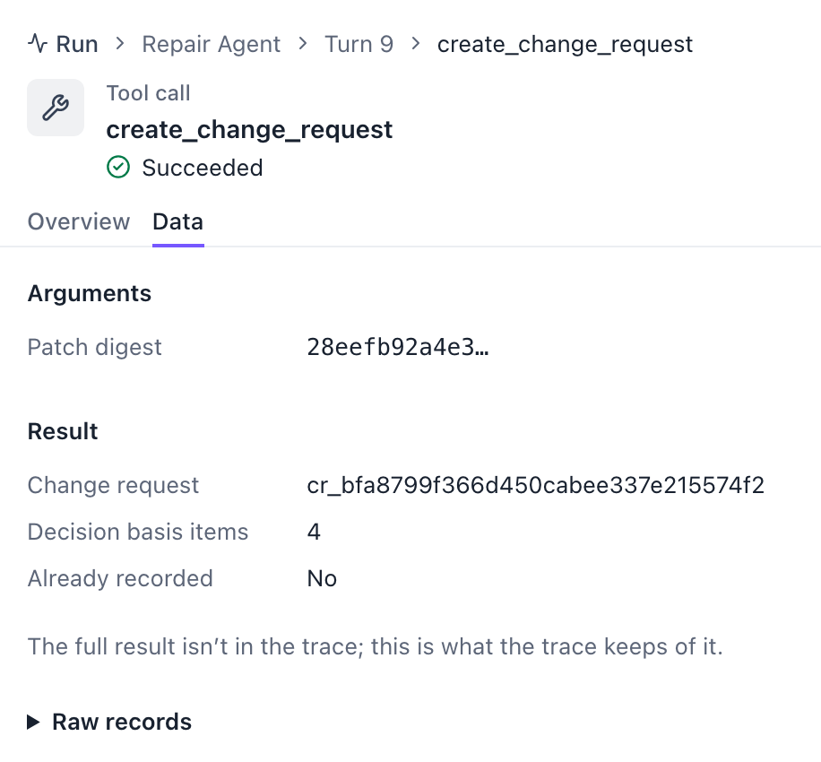</td>
</tr>
<tr>
<td width="110"><strong>Request release and approval</strong></td>
<td width="190">Requests release of this change request</td>
<td width="220">Release needs approval, so the Agent pauses. The approval is valid for this release request only. A demo script approved it with the fixed identity <code>demo-operator</code>, with no human review</td>
<td>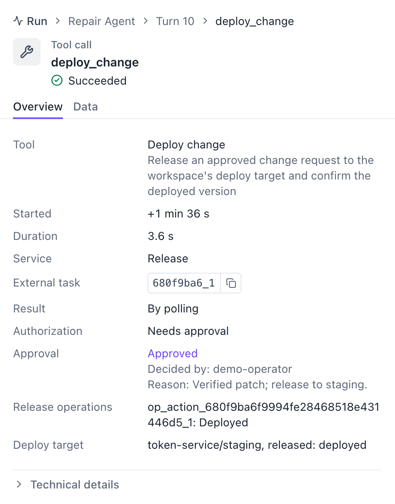</td>
</tr>
<tr>
<td width="110"><strong>Confirm deployment</strong></td>
<td width="190">Waits for the release result</td>
<td width="220">Reserves the release target after approval and queries the mock production service by operation ID. Releases the target once version v53 is deployed and healthy. The Agent time limit pauses during approval and release, and the deadline moves later</td>
<td>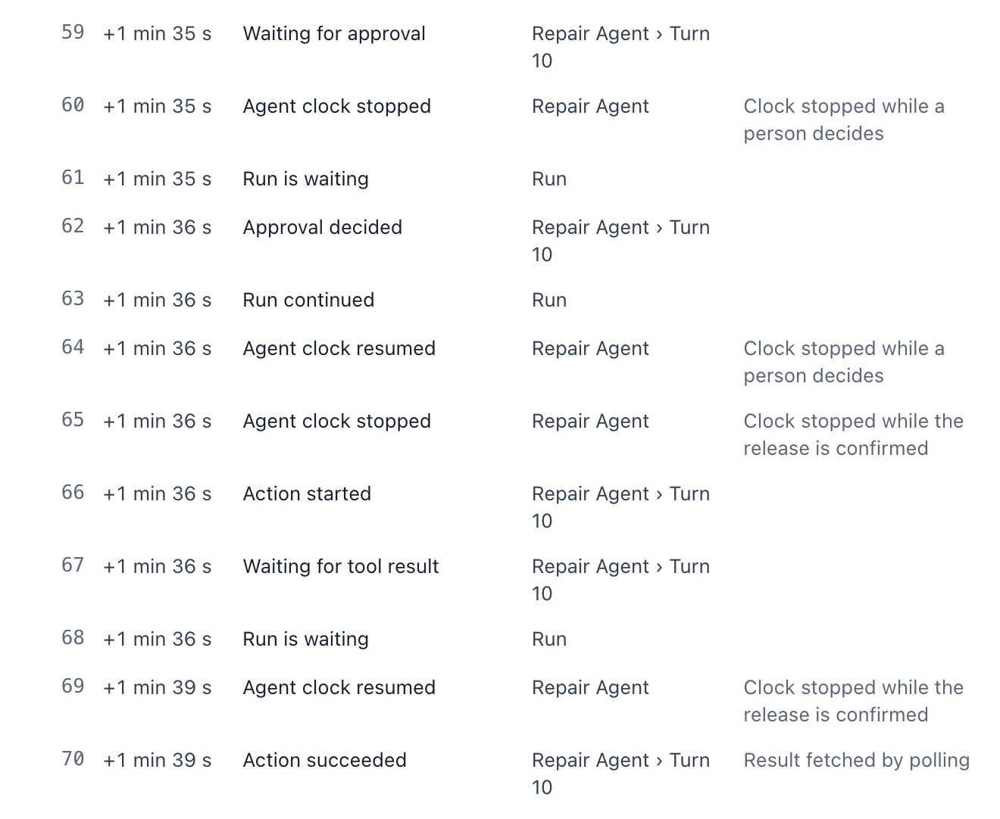</td>
</tr>
<tr>
<td width="110"><strong>Completion check</strong></td>
<td width="190">Submits the report and declares deployment</td>
<td width="220">Checks 8 conditions against the repair-and-release goal, including that the latest patch is verified, the change request and live version match it, the release is approved and the service is healthy</td>
<td>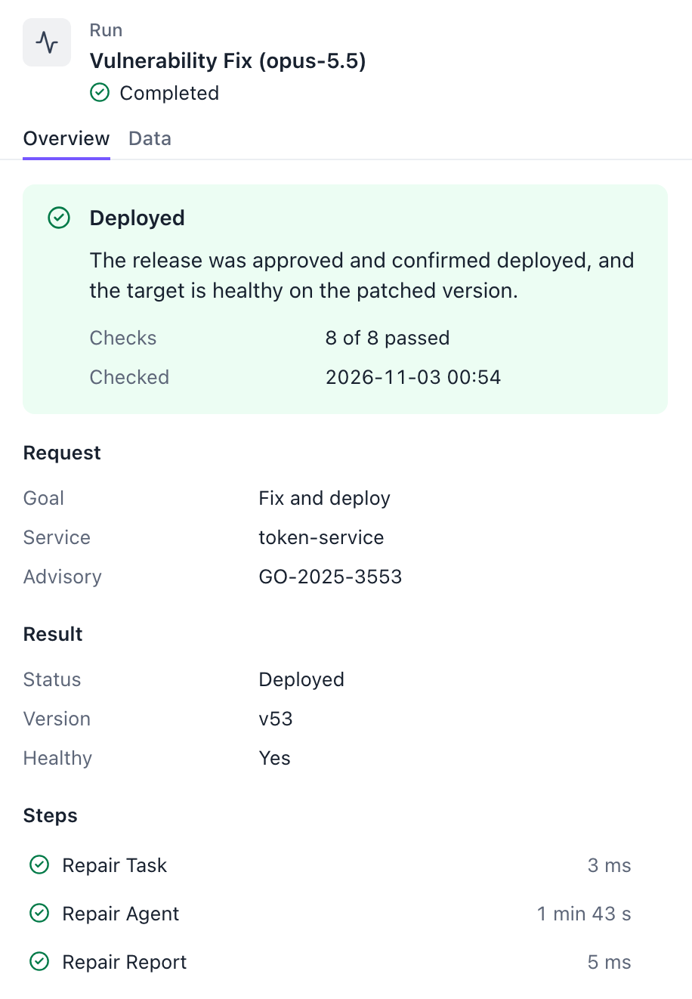</td>
</tr>
</tbody>
</table>

### Trace and Event Log

Trace shows the 11 turns of decisions, tool calls and external waits. Dashed segments are waits on verification and release. The event log keeps this run's 83 state changes in commit order. The "Confirm deployment" row above covers events 59 to 70.

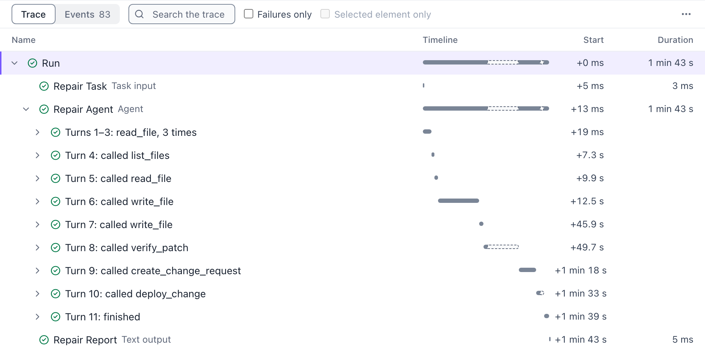

## Mock Agent Refusal Scenarios

The three runs below took place on 2026-11-08. Decisions are scripted and a mock backend provides verification. They check whether the system refuses before execution when an Agent oversteps.

| Run | Agent attempt | System behavior | Result |
|---|---|---|---|
| `e485ed7d` | Change `tests/auth_test.go` | Outside allowed paths, refused before execution | Returned to allowed paths; change request awaiting approval |
| `1202b83d` | Request verification with an old patch digest after a code change | Not the current patch, refused before execution; nothing sent to the verification service | Verified the current patch; change request awaiting approval |
| `5b981e68` | Attempt a release on a prepare-only task | Refused by the task goal; no approval created and the production service received no request | Change request awaiting approval |

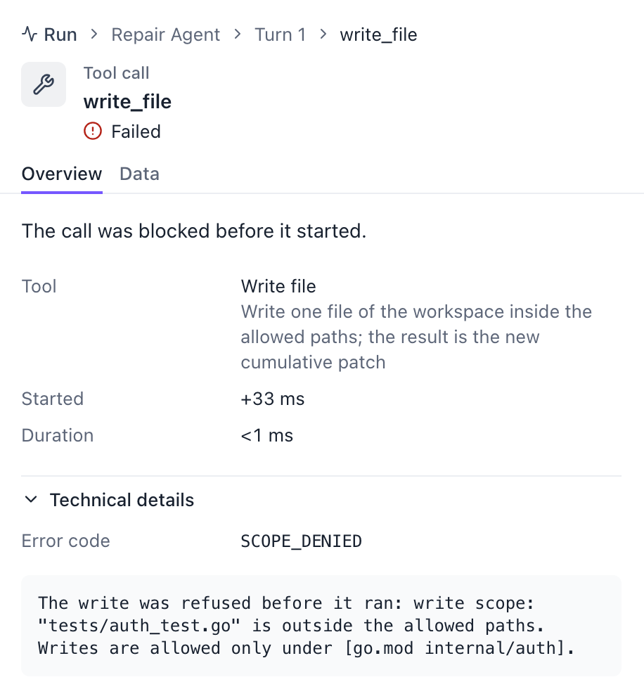

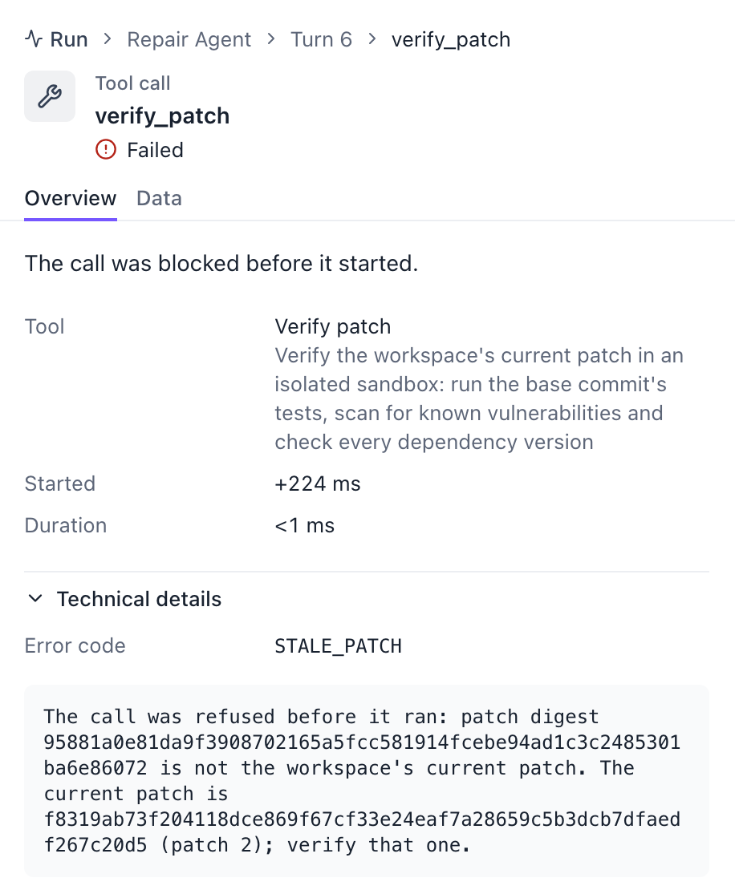

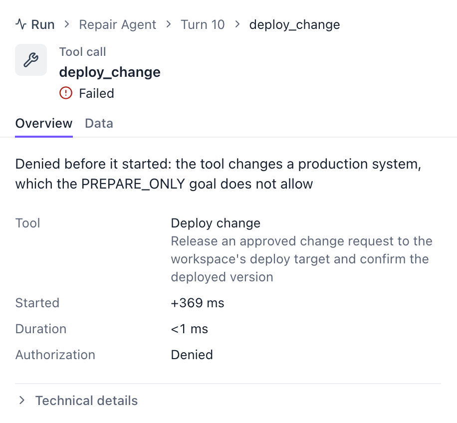

## Fault Scenarios

These scenarios come from a full demo on 2026-11-03, using mock Agents and fault injection across 18 variants. Emberling's records for each variant matched the independent records of the verification service and mock production service. These runs are no longer in the current demo database, so there are no screenshots or Run links.

| Variant | Situation | Result |
|---|---|---|
| `vuln-restart-during-approval` | Backend force-stopped while waiting for approval | Still waiting after restart, time limit stays paused, one release after approval |
| `vuln-duplicate-approval` | Same approval submitted twice | One takes effect and one deployment happens |
| `vuln-reject-resubmit` | Agent changes code and reapplies after rejection | New patch gets a new change request and release request, approved again |
| `vuln-release-crash-deployed` | Request accepted, response lost, then a crash | Query after restart confirms deployment, with no resend |
| `vuln-release-crash-voided` | Request abandoned and voided by the production service | Same approved request released again with a new operation ID, one deployment |
| `vuln-void-exhausted` | Operations repeatedly voided until release attempts run out | Definitely not deployed, target released, task incomplete |
| `vuln-target-occupied` | Another task requests release to a reserved target | Second request refused and does not enter approval |
| `vuln-release-refused` | Production service explicitly refuses the release | Target released, reason returned to the Agent, task incomplete |
| `vuln-unhealthy` | Deployment succeeds but health check fails | Reported as is, rollback left to a person |
| `vuln-release-unreachable-stop` | Production service unreachable and a person stops waiting | Ends with an unknown release result, target stays reserved until voiding is confirmed |
| `vuln-stop-then-deployed` | Production service deploys after a person stops waiting | Later reconciliation releases the target and records that this version went live unchecked |

Restart, duplicate approval and unknown release results depend on controlled fault timing. They reproduce reliably only in mock environments and do not represent real production behavior. The system does not promise cross-system exactly-once delivery and does not report throughput or latency.

## Current Boundaries

- The approver is a fixed identity and authentication is mocked. A full identity and permission system is out of scope.
- There is no automatic rollback. The rollback plan is in the change request, and a person carries it out.
- The verification container is created fresh and discarded after use. A long-running Sandbox is out of scope here.
- The authorized scope is set before the task starts. The Agent cannot request more.

## Reproduce

Mock variants need no model cost. See all `vuln-*` variants in the [Makefile](../../../Makefile). Variants with approval need `EMBERLING_OPERATOR_TOKEN` set to at least 32 bytes.

```sh
EMBERLING_DEMO_VARIANT=vuln-scope-denied make demo
EMBERLING_DEMO_VARIANT=vuln-stale-evidence make demo
EMBERLING_DEMO_VARIANT=vuln-prepare-only make demo
```

Real model runs incur cost. They need model environment variables and `EMBERLING_DEMO_RUNNER=docker` for the real verification container. Build the verification image with `deploy/sandboxrunner-verify/build.sh`.

The [report script](../../../scripts/demo/vuln-evidence-report.sh) cross-checks execution records, verification service records and mock release records.

[Architecture and design trade-offs](../architecture.md) · [Back to real work](../../../README.md#demos)
