# 漏洞修复与发布：行动、证据和发布结果

[返回 README](../../../README.zh-CN.md#demos) · [English](./vuln-repair.md)

Agent 修复一处依赖漏洞，验证补丁，写好变更请求，经批准后发布，并确认实际部署结果。这份记录说明两类运行分别能证明什么：一次真实模型运行证明主流程走得通，模拟 Agent 和故障注入证明约束在出错时仍然生效。生产服务始终是模拟的，这里没有任何真实生产发布。

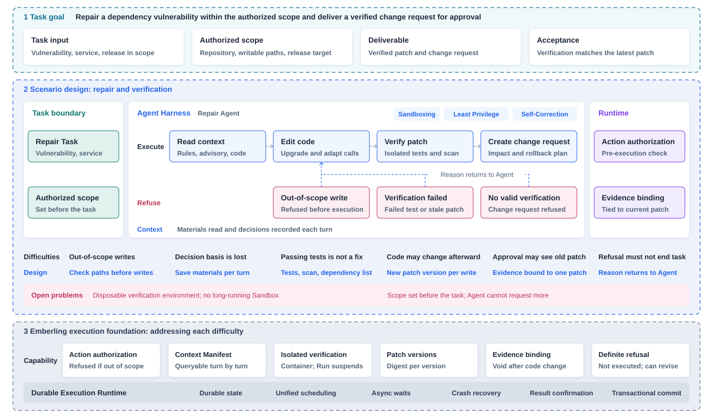

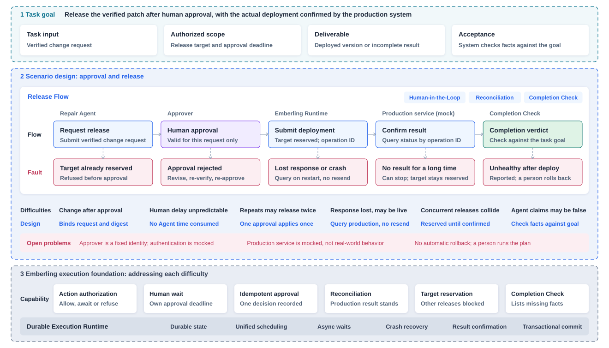

## 为什么这样设计

测试通过或 Agent 说修好了，都不足以放行一次发布。测试只说明某一份代码通过了检查，Agent 之后可能又改过文件，审批人看到的也可能不是最后那一版。Emberling 让验证结果、变更请求和发布请求对应同一份最终补丁，代码一旦变化，旧的验证和批准都不再有效。准备变更和执行发布的风险不同，授权也分开：变更请求在检查通过后直接创建，发布必须等人批准。人何时处理无法预估，这段等待不消耗 Agent 的执行时限，审批另有自己的期限。

发布请求发出之后，最难处理的是收不到回应的情况，此时部署可能已经发生，重发会造成重复发布，判为失败又会忽略已经生效的变更。Emberling 按操作编号向生产服务查询实际结果，结果确认之前一直占用发布目标，其他发布无法进入。等待过久时，人可以决定不再等待，但不能替生产服务认定发布是否生效，目标会继续保持占用，直到生产服务给出确定答复。任务是否完成同样不取决于 Agent 的声明，系统按任务目标逐项核对事实，并列出缺少的部分。

## 真实运行

Run `ff426940`，2026-11-03，模型 Claude Opus 5.5，经 OpenRouter 调用。

| 项目 | 记录 |
|---|---|
| 任务 | 修复 `token-service` 的依赖漏洞 GO-2025-3553，目标包含发布 |
| 可修改范围 | `go.mod`、`internal/auth/` |
| 过程 | 11 轮，耗时 1 分 43 秒；2 次写入，1 次验证通过，1 份变更请求，1 次发布 |
| 补丁 | 第 2 版，摘要 `28eefb92a4e3` |
| 依赖变化 | `golang-jwt/jwt` v3.2.2 升级到 `jwt/v5` v5.3.1，`token.go` 按新接口改写 |
| 验证 | 基线提交的 9 个测试全部通过；`govulncheck` 无发现；依赖清单不含漏洞版本 |
| 发布 | 模拟生产服务的 `token-service/staging`，版本 v53，健康检查通过 |
| 完成判定 | 8 项条件全部通过，结果为已部署 |

**哪些是真实的。** 模型调用、代码修改、测试和漏洞扫描是真实的。验证日志中有 `git apply`、`go list`、`go test -json` 和 `govulncheck` 的实际输出，模拟验证后端不会产生这些内容。

**哪些不是。** 生产服务是模拟的。批准由演示脚本以固定身份 `demo-operator` 提交，从提出请求到批准约 0.25 秒，没有真人审阅，这次运行也没有进入等待人工的状态。Agent 时限的暂停和后延确实发生了，但批准和发布合计只暂停了 3.82 秒。真实模型在第一次验证前就改好了代码，没有出现多轮修复。

这次运行的 Workflow 由任务输入、Agent 和结果报告三步组成。Agent 可用的工具和运行上限在节点上声明，允许修改的目录和发布目标在任务开始前确定，执行中不能更改。

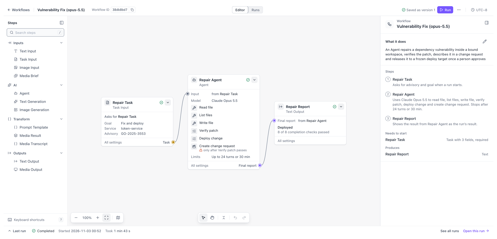

<table>
<thead><tr><th>阶段</th><th>Agent 的行动</th><th>Emberling 的处理</th><th>Studio 中的记录</th></tr></thead>
<tbody>
<tr>
<td width="110"><strong>读取与修改</strong></td>
<td width="190">读取项目规则、漏洞公告和现有代码，按 v5 的接口改写 <code>token.go</code>，再更新 <code>go.mod</code></td>
<td width="220">写入前检查路径是否在允许范围内，只能改 <code>go.mod</code> 和 <code>internal/auth/</code>；每次写入形成一版补丁，每轮读取的材料都有记录</td>
<td>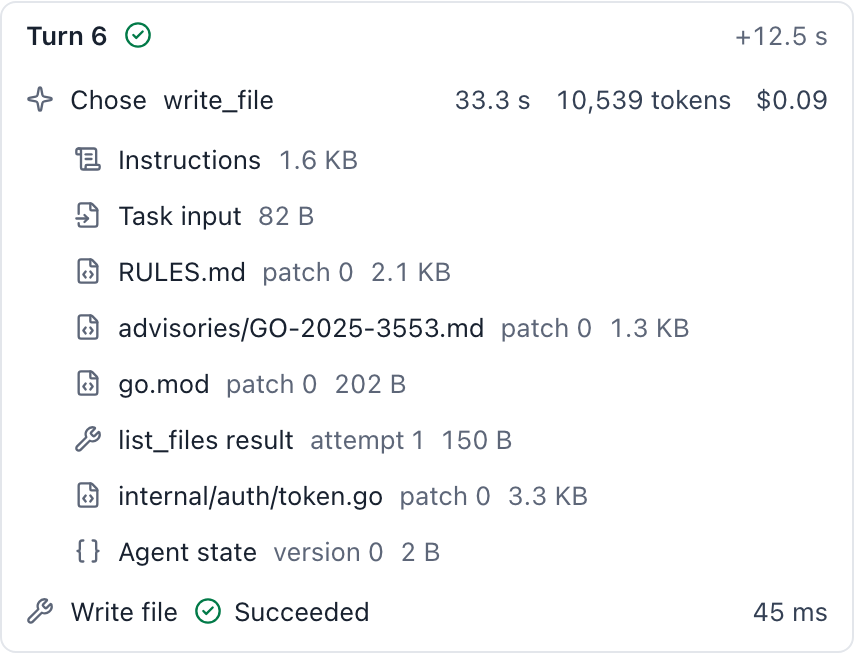</td>
</tr>
<tr>
<td width="110"><strong>验证补丁</strong></td>
<td width="190">对第 2 版补丁发起验证</td>
<td width="220">在隔离容器中运行基线提交的全部测试，再做漏洞扫描和依赖核对，等待期间 Run 挂起；结论只对这一版补丁有效</td>
<td>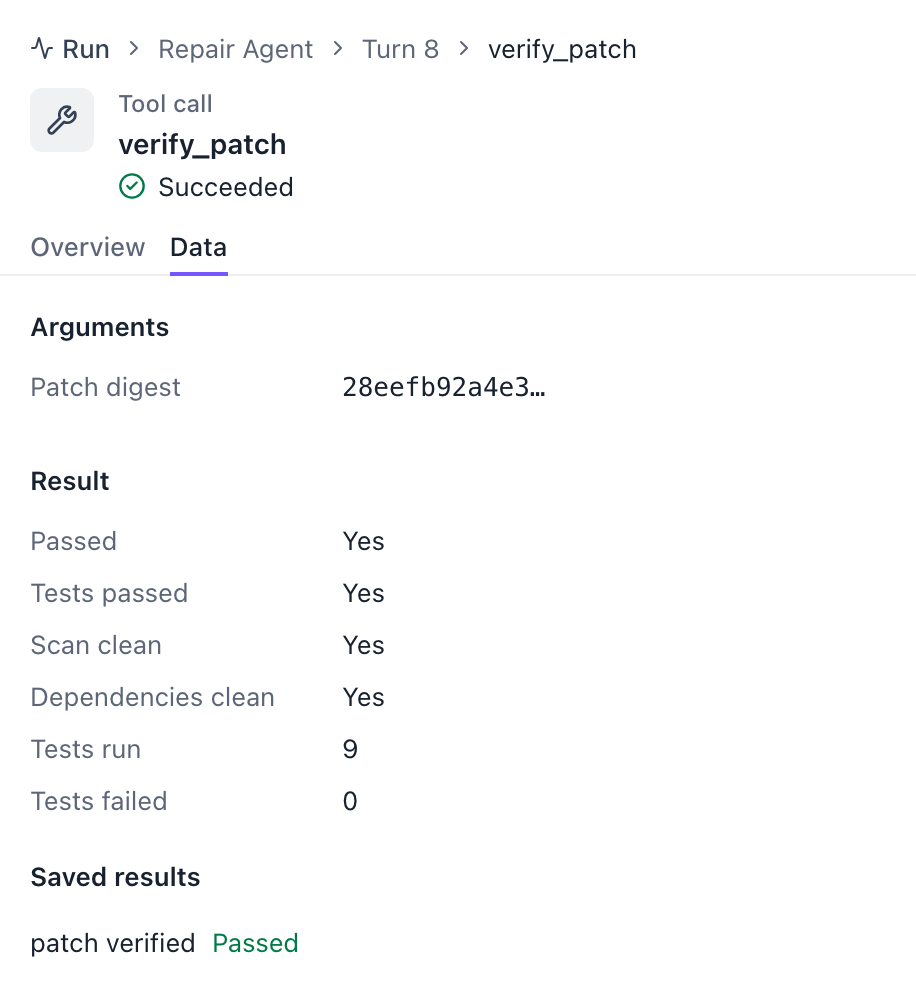</td>
</tr>
<tr>
<td width="110"><strong>创建变更请求</strong></td>
<td width="190">写明修改内容、影响范围、回滚方案和 4 条决策依据</td>
<td width="220">核对补丁是最新版本且已通过验证后直接放行，变更请求绑定这一版补丁</td>
<td>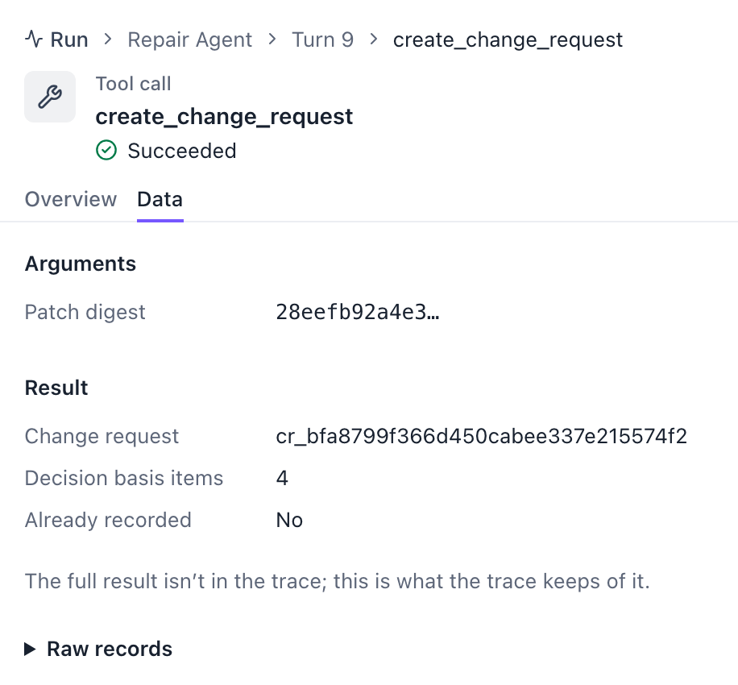</td>
</tr>
<tr>
<td width="110"><strong>申请发布与批准</strong></td>
<td width="190">请求发布这份变更请求</td>
<td width="220">发布需要批准，Agent 暂停，批准只对这一个发布请求有效。本次由演示脚本以固定身份 <code>demo-operator</code> 批准，没有真人审阅</td>
<td>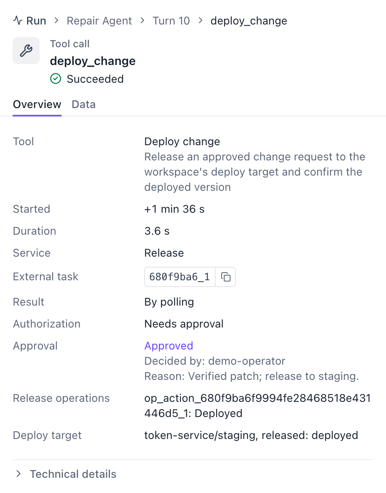</td>
</tr>
<tr>
<td width="110"><strong>确认部署</strong></td>
<td width="190">等待发布结果</td>
<td width="220">批准后占用发布目标，按操作编号向模拟生产服务查询，确认版本 v53 已部署且健康后解除占用。批准和发布期间 Agent 时限暂停，截止时间相应后延</td>
<td>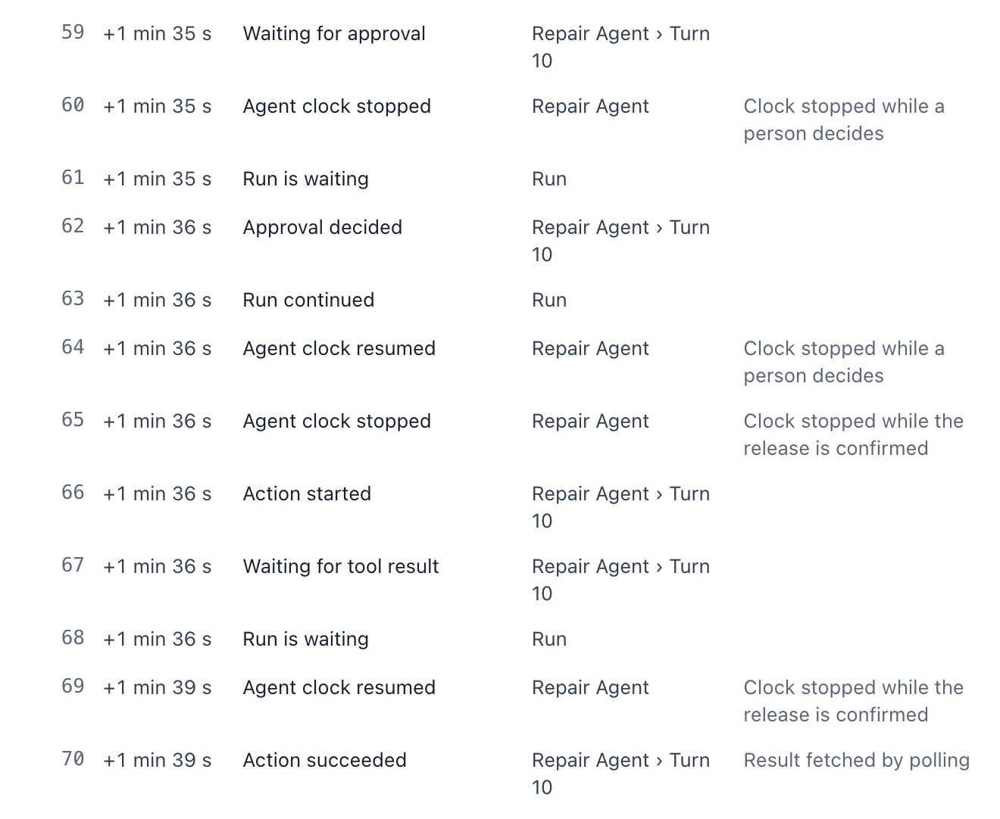</td>
</tr>
<tr>
<td width="110"><strong>判定完成</strong></td>
<td width="190">提交报告，声明已部署</td>
<td width="220">按修复并发布的目标核对 8 项条件，包括最新补丁已验证、变更请求和线上版本都对应这一版补丁、发布已获批准且服务健康</td>
<td>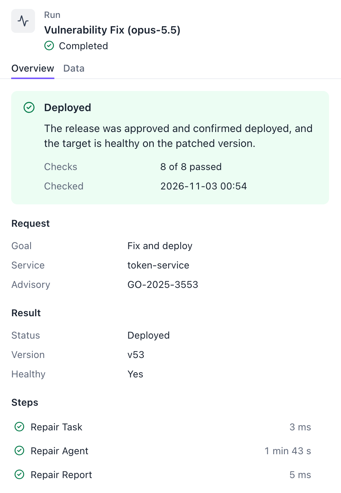</td>
</tr>
</tbody>
</table>

### Trace 与事件记录

Trace 按轮次展示 11 轮决定、工具调用和外部等待，虚线段是等待验证和发布结果的时间。事件记录按提交顺序保存这次运行的 83 条状态变化，上表“确认部署”一行是其中第 59 至 70 条。

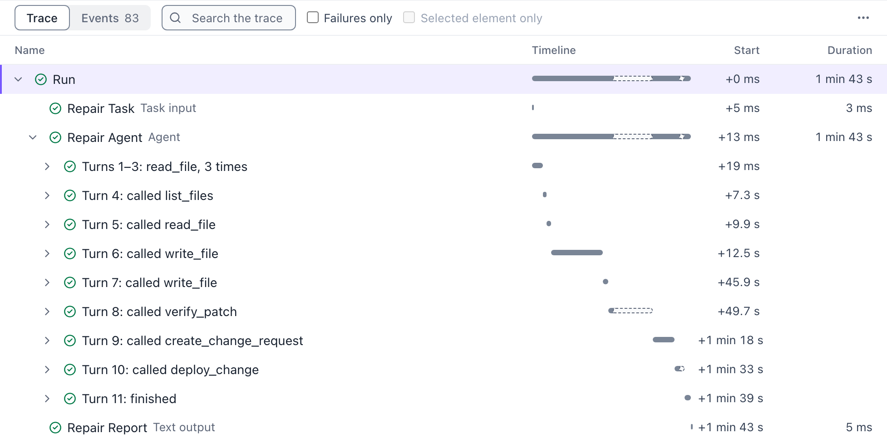

## 模拟 Agent 的拒绝场景

下面三次运行于 2026-11-08，决策预先设定，验证由模拟后端给出，用来检查 Agent 越界时系统是否在执行前拒绝。

| Run | Agent 的尝试 | 系统的处理 | 结果 |
|---|---|---|---|
| `e485ed7d` | 修改 `tests/auth_test.go` | 超出允许路径，执行前拒绝 | 回到允许路径内修改，变更请求待审批 |
| `1202b83d` | 代码改动后用旧补丁摘要请求验证 | 不是当前补丁，执行前拒绝，请求没有发给验证服务 | 验证当前补丁，变更请求待审批 |
| `5b981e68` | 任务只准备变更，仍尝试发布 | 依据任务目标拒绝，没有产生审批，生产服务没有收到请求 | 变更请求待审批 |

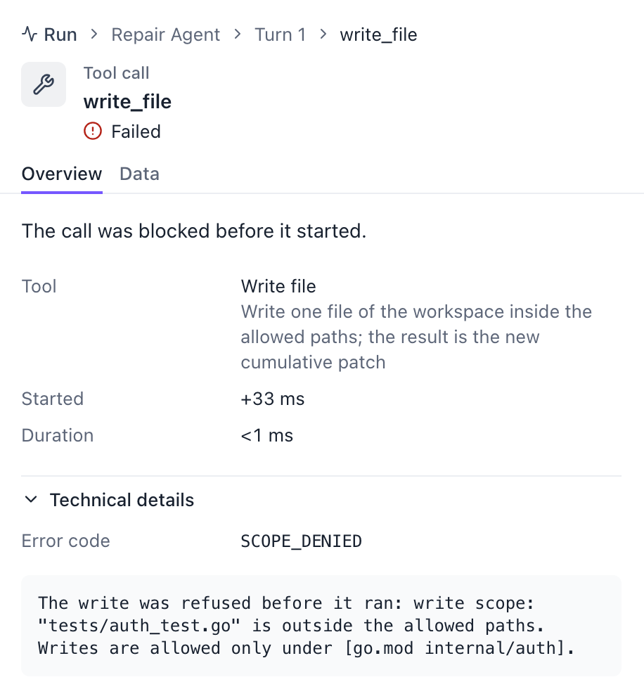

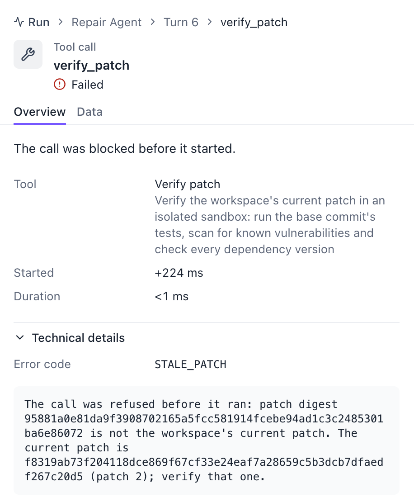

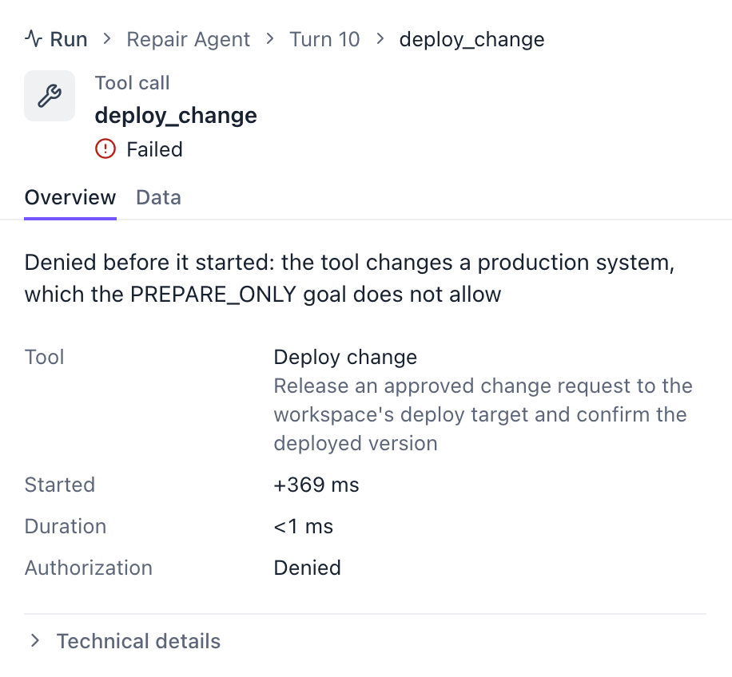

## 故障场景

以下场景来自 2026-11-03 的一次完整演示，全部使用模拟 Agent 和故障注入，共 18 个变体。每个变体的 Emberling 记录都与验证服务、模拟生产服务的独立记录核对一致。这些运行已不在当前演示数据库中，所以这里没有截图和 Run 链接。

| 变体 | 情况 | 结果 |
|---|---|---|
| `vuln-restart-during-approval` | 等待批准时后端被强制停止 | 重启后仍在等待，时限保持暂停，批准后发布一次 |
| `vuln-duplicate-approval` | 同一批准重复提交 | 只有一次生效，只部署一次 |
| `vuln-reject-resubmit` | 驳回后 Agent 修改代码重新申请 | 新补丁对应新的变更请求和发布请求，重新批准 |
| `vuln-release-crash-deployed` | 请求已被接受，回应丢失后崩溃 | 重启后查询，确认已部署，没有重发 |
| `vuln-release-crash-voided` | 请求被放弃，生产服务确认作废 | 同一获批请求换操作编号重新发布，只部署一次 |
| `vuln-void-exhausted` | 操作连续作废，重新发布次数用完 | 确定未部署，解除占用，任务未完成 |
| `vuln-target-occupied` | 另一个任务申请发布到被占用的目标 | 第二个请求被拒绝，不进入审批 |
| `vuln-release-refused` | 生产服务明确拒绝发布 | 解除占用，原因返回 Agent，任务未完成 |
| `vuln-unhealthy` | 部署成功但健康检查未通过 | 如实报告，回滚交给人处理 |
| `vuln-release-unreachable-stop` | 生产服务不可达，人停止等待 | 以发布结果不明结束，目标保持占用；确认作废后解除 |
| `vuln-stop-then-deployed` | 人停止等待后，生产服务完成部署 | 事后对账解除占用，并记录这个版本已上线但未经检查 |

重启、重复批准和发布结果不明这几类场景都依赖可控的故障时机，只能在模拟环境中稳定复现，不代表真实生产环境的表现。系统不承诺跨系统恰好一次，也不报告吞吐或延迟。

## 当前边界

- 审批人是固定身份，认证是模拟的，完整的身份与权限系统不在范围内。
- 没有自动回滚。回滚方案写在变更请求里，由人按方案处理。
- 验证容器每次新建、用完即弃，长期运行的 Sandbox 不在这次范围内。
- 授权范围在任务开始前确定，Agent 不能申请扩大。

## 复现

模拟变体不需要模型费用，可在 [Makefile](../../../Makefile) 中查看全部 `vuln-*` 变体。涉及批准的变体需要设置至少 32 字节的 `EMBERLING_OPERATOR_TOKEN`。

```sh
EMBERLING_DEMO_VARIANT=vuln-scope-denied make demo
EMBERLING_DEMO_VARIANT=vuln-stale-evidence make demo
EMBERLING_DEMO_VARIANT=vuln-prepare-only make demo
```

真实模型运行会产生费用，需要配置模型环境变量，并用 `EMBERLING_DEMO_RUNNER=docker` 启用真实验证容器，验证镜像由 `deploy/sandboxrunner-verify/build.sh` 构建。

[报告生成脚本](../../../scripts/demo/vuln-evidence-report.sh) 把执行记录、验证服务记录和模拟发布记录交叉核对。

[架构与设计取舍](../architecture.zh-CN.md) · [返回实际工作](../../../README.zh-CN.md#demos)
